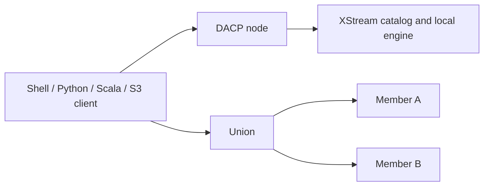

# DACP


[中文](README_zh.md)

DACP (Data Access and Collaboration Protocol) publishes data and makes it accessible remotely through consistent streaming interfaces. A single node serves files, databases and scientific data and accepts remote Jobs. Union combines independent nodes for cross-center analysis. Clients browse and read data using the same interface in either case.

**Powered by Apache Arrow Flight and XStream.** XStream provides Dataset management and local streaming execution; DACP provides publication, remote access, authentication and remotely callable Job execution. Union plans and coordinates computation across its members.



## Get started

- [Connect and preview your first Item](docs/quickstart.md)
- [User guide](docs/usage.md): remote data access and Jobs
- [Operations guide](docs/operations/README.md): deployment, publication, security, monitoring and maintenance
- [Development guide](docs/developers/README.md): SDK integration, embedded services and protocols
- [Documentation by topic](docs/README.md)
- [Official website and downloads](http://dacp.conoai.cn/)

## Components

| Component | Purpose |
|---|---|
| `dacp-server` | Publish a catalog, serve Item streams and execute Jobs locally through XStream |
| `dacp-client` and [Scala SDK](dacp-client-scala/README.md) | Browse, read, query and submit remote Jobs; the Python client includes `dacp-shell` |
| [Union Server](dacp-union-server/README.md) | Expose a unified public catalog and plan Jobs across member nodes |
| [Proxy Server](dacp-proxy-server/README.md) | Relay one private DACP service while preserving TLS and authentication |
| `dacp-admin` / `union-admin` | Local account, credential, history and Union diagnostic operations |
| [Collaboration SDK](dacp-collaboration-client/README.md) and [transport API](dacp-union-protocol/README.md) | Member service calls and shared collaboration protocol |

Catalog and Item metadata are public over TLS. Data reads require `reader` or `runner`; execution requires `runner`. S3 uses SigV4 with the same account roles. Internal read-only dashboards show operational status and execution plans. See [security](docs/security.md), [S3](docs/s3-service.md) and [dashboards](docs/node-web.md).

## Build and run a node

Use JDK 17 and sbt 1.10.x; Python clients require Python 3.10+. Prepare the XStream artifacts described in the [build guide](https://github.com/rdcn-link/xstream-codex/blob/main/docs/repositories.md), then run:

```bash
(cd dacp-server && sbt stage)
```

Follow [node deployment](docs/operations/README.md) to configure TLS, published data, credentials and execution environments. Use the [weather collaboration example](examples/union/README.md) for a complete Union setup.

Data models, formats, Job authoring and operator development are documented in the [XStream guides](http://xstream.conoai.cn/docs.html). Approved operators and runtimes are available from the independent [operator repository](http://repo.conoai.cn/).
