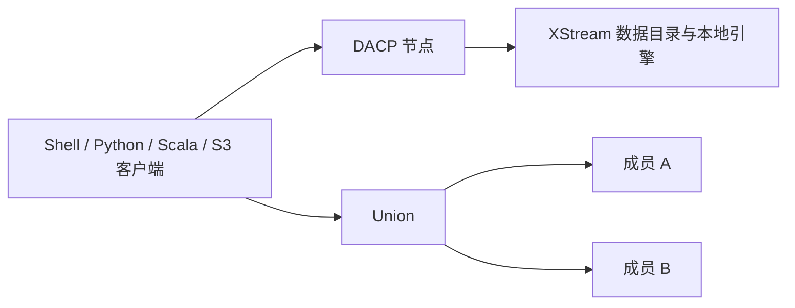

# DACP


[English](README.md)

DACP（Data Access and Collaboration Protocol，数据访问与协作协议）发布数据，通过一致的流式接口提供远程访问。单节点可以发布文件、数据库和科学数据，并接收远程 Job；Union 将独立节点组合起来完成跨中心分析。客户端在两种情况下都使用相同接口浏览和读取数据。

**Powered by Apache Arrow Flight 和 XStream。** XStream 提供数据集管理与本地流式执行；DACP 提供数据发布、远程访问、身份认证与可远程调用的 Job 执行，Union 负责在成员之间规划和协调计算。



## 快速上手

- [连接并预览第一个 Item](docs/quickstart_zh.md)
- [使用指南](docs/usage_zh.md)：远程数据访问与 Job
- [运维指南](docs/operations/README_zh.md)：部署、发布、安全、监控与维护
- [开发指南](docs/developers/README_zh.md)：SDK 集成、嵌入服务与协议
- [按主题浏览文档](docs/README_zh.md)
- [官方网站与下载](http://dacp.conoai.cn/)

## 组件

| 组件 | 用途 |
|---|---|
| `dacp-server` | 发布目录、提供 Item 流，并通过 XStream 本地执行 Job |
| `dacp-client` 与 [Scala SDK](dacp-client-scala/README_zh.md) | 浏览、读取、查询和提交远程 Job；Python 客户端包含 `dacp-shell` |
| [Union Server](dacp-union-server/README_zh.md) | 提供统一公开目录，并在成员节点之间规划 Job |
| [Proxy Server](dacp-proxy-server/README_zh.md) | 代理一个内网 DACP 服务，保留 TLS 与身份认证 |
| `dacp-admin` / `union-admin` | 本地账号、凭据、历史记录及 Union 诊断操作 |
| [协作 SDK](dacp-collaboration-client/README_zh.md) 与[传输 API](dacp-union-protocol/README_zh.md) | 成员服务调用与共享协作协议 |

目录和 Item 元信息允许通过 TLS 匿名访问；读取需要 `reader` 或 `runner`，执行需要 `runner`。S3 使用相同账号角色与 SigV4 认证。内网只读看板展示运行状态和执行计划。详见[安全](docs/security_zh.md)、[S3](docs/s3-service_zh.md)与[看板](docs/node-web_zh.md)。

## 构建并运行节点

使用 JDK 17 与 sbt 1.10.x；Python 客户端需要 Python 3.10+。按[构建指南](https://github.com/rdcn-link/xstream-codex/blob/main/docs/repositories_zh.md)准备 XStream 构件后执行：

```bash
(cd dacp-server && sbt stage)
```

按[节点部署](docs/operations/README_zh.md)配置 TLS、公开数据、凭据和执行环境。完整 Union 部署见[气象协作示例](examples/union/README_zh.md)。

数据模型、格式、Job 编写和算子开发参阅 [XStream 指南](http://xstream.conoai.cn/docs.html)。审核通过的算子与运行环境可从独立的[算子仓库](http://repo.conoai.cn/)获取。
