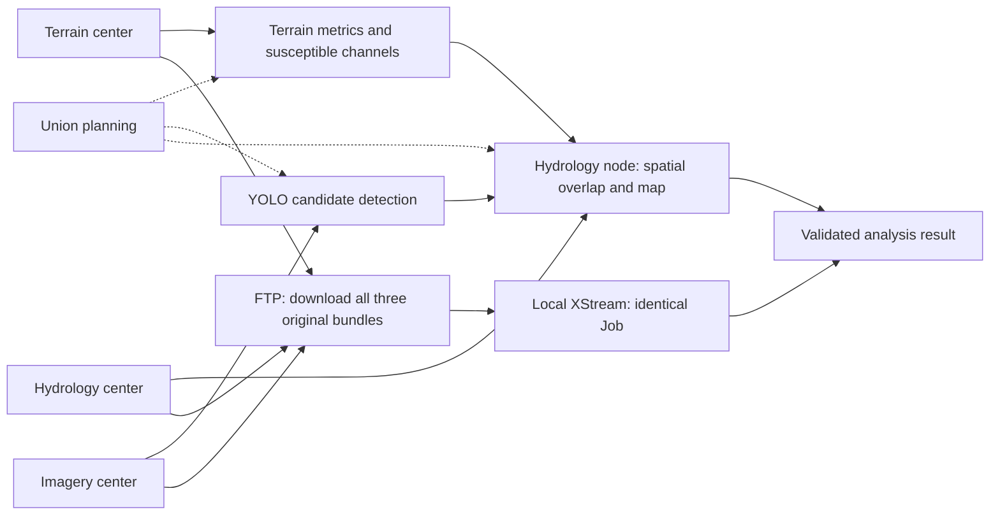
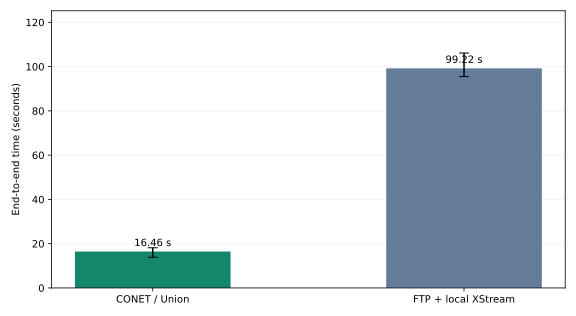
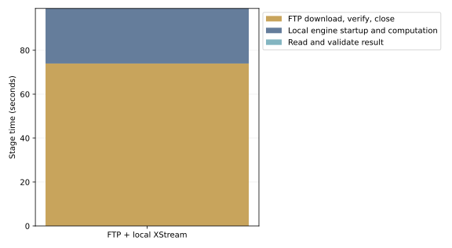

# Check-dam analysis: CONET versus FTP download-first processing

[中文](check-dams-benchmark_zh.md)

2026-11-08T12:21:10Z

**Three data nodes, Union and CONET run on 39.106.98.67; FTP downloads and centralized computation run on the local client. Data are synthetic, without bandwidth shaping. Client-to-server traffic uses the public WAN; the three centers remain colocated, not geographically distributed.**

## Environment

```json
{
  "client": {
    "platform": "Linux-6.8.0-85-generic-x86_64-with-glibc2.39",
    "logical_cpus": 16,
    "network": "Public WAN: local client to 39.106.98.67; three remote centers colocated; no shaping; direct HTTP and FTP"
  },
  "remote": {
    "host": "39.106.98.67",
    "logical_cpus": 8,
    "memory_gib": 15,
    "os": "Ubuntu 26.04 x86_64",
    "java": "21.0.12.1",
    "runtime_image": "xstream/check-dams-demo:1.0",
    "runtime_image_id": "sha256:ee77fe0eed057308945ef0406e5fcccacb829d1de3cb00dccd5566a6db90db3e",
    "jvm_heap": "64m–512m per service",
    "other_services": "Existing unrelated applications remain running",
    "layout": "Three source nodes, Union, CONET and FTP share one remote host"
  }
}
```

Client and server hardware differ, and unrelated services share the remote server. This measures entire deployment paths, not a protocol or engine in isolation. CONET HTTP control and final results cross the WAN; inter-node transfers remain local to the remote host.

## One task, two execution paths



The diagram shows the current execution paths: Union plans, and data nodes execute their assigned steps. Exact placement is listed below.

## Inputs and result equality

- Terrain: `terrain.bundle`, 277,760,000 bytes; SHA-256 `eda7082e65f3113f3eec5ea5a85b6b34e90544e6d941ecd3335f88e9b319d4c4`.
- Imagery: `imagery.bundle`, 555,120,640 bytes; SHA-256 `cb4f2daf2a2397aeb1e26a24c06eb3eb637fac68c19abacb5e071f7357c83ded`.
- Channel grids: `channels.bundle`, 185,180,160 bytes; SHA-256 `ba58cd963acbddf8741688af11019fbb82cbfb30cef93a63edfccdb24dde780f`.

Source data total 1,018,060,800 bytes (1.018 GB, 970.9 MiB). The analysis uses the default first-tile polygon and confidence 0.35. All original bundles are retained, without cropping for the local path.

```json
{
  "region": {
    "type": "Polygon",
    "coordinates": [
      [
        [
          109.1107897841093,
          36.05322366614358
        ],
        [
          109.20694875299046,
          36.05322366614358
        ],
        [
          109.20694875299046,
          36.131268701939064
        ],
        [
          109.1107897841093,
          36.131268701939064
        ],
        [
          109.1107897841093,
          36.05322366614358
        ]
      ]
    ]
  },
  "min_confidence": 0.35
}
```

All runs validate every field, type, list length and order. Integers, strings and selection decisions match exactly; cross-CPU floating values use explicit absolute tolerances: longitude/latitude 1e-9 degrees, projected/pixel positions 1e-4 native units, confidence 1e-6, and other floats 1e-8. Original JSON hashes and difference paths are retained; results are not claimed to be byte-identical. Every run has 5 candidates, 3 valid sites, 4 rejections and 361 inference windows.

## Measured time

Each path has 1 warmups and 3 measured runs, interleaved with a fixed random seed. Values are medians and min–max ranges, not confidence intervals.

| Path | Median end-to-end | Min–max |
|---|---:|---:|
| CONET / Union | 16.464 s | 13.874–18.168 s |
| FTP + local XStream | 99.217 s | 95.505–106.121 s |

Centralized / CONET time ratio: **6.03×**. Above 1 means CONET is faster; below 1 means centralized processing is faster.



### Centralized stages

| Stage | Median time |
|---|---:|
| Parallel FTP download, hash, write and close | 73.935 s |
| Local engine startup, computation and output write | 25.069 s |
| Read and validate full analysis result | 0.001 s |

Independent stage medians need not sum to the median total.



## Actual placement and remote payload

| Center | Steps |
|---|---|
| Terrain center | `terrain_data`, `terrain_metrics`, `susceptible_channels` |
| Imagery center | `imagery`, `candidate_sites` |
| Hydrology center | `channel_grids`, `spatial_overlap`, `distribution_map` |

Median observed remote payload across CONET node output ports is 40,147 bytes, versus 1,018,060,800 FTP source bytes per centralized run. In this batch overlap runs on the channel-grid node, avoiding a full channel-grid transfer. Placement differs from the previous local batch, so its traffic cannot be assumed identical. These are not TCP/TLS wire-byte measurements. The final SVG is 14,816 bytes and is not the traffic total of the collaboration.

## Measurement boundaries

- CONET timing starts at the application request and includes queuing, Union planning, execution and packaging, ending after SVG retrieval and validation.
- Centralized timing starts before the three parallel FTP connections; each trial downloads anew. All downloads, verification and file close finish before local computation starts.
- The Job, parameters, operator packages and engine JARs match; only three URIs become local context: references. Local dependency parallelism is preserved.
- Local execution launches a fresh JVM, while CONET server JVMs persist. Operator processes/containers start normally; local computation includes engine startup.
- FTP is unencrypted; CONET uses its existing TLS. Security conditions differ and must be interpreted with the workload.
- Data, models and images are prepared outside timing. OS caches are not cleared; existing services share CPU, memory and disk.
- This tests one region and the current implementation in this remote deployment. Timings and payloads cannot establish a universal WAN speedup or describe repeated local analysis after downloading once.

## Individual trials and reproduction

| Measured repeat | CONET s | FTP centralized s |
|---:|---:|---:|
| 1 | 18.168 | 106.121 |
| 2 | 16.464 | 95.505 |
| 3 | 13.874 | 99.217 |

Of 3 paired measured runs, CONET is faster in 3 and centralized processing in 0. The small sample does not establish a stable speedup or statistical significance.


[Sanitized raw measurements](benchmarks/check-dams-wan/results.json)

## Reproduction

The [CONET benchmark tools](https://github.com/rdcn-link/conet/tree/main/benchmarks/check-dams) provide isolated remote deployment, FTP downloads and local execution of the same Job. Prepare data, images and operators first; keep connection configuration private. Run these commands in the CONET checkout:

```bash
python benchmarks/check-dams/compare.py \
  --remote-config .state/benchmarks/remote-upload/remote-config.json \
  --url http://39.106.98.67:28720 \
  --output .state/benchmarks/check-dams-wan-verified-20261108 \
  --warmups 1 --repeats 3 --timeout 1200
```
