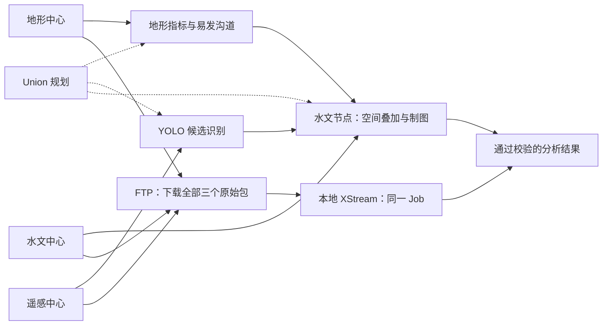
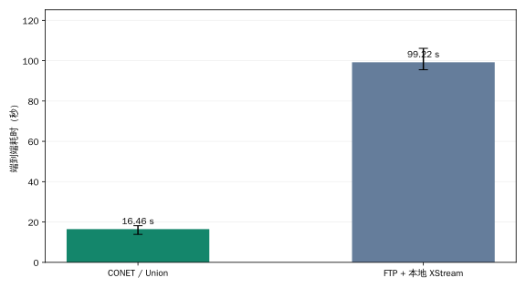
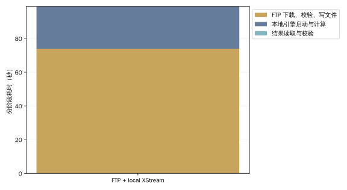

# 淤地坝案例：CONET 与 FTP 集中处理对比

[English](check-dams-benchmark.md)

2026-11-08T12:21:10Z

**三个数据节点、Union 和 CONET 部署于 39.106.98.67；FTP 下载和集中计算在客户端本机。数据为合成数据，未限速。真实公网链路连接客户端与远程服务器；三个数据中心仍同机，并非三个地理分布中心。**

## 测试环境

```json
{
  "client": {
    "platform": "Linux-6.8.0-85-generic-x86_64-with-glibc2.39",
    "logical_cpus": 16,
    "network": "Public WAN: local client to 39.106.98.67; three remote centers colocated; no shaping; direct HTTP and FTP"
  },
  "remote": {
    "host": "39.106.98.67",
    "logical_cpus": 8,
    "memory_gib": 15,
    "os": "Ubuntu 26.04 x86_64",
    "java": "21.0.12.1",
    "runtime_image": "xstream/check-dams-demo:1.0",
    "runtime_image_id": "sha256:ee77fe0eed057308945ef0406e5fcccacb829d1de3cb00dccd5566a6db90db3e",
    "jvm_heap": "64m–512m per service",
    "other_services": "Existing unrelated applications remain running",
    "layout": "Three source nodes, Union, CONET and FTP share one remote host"
  }
}
```

远程与本地硬件不同，且远程服务器存在其他服务负载。此结果衡量两种部署路径的整体效果，不能单独归因于协议或引擎。CONET 的 HTTP 控制与最终结果经过公网，节点之间仍走远程服务器本机网络。

## 相同任务、两条路径



图示为当前执行路径；Union 负责规划，各数据节点执行分配给它们的步骤。具体分配见下表。

## 输入与结果一致性

- 地形数据: `terrain.bundle`, 277,760,000 bytes; SHA-256 `eda7082e65f3113f3eec5ea5a85b6b34e90544e6d941ecd3335f88e9b319d4c4`.
- 遥感影像: `imagery.bundle`, 555,120,640 bytes; SHA-256 `cb4f2daf2a2397aeb1e26a24c06eb3eb637fac68c19abacb5e071f7357c83ded`.
- 沟道栅格: `channels.bundle`, 185,180,160 bytes; SHA-256 `ba58cd963acbddf8741688af11019fbb82cbfb30cef93a63edfccdb24dde780f`.

源数据共 1,018,060,800 字节（1.018 GB，970.9 MiB）。分析范围为默认第一块瓦片多边形，识别置信度 0.35；三个源包均完整保留，未为本地路径裁剪。

```json
{
  "region": {
    "type": "Polygon",
    "coordinates": [
      [
        [
          109.1107897841093,
          36.05322366614358
        ],
        [
          109.20694875299046,
          36.05322366614358
        ],
        [
          109.20694875299046,
          36.131268701939064
        ],
        [
          109.1107897841093,
          36.131268701939064
        ],
        [
          109.1107897841093,
          36.05322366614358
        ]
      ]
    ]
  },
  "min_confidence": 0.35
}
```

所有运行都进行了完整字段、类型、顺序和列表长度的校验。整数、字符串和筛选结论完全一致；跨 CPU 浮点字段按明确容差比较：经纬度 1e-9 度、投影坐标和像素框 1e-4 原单位、置信度 1e-6、其他浮点数 1e-8。保留每次原始 JSON 摘要和差异路径，不宣称逐字节相同。各次均有 5 个候选、3 个有效点、4 条剔除记录、361 个推理窗口。

## 实测耗时

每条路径预热 1 次、正式运行 3 次，按固定随机种子交错执行。表中为中位数及最小—最大值，误差范围不是置信区间。

| 路径 | 端到端中位耗时 | 最小—最大 |
|---|---:|---:|
| CONET / Union | 16.464 s | 13.874–18.168 s |
| FTP + 本地 XStream | 99.217 s | 95.505–106.121 s |

集中处理 / CONET 耗时比：**6.03×**。大于 1 表示 CONET 较快，小于 1 表示集中处理较快。



### 集中处理阶段

| 阶段 | 中位耗时 |
|---|---:|
| FTP 并行下载、摘要校验、写入与关闭文件 | 73.935 s |
| 本地引擎启动与计算、成果写入 | 25.069 s |
| 读取并校验完整分析结果 | 0.001 s |

各阶段独立取中位数，相加未必等于总耗时中位数。



## 实际计算位置与跨节点负载

| 节点 | 步骤 |
|---|---|
| 地形地貌数据中心 | `terrain_data`, `terrain_metrics`, `susceptible_channels` |
| 遥感观测数据中心 | `imagery`, `candidate_sites` |
| 水文流域数据中心 | `channel_grids`, `spatial_overlap`, `distribution_map` |

CONET 节点输出端口记录的跨节点有效负载中位数为 40,147 字节；集中路径每次 FTP 下载 1,018,060,800 字节。本批次叠加分析放在沟道栅格所在节点，避免传输完整沟道栅格；前次同机测试的放置不同，流量不可直接等同；二者也不是 TCP/TLS 线速字节统计。最终 SVG 为 14,816 字节，不代表整个协作过程的传输量。

## 测量边界

- CONET 从提交应用请求计时，包含应用排队、Union 规划、执行和结果打包，直到获取 SVG 并校验。
- 集中路径从三个 FTP 连接开始计时，三个下载并行且每次重新下载，完整下载/校验/文件关闭 后才启动本地计算，不重叠下载与计算。
- 原 Job、参数、算子包和引擎 JAR 相同，只有三项 URI 改成本地 context:。本地不人为串行化 Job。
- 本地每次启动独立 JVM；CONET 的服务器 JVM 常驻。算子进程/容器均正常启动，本地计算阶段包含引擎启动时间。
- FTP 是明文；CONET 使用现有 TLS。网络安全条件不同，应结合应用场景解释。
- 数据、模型和镜像预先生成，不计入分析；不清理 OS 缓存，现有服务共享 CPU/内存/磁盘。
- 只测这一个区域、当前实现和本次远程部署。不能将实测耗时或负载外推为普遍的 WAN 加速倍数，也不将下载集中后重复分析的成本等同于每次重新下载。

## 逐次结果与复现

| 正式轮次 | CONET 秒 | FTP 集中处理秒 |
|---:|---:|---:|
| 1 | 18.168 | 106.121 |
| 2 | 16.464 | 95.505 |
| 3 | 13.874 | 99.217 |

三组成对正式运行中，CONET 有 3 组较快，集中处理有 0 组较快。样本数量有限，中位数比不是稳定加速保证，也不是统计显著性结论。


[原始脱敏测量](benchmarks/check-dams-wan/results.json)

## 复现

测试程序位于 [CONET 测试工具目录](https://github.com/rdcn-link/conet/tree/main/benchmarks/check-dams)，包括远程隔离服务部署、FTP 下载和相同 Job 的本机执行。数据、镜像及算子预先准备；连接配置仅保存在本地私有目录。以下命令在 CONET 仓库中执行：

```bash
python benchmarks/check-dams/compare.py \
  --remote-config .state/benchmarks/remote-upload/remote-config.json \
  --url http://39.106.98.67:28720 \
  --output .state/benchmarks/check-dams-wan-verified-20261108 \
  --warmups 1 --repeats 3 --timeout 1200
```
