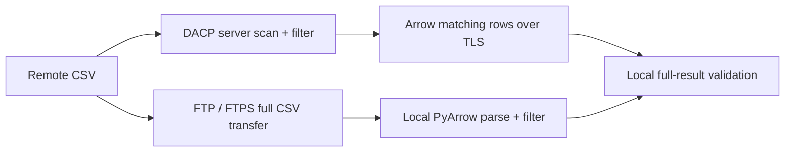
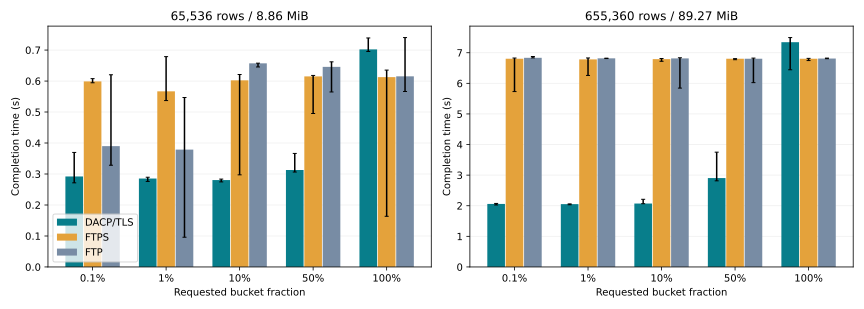
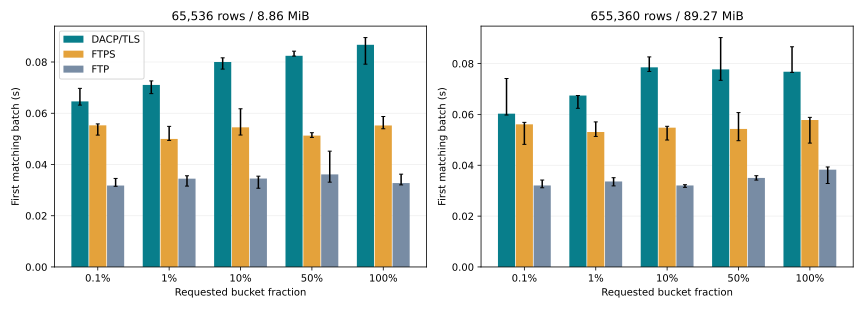
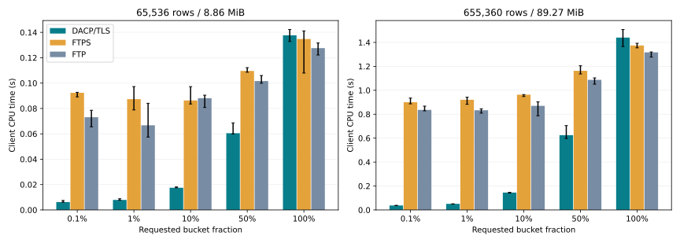

# CSV attribute filtering over the public WAN

[中文](csv-filter-benchmark_zh.md)

2026-11-08T12:45:00Z

DACP/TLS, FTPS and FTP run on **39.106.98.67**. The client runs on the original local machine. This compares server-side DACP filtering with streaming client-side FTP/FTPS filtering. Both paths consume and validate all matching rows; neither saves results to disk.



## Environment and verification

```json
{
  "client": {
    "platform": "Linux-6.8.0-85-generic-x86_64-with-glibc2.39",
    "logical_cpus": 16,
    "memory_bytes": 33639645184,
    "network": "Public WAN client to 39.106.98.67; direct DACP/TLS, FTPS and FTP; no bandwidth shaping"
  },
  "server": {
    "host": "39.106.98.67",
    "platform": "Ubuntu 26.04 x86_64",
    "logical_cpus": 8,
    "memory_gib": 15,
    "cpu": "Intel Xeon Platinum",
    "java": "21.0.12.1",
    "jvm_heap": "64m–512m",
    "other_load": "Existing unrelated services remain running",
    "server_resource_sampling": "Not collected; server CPU/RSS are null, never local PID samples"
  }
}
```

The client has 16 logical CPUs and the server has 8; hardware differs and both machines share resources with other services. No bandwidth shaping, SSH tunnel or network proxy is used. These results describe this particular public link and workload, not universal protocol speed.

Original fixture SHA-256 values, server JAR and vsftpd binary match the preceding local experiment. Both encrypted methods validate the same pinned self-signed certificate with a public-IP SAN. No certificate validation is disabled. The dataset is public, FTP is read-only, and scoped firewall rules admit only the benchmark client and loopback.

## Data and query

- `observations-65536.csv`: 65,536 rows; 9,295,028 bytes (8.86 MiB); SHA-256 `e9012a01f8670ba0c9a2a0f407a4bafe38829683fe53a87d2e49809c34dd6240`.
- `observations-655360.csv`: 655,360 rows; 93,605,396 bytes (89.27 MiB); SHA-256 `95338db25f544d8f9b6ef36f7a3d54f7fc43795b404e2c4fb86e43db61cd2020`.

Schema: `id:int64`, `bucket:int64`, `quality:int64`, `payload:string`; `bucket = id % 10000`, with a deterministic 128-character payload. All four columns are returned. No index, projection or row limit is used.

```sql
SELECT * FROM source WHERE bucket <= :threshold
```

Thresholds are 9, 99, 999, 4999 and 9999. DACP uses the typed SDK predicate; FTP/FTPS use the equivalent PyArrow comparison. CSV still requires a complete server scan in the DACP path.

Every combination has 1 warmups and 3 measured repeats, interleaved using seed 20261108. All 120 trials pass exact row-count and per-column SHA-256 checks, independent of batch boundaries. No floating-point tolerance is used.

## Completion time

### observations-65536.csv

| Actual selectivity | Rows | DACP/TLS s | FTPS s | FTP s | FTPS/DACP | FTP/DACP |
|---:|---:|---:|---:|---:|---:|---:|
| 0.107% | 70 | 0.2920 | 0.5989 | 0.3899 | 2.05× | 1.34× |
| 1.068% | 700 | 0.2854 | 0.5669 | 0.3788 | 1.99× | 1.33× |
| 10.681% | 7,000 | 0.2804 | 0.6022 | 0.6571 | 2.15× | 2.34× |
| 53.406% | 35,000 | 0.3129 | 0.6149 | 0.6457 | 1.97× | 2.06× |
| 100.000% | 65,536 | 0.7021 | 0.6125 | 0.6153 | 0.87× | 0.88× |

### observations-655360.csv

| Actual selectivity | Rows | DACP/TLS s | FTPS s | FTP s | FTPS/DACP | FTP/DACP |
|---:|---:|---:|---:|---:|---:|---:|
| 0.101% | 660 | 2.0603 | 6.8048 | 6.8339 | 3.30× | 3.32× |
| 1.007% | 6,600 | 2.0521 | 6.7836 | 6.8183 | 3.31× | 3.32× |
| 10.071% | 66,000 | 2.0725 | 6.7915 | 6.8158 | 3.28× | 3.29× |
| 50.354% | 330,000 | 2.9044 | 6.8040 | 6.8050 | 2.34× | 2.34× |
| 100.000% | 655,360 | 7.3440 | 6.8042 | 6.8110 | 0.93× | 0.93× |

Values are medians. Ratios above 1 favor DACP, below 1 favor the FTP method. Chart whiskers show min–max, not confidence intervals. Three repeats are insufficient for a statistical-significance claim.







## Result size and interpretation

| Actual selectivity | FTP source CSV MiB | Matching Arrow logical MiB |
|---:|---:|---:|
| 0.101% | 89.269 | 0.098 |
| 1.007% | 89.269 | 0.982 |
| 10.071% | 89.269 | 9.819 |
| 50.354% | 89.269 | 49.095 |
| 100.000% | 89.269 | 97.500 |

The table uses the larger CSV. Arrow logical memory is not IPC/TLS/TCP wire size and cannot establish an exact traffic-saving ratio. FTP reads the entire source even at low selectivity. DACP returns only matches but still incurs server CSV scanning, parsing, filtering and Arrow encoding. High-selectivity or fast-link cases may favor FTP; see the measured table rather than assuming a winner.

## Measurement boundaries

- Connection readiness/TLS handshakes and FTP login/TYPE I are outside timing. The DACP client explicitly waits for availability; per-item metadata requests remain inside timing.
- Reads, parse/filter, transfer, Arrow decoding, all-result consumption and per-column validation are timed. First-result time means the first nonempty matching batch, not first TCP byte.
- FTP parses directly from the data socket with 64 KiB CSV blocks and a single parser thread; there is no full-download-to-disk delay. FTPS protects control and data connections. Plain FTP is a reference with weaker transport security.
- Files and server startup are prepared outside timing. OS caches are not cleared; methods are interleaved and run one at a time. Warmups do not guarantee a fully steady-state JVM.
- Client CPU/RSS are process-wide, sampled every 50 ms. Remote server CPU/RSS are not collected and remain null; remote PIDs are never sampled as local processes.
- Repetitions, machine differences, application load, RTT, batching and parser differences all limit generalization. This tests a server-side filtering capability, not file transfer speed in isolation.

## Reproduction and raw measurements

```bash
/tmp/dacp-transfer-venv/bin/python benchmarks/transfer/filter_suite.py \
  --remote-config .benchmark-runs/csv-filter-wan-staging/remote-config.json \
  --output .benchmark-runs/csv-filter-wan-20261108 \
  --profile final --warmups 1 --repeats 3
/tmp/dacp-transfer-venv/bin/python benchmarks/transfer/publish_filter_wan.py \
  .benchmark-runs/csv-filter-wan-20261108/results.json \
  --output .benchmark-runs/csv-filter-wan-20261108/report
```

[All measured and warmup samples](benchmarks/csv-filter-wan/results.json) include fingerprints and validation results. See [deployment instructions](../benchmarks/transfer/README.md). Reports are generated only in the explicitly selected directory; website/document publication is a separate action.
