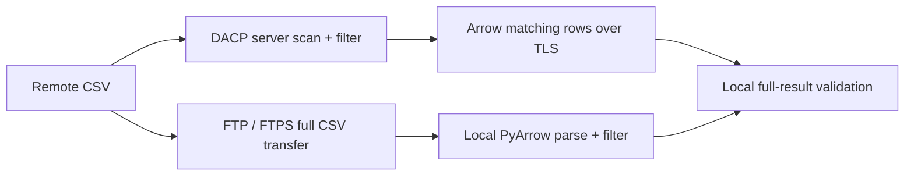
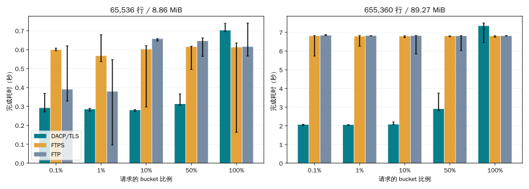
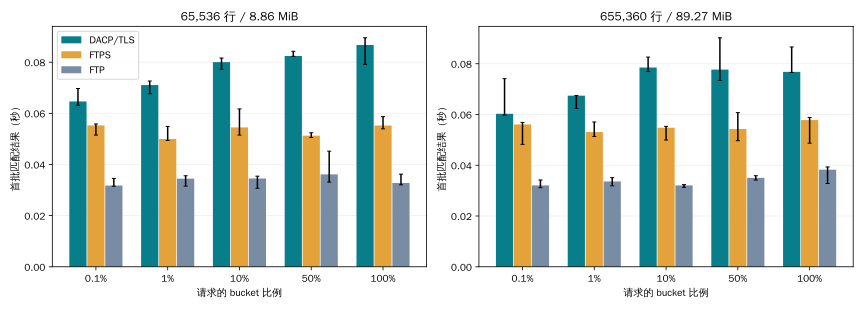
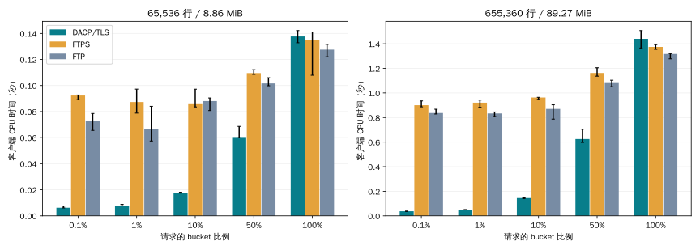

# 公网 CSV 大文件属性筛选对比

[English](csv-filter-benchmark.md)

2026-11-08T12:45:00Z

DACP/TLS、FTPS 和 FTP 均部署在 **39.106.98.67**，客户端仍在原本机。对比 DACP 服务端筛选与 FTP/FTPS 客户端流式筛选；双方均消费并校验全部匹配记录，不将结果落盘。



## 环境与校验

```json
{
  "client": {
    "platform": "Linux-6.8.0-85-generic-x86_64-with-glibc2.39",
    "logical_cpus": 16,
    "memory_bytes": 33639645184,
    "network": "Public WAN client to 39.106.98.67; direct DACP/TLS, FTPS and FTP; no bandwidth shaping"
  },
  "server": {
    "host": "39.106.98.67",
    "platform": "Ubuntu 26.04 x86_64",
    "logical_cpus": 8,
    "memory_gib": 15,
    "cpu": "Intel Xeon Platinum",
    "java": "21.0.12.1",
    "jvm_heap": "64m–512m",
    "other_load": "Existing unrelated services remain running",
    "server_resource_sampling": "Not collected; server CPU/RSS are null, never local PID samples"
  }
}
```

客户端 16 个逻辑 CPU，服务端 8 个；硬件不同，两端均与其他服务共享资源。未限速，不使用 SSH 隧道或网络代理。结果描述本次公网链路和任务，不能作为普遍的协议速度结论。

原始数据 SHA-256、服务端 JAR 和 vsftpd 可执行文件均与此前本机测试一致。两种加密方法均校验同一份固定信任的自签证书，证书 SAN 包含公网 IP，没有关闭证书验证。数据集公开、FTP 只读，限定防火墙规则仅允许测试客户端及回环访问。

## 数据与查询

- `observations-65536.csv`: 65,536 行; 9,295,028 bytes (8.86 MiB); SHA-256 `e9012a01f8670ba0c9a2a0f407a4bafe38829683fe53a87d2e49809c34dd6240`.
- `observations-655360.csv`: 655,360 行; 93,605,396 bytes (89.27 MiB); SHA-256 `95338db25f544d8f9b6ef36f7a3d54f7fc43795b404e2c4fb86e43db61cd2020`.

字段为 `id:int64`、`bucket:int64`、`quality:int64`、`payload:string`；`bucket = id % 10000`，payload 为确定性的 128 字符文本。返回所有四列，无索引、投影或行数限制。

```sql
SELECT * FROM source WHERE bucket <= :threshold
```

阈值为 9、99、999、4999、9999。DACP 使用 SDK 类型化谓词，FTP/FTPS 使用等价 PyArrow 比较。DACP 路径仍需在服务端完整扫描 CSV。

每种组合预热 1 次、正式重复 3 次，以种子 20261108 交错执行。全部 120 次运行均通过精确行数和逐列 SHA-256 校验，不受批次边界影响，不使用浮点容差。

## 完成耗时

### observations-65536.csv

| 实际命中率 | 行数 | DACP/TLS 秒 | FTPS 秒 | FTP 秒 | FTPS/DACP | FTP/DACP |
|---:|---:|---:|---:|---:|---:|---:|
| 0.107% | 70 | 0.2920 | 0.5989 | 0.3899 | 2.05× | 1.34× |
| 1.068% | 700 | 0.2854 | 0.5669 | 0.3788 | 1.99× | 1.33× |
| 10.681% | 7,000 | 0.2804 | 0.6022 | 0.6571 | 2.15× | 2.34× |
| 53.406% | 35,000 | 0.3129 | 0.6149 | 0.6457 | 1.97× | 2.06× |
| 100.000% | 65,536 | 0.7021 | 0.6125 | 0.6153 | 0.87× | 0.88× |

### observations-655360.csv

| 实际命中率 | 行数 | DACP/TLS 秒 | FTPS 秒 | FTP 秒 | FTPS/DACP | FTP/DACP |
|---:|---:|---:|---:|---:|---:|---:|
| 0.101% | 660 | 2.0603 | 6.8048 | 6.8339 | 3.30× | 3.32× |
| 1.007% | 6,600 | 2.0521 | 6.7836 | 6.8183 | 3.31× | 3.32× |
| 10.071% | 66,000 | 2.0725 | 6.7915 | 6.8158 | 3.28× | 3.29× |
| 50.354% | 330,000 | 2.9044 | 6.8040 | 6.8050 | 2.34× | 2.34× |
| 100.000% | 655,360 | 7.3440 | 6.8042 | 6.8110 | 0.93× | 0.93× |

表中为中位数，耗时比大于 1 表示 DACP 较快，小于 1 表示 FTP 方法较快。图中误差线为最小—最大值，不是置信区间；三次重复不足以支持统计显著性结论。







## 结果大小与解释

| 实际命中率 | FTP 源 CSV MiB | 匹配记录 Arrow 逻辑 MiB |
|---:|---:|---:|
| 0.101% | 89.269 | 0.098 |
| 1.007% | 89.269 | 0.982 |
| 10.071% | 89.269 | 9.819 |
| 50.354% | 89.269 | 49.095 |
| 100.000% | 89.269 | 97.500 |

上表为较大 CSV 的结果。Arrow 逻辑内存量不是 IPC/TLS/TCP 线速字节，不能据此计算精确网络节省比例。FTP 在低命中率下仍读取全部源文件；DACP 仅返回匹配记录，但仍有服务端扫描、解析、筛选及 Arrow 编码成本。高命中率或高速链路可能有利于 FTP，应以实测表格为准。

## 测量边界

- 连接就绪、TLS 握手、FTP 登录和 TYPE I 在计时外；DACP 客户端显式等待可用，逐 Item 元数据请求仍在计时内。
- 读取、解析筛选、传输、Arrow 解码、全部结果消费及逐列校验均在计时内。首批时间指首个非空匹配批次，不是首个 TCP 字节。
- FTP 直接从数据 socket 流式解析，CSV 块大小 64 KiB，单解析线程，没有先全量下载落盘的额外等待。FTPS 控制和数据连接均加密；明文 FTP 作为安全条件较弱的参考。
- 数据准备和服务启动不计时；不清理操作系统缓存，各方法交错且串行运行。预热不保证 JVM 完全稳态。
- 客户端 CPU/RSS 为进程整体统计，每 50 ms 采样。未采集远程服务端 CPU/RSS，相关字段保留 null，不将远程 PID 当成本地进程采样。
- 重复次数、硬件差异、其他应用负载、RTT、批次和解析器实现都限制结果外推。本测试比较服务端筛选能力，而非孤立的文件传输速度。

## 复现与原始测量

```bash
/tmp/dacp-transfer-venv/bin/python benchmarks/transfer/filter_suite.py \
  --remote-config .benchmark-runs/csv-filter-wan-staging/remote-config.json \
  --output .benchmark-runs/csv-filter-wan-20261108 \
  --profile final --warmups 1 --repeats 3
/tmp/dacp-transfer-venv/bin/python benchmarks/transfer/publish_filter_wan.py \
  .benchmark-runs/csv-filter-wan-20261108/results.json \
  --output .benchmark-runs/csv-filter-wan-20261108/report
```

[全部正式及预热样本](benchmarks/csv-filter-wan/results.json)包含版本指纹及校验结果。参见[部署步骤](../benchmarks/transfer/README_zh.md)。报告只生成到显式指定目录，不自动发布到官网或说明文档。
