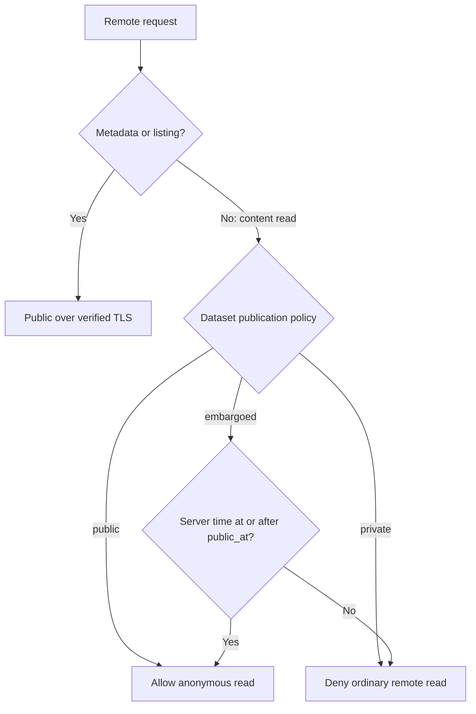

# Dataset publication policies

A publication policy controls remote content reads for an entire dataset. Every Item and every View inherits it. Dataset descriptions, Item and Folder listings, declared schemas, sizes, timestamps and other Item metadata are always public over verified TLS. Explicit scans, queries, previews and samples that consume content are reads.

Set `publication` inside the dataset's public description JSON. This works with catalog plugins and preserves the policy when Union assigns a dataset a new name. For a configured dataset:

```yaml
datasets:
  observations:
    provider: directory
    description: '{"title":"Observations","description":"Example dataset","publication":{"policy":"embargoed","public_at":"2027-01-01T00:00:00Z"}}'
    source:
      root: /srv/data/observations
```

Keep provider-specific source settings appropriate to the selected plugin; the policy does not change backend contracts.

| Policy | Remote content reads |
| --- | --- |
| `public` | Anonymous reads allowed |
| `private` | Ordinary remote reads denied |
| `embargoed` | Denied before `public_at`; anonymous reads allowed at and after that instant |

`public_at` is an ISO 8601 instant with an offset, such as `2027-01-01T00:00:00Z`. The server clock determines expiry, without requiring a restart at the deadline. Public and private policies accept only `policy`; embargoed policies require exactly `policy` and `public_at`. Missing policy defaults to private. Invalid policies fail closed. To publish existing datasets, explicitly add `{"policy":"public"}`.

The same policy gates DACP reads of all Views, computed counts, S3 GET (including signed requests), and `read_item` inputs of remotely submitted Jobs. Public S3 listing and HEAD do not consume content. Supplied invalid credentials/signatures are rejected even for public operations. Reader or runner roles and presigned URLs do not override a private or unexpired embargoed policy. Job submission still requires runner authorization, and owned results retain their ownership checks. Schema inference that reads only public metadata remains available to authorized inference callers; inference that actually reads content must satisfy publication policy.

Nodes fully trust explicitly authenticated Union service identities. Such Union requests can read private datasets; Union applies the source dataset policy to ordinary users before proxying or dispatching work. A Union does not need to map its users to node-local accounts. Do not distribute Union service credentials to users. Internal server credentials are process-local and used only after request admission. Embedded trusted local computation is separate from ordinary remote access.

A read is admitted when the request or Job input is checked. Streams already admitted are not interrupted solely by ordinary policy changes; Union credential revocation retains its cancellation behavior. Directory metadata is resolved on new admissions, and Union discovery caches can delay policy visibility. Policies are not per-Item ACLs or per-user grants.

## Read authorization flow



This diagram describes ordinary remote access. Trusted Union execution uses the separate service authorization rules described above; a user Job token alone does not bypass the publication policy.
