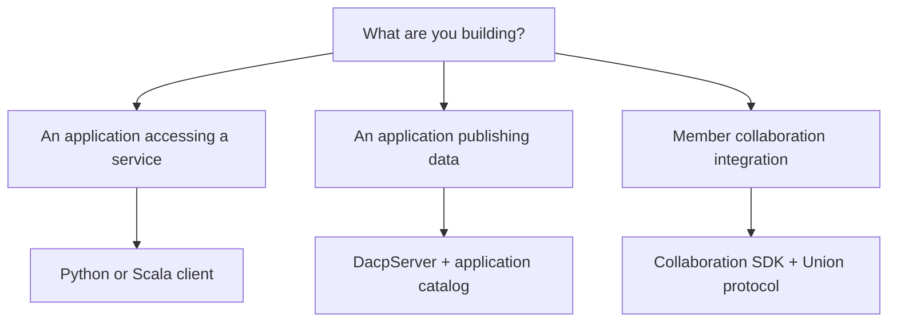

# Development guide

[中文](README_zh.md) · [User guide](../usage.md)

Integrate DACP into applications, embed a data service, or work on remote-access and collaboration protocols. Start with a complete example and use the corresponding API reference while developing.



## 1. Application integration

| Task | Example and reference |
|---|---|
| Discover data and consume remote streams | [Python examples](../users/README.md#browsing-and-reading), [Scala SDK](../../dacp-client-scala/README.md) |
| Submit Jobs and consume attempt/result events | [Job submission](../jobs.md), [execution policies](../materialization.md) |
| Handle authentication and capabilities | [Security and role checks](../security.md), [protocol](../protocol.md) |
| Integrate member collaboration operations | [Python collaboration SDK](../../dacp-collaboration-client/README.md), [Scala collaboration SDK](../../dacp-collaboration-client-scala/README.md) |

Ordinary and collaboration clients share transport and certificate implementations. Servers enforce permissions independently of the chosen SDK.

## 2. Embed and extend a service

| Task | Example and reference |
|---|---|
| Start and close a server from Scala | [Embedding API](../embedded-server.md), [complete embedded-server example](../../examples/embedded-server/README.md) |
| Publish an application catalog | [Embedding API](../embedded-server.md), [server configuration](../reference.md) |
| Load existing backend and runtime plugins | [Plugin deployment](../plugins.md), [plugin example](../../examples/plugins/README.md) |
| Configure service-side execution history | [History API and administration](../execution-history.md) |

Implement Dataset backends, format readers, operators, stream contracts and execution-storage plugins using the [XStream Development guide](http://xstream.conoai.cn/manual/xstream-codex/docs/development.html). Use DACP configuration to load them into a service.

## 3. Protocol reference

| Topic | Reference |
|---|---|
| Discovery, reads, tickets and caller capabilities | [DACP protocol](../protocol.md) |
| Wire messages and service configuration | [Service reference](../reference.md), [dacp.proto](../../proto/dacp.proto) |
| Membership, subjob dispatch and inter-node streams | [Union collaboration](../union.md), [Union transport API](../../dacp-union-protocol/README.md) |
| Public Union namespace and incomplete catalogs | [Union public service](../union-proxy.md) |
| Credentials, authorization and cancellation ownership | [Security](../security.md) |

## 4. Validate integrations

Run the checks matching the changed component from the repository root:

```bash
(cd dacp-server && sbt test)
.venv/bin/python -m pytest -q dacp-client/tests
(cd dacp-client-scala && sbt test)
(cd dacp-union-server && sbt test)
```

For cross-node container integration, run `bash scripts/test-collaboration.sh` with Docker and the certificates and runtimes specified by that script. Cover discovery, role denial, partial directories, cancellation, stream closure and failure propagation. Keep protocol definitions, callers, examples and English/Chinese references synchronized.
