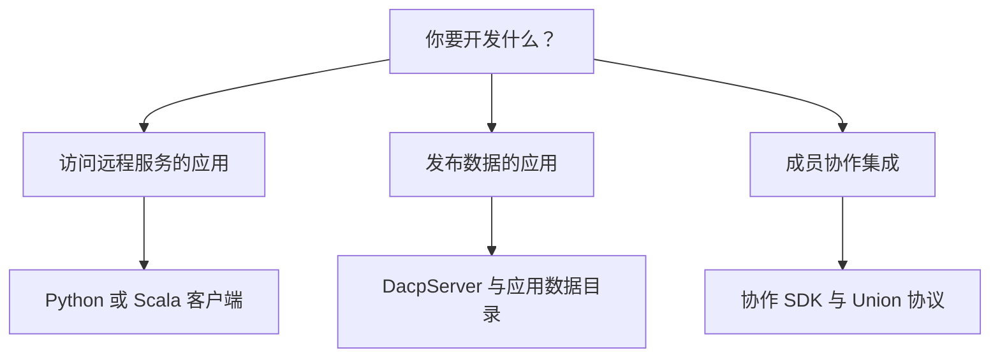

# 开发指南

[English](README.md) · [使用指南](../usage_zh.md)

将 DACP 集成到应用中、嵌入数据服务，或开发远程访问与协作协议集成。先运行完整示例，开发时再查阅对应 API 参考。



## 1. 应用集成

| 任务 | 示例与参考 |
|---|---|
| 发现数据并消费远程流 | [Python 示例](../users/README_zh.md#浏览与读取)、[Scala SDK](../../dacp-client-scala/README_zh.md) |
| 提交 Job 并消费执行尝试与结果事件 | [Job 提交](../jobs_zh.md)、[执行策略](../materialization_zh.md) |
| 处理认证与能力信息 | [安全与角色检查](../security_zh.md)、[协议](../protocol_zh.md) |
| 集成成员协作操作 | [Python 协作 SDK](../../dacp-collaboration-client/README_zh.md)、[Scala 协作 SDK](../../dacp-collaboration-client-scala/README_zh.md) |

普通客户端与协作客户端共用传输和证书实现，权限由服务器检查，与选择哪一种 SDK 无关。

## 2. 嵌入和扩展服务

| 任务 | 示例与参考 |
|---|---|
| 从 Scala 启动并关闭服务器 | [嵌入 API](../embedded-server_zh.md)、[完整嵌入示例](../../examples/embedded-server/README_zh.md) |
| 发布应用中的数据目录 | [嵌入 API](../embedded-server_zh.md)、[服务配置](../reference_zh.md) |
| 加载已有后端与运行环境插件 | [插件部署](../plugins_zh.md)、[插件示例](../../examples/plugins/README_zh.md) |
| 配置服务端执行记录存储 | [历史 API 与管理](../execution-history_zh.md) |
| 在 DEBUG 部署中使用临时源码算子 | [DEBUG 源码算子](../operator-source_zh.md) |

数据集后端、格式解析、算子、流契约和执行存储插件的开发请使用 [XStream 开发指南](http://xstream.conoai.cn/manual/xstream-codex/docs/development_zh.html)，通过 DACP 配置将插件加载到服务。

## 3. 协议参考

| 主题 | 参考 |
|---|---|
| 发现、读取、Ticket 与调用方能力 | [DACP 协议](../protocol_zh.md) |
| 线协议消息与服务配置 | [服务参考](../reference_zh.md)、[dacp.proto](../../proto/dacp.proto) |
| 成员、子 Job 分发与节点间数据流 | [Union 协作](../union_zh.md)、[Union 传输 API](../../dacp-union-protocol/README_zh.md) |
| Union 公开命名空间与不完整目录 | [Union 公开服务](../union-proxy_zh.md) |
| 凭据、授权与取消操作的归属 | [安全](../security_zh.md) |

## 4. 验证集成

在仓库根目录按修改组件运行检查：

```bash
(cd dacp-server && sbt test)
.venv/bin/python -m pytest -q dacp-client/tests
(cd dacp-client-scala && sbt test)
(cd dacp-union-server && sbt test)
```

跨节点容器集成使用 `bash scripts/test-collaboration.sh`，并准备脚本指定的 Docker、证书与运行环境。覆盖目录发现、角色拒绝、不完整目录、取消、流关闭和失败传播；保持协议、调用端、示例和中英文参考同步。
