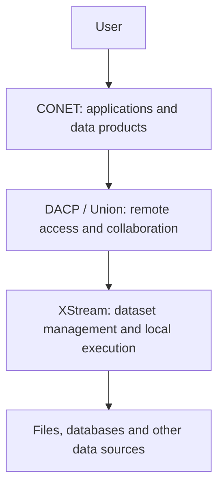
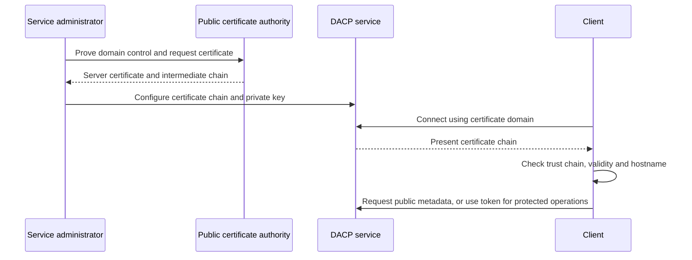

# Frequently asked questions

[中文](faq_zh.md)

- [1. How do CONET, DACP and XStream relate to each other?](#1-how-do-conet-dacp-and-xstream-relate-to-each-other)
- [2. What is `/etc/dacp/ca.crt`?](#2-what-is-etcdacpcacrt)
- [3. How do I configure certificates for a public DACP service?](#3-how-do-i-configure-certificates-for-a-public-dacp-service)
- [4. What must the server configure to allow domain-name connections?](#4-what-must-the-server-configure-to-allow-domain-name-connections)
- [5. How does a node join a Union?](#5-how-does-a-node-join-a-union)
- [6. Can one node belong to multiple Unions?](#6-can-one-node-belong-to-multiple-unions)
- [7. Which permissions and roles are available?](#7-which-permissions-and-roles-are-available)
- [8. What operations does DACP support, and what are their business names and permissions?](#8-what-operations-does-dacp-support-and-what-are-their-business-names-and-permissions)
- [9. How can I restrict DACP services to an internal network?](#9-how-can-i-restrict-dacp-services-to-an-internal-network)
- [10. How do I disable the dashboard Web service?](#10-how-do-i-disable-the-dashboard-web-service)
- [11. Do dashboards refresh automatically?](#11-do-dashboards-refresh-automatically)
- [12. Do steps and cross-node Jobs have time limits?](#12-do-steps-and-cross-node-jobs-have-time-limits)
- [13. Does a 30-second deadline error mean the Job ran for too long?](#13-does-a-30-second-deadline-error-mean-the-job-ran-for-too-long)
- [14. Where are request logs and complete exception stacks?](#14-where-are-request-logs-and-complete-exception-stacks)
- [15. How can DACP dynamically publish Datasets and Items from an existing Java application?](#15-how-can-dacp-dynamically-publish-datasets-and-items-from-an-existing-java-application)
- [16. How can I tune or extend physical plan optimization?](#16-how-can-i-tune-or-extend-physical-plan-optimization)

## 1. How do CONET, DACP and XStream relate to each other?

**XStream supplies data management and local computation, DACP exposes those capabilities over the network, and CONET turns the network capabilities into user-facing applications.**

| Project | Role | Main responsibilities |
|---|---|---|
| XStream | Dataset management and local dataflow execution engine | DataCatalog—Dataset—Item, format parsing, DataViews, operators, local Job execution and Designer |
| DACP | Data publication and remote computation service | Network access to datasets and Job execution, authentication and read authorization; Union supplies cross-node collaboration |
| CONET | Data collaboration network and application platform | Data-center organization, a combined catalog, App Builder, analysis history, data-product publication and sharing, and network visualization |



For a cross-center analysis:

1. The user selects a region, uploads a file or supplies parameters in a CONET application.
2. CONET binds those parameters to a fixed Job and submits it to a DACP Union.
3. Union plans and splits the Job according to data locations and dispatches sub-jobs to DACP nodes.
4. Each node executes its local steps with its embedded XStream engine.
5. CONET presents progress and results, and can publish the resulting data as a DACP Dataset.

XStream executes steps locally: reading a remote Item does not automatically push subsequent computation to that server. DACP provides remote invocation and Union provides cross-node planning. CONET supplies application forms, presentation, history and products rather than reimplementing parsing, stream execution or cross-node planning. Its application admission queue complements execution-node resource protection; it does not replace it.

XStream can run independently on a local machine. DACP can be used without CONET through clients, SDKs or Shell. CONET provides an application-oriented entry point to a DACP network. The diagram shows this application stack, not a requirement that all XStream data access pass through DACP.

## 2. What is `/etc/dacp/ca.crt`?

It is an example path to a public CA certificate used to validate the remote service's TLS certificate. Use the actual CA certificate path for your deployment. The certificate is not an access token or a private key, and it grants no data-read or Job-execution permissions.

All connections verify the server certificate and hostname. Omit an explicit CA only if the platform trusts the server certificate; configure `ca` for private or self-signed CAs. In Designer connection settings, this path is on the Designer server, not the visitor's computer. Account tokens are configured separately through `token_file`. See [authentication and access control](security.md).

## 3. How do I configure certificates for a public DACP service?

Use a server certificate issued by a publicly trusted CA. Obtain it with an ACME client such as Certbot or acme.sh after proving control of the service domain through an HTTP or DNS challenge. Configure the DACP TLS listener with the server certificate and intermediate certificate chain (commonly `fullchain.pem`) and its private key (commonly `privkey.pem`). Keep the private key on the server, automate renewal, and reload or restart the service after renewal so it serves the new certificate.

Clients validate the certificate chain, validity period and hostname. When the issuing CA is trusted by the client runtime's default trust store, no explicit `ca` file is needed. For a private CA, distribute its root certificate through a trusted channel and configure `ca`, or install it in the client's managed trust store. Do not disable server verification, including for anonymous catalog access. Keep client trust stores up to date.

Certificate verification establishes server identity; an access token authorizes operations. Public catalog browsing still verifies the server, while protected operations additionally require appropriate credentials. Ordinary clients do not need a client certificate. See [authentication and access control](security.md) and [ACME certificate issuance](https://letsencrypt.org/getting-started/).

## 4. What must the server configure to allow domain-name connections?

For a service named `node.example.com`:

1. Create a DNS A record pointing to its public IPv4 address; add an AAAA record only when IPv6 is configured and reachable.
2. Bind the DACP listener to a reachable local interface, or `0.0.0.0` for all IPv4 interfaces. The listener address remains a local interface address; it need not be the domain name. A listener bound to `127.0.0.1` is local-only.
3. Install a TLS certificate whose Subject Alternative Name includes `node.example.com`, with its intermediate chain and private key.
4. Allow the configured TCP port through the firewall, cloud security group and any necessary NAT mapping.
5. Set DACP Server's `public_host` to `node.example.com`, or Union's `public_url` to `dacp://node.example.com:19860`, using the actual port. Update client, Designer and Union member connection addresses as appropriate.

Clients can then connect using a URI such as `dacp://node.example.com:19860/dataset/item`. A certificate issued only for a domain does not validate a connection made directly to its IP address. DNS changes alone do not make an existing IP-only certificate valid for the domain.

DACP can terminate TLS directly; a reverse proxy is optional. If one is used, it must support Arrow Flight's gRPC/HTTP/2 traffic and preserve the required security boundaries. Configure separately exposed dashboard and S3 endpoints independently.

#### Connection setup at a glance



The private key stays on the server. Client trust comes from its default trust store or an explicitly trusted private CA, not simply from accepting whatever certificate the server sends. See questions 3 and 4 for deployment details.

## 5. How does a node join a Union?

The Union connects to a configured node using a service credential issued by that node. Nodes do not register themselves or send invitations.

1. Prepare the Union configuration and query its stable identity on the Union host:

   ```bash
   union-admin identity /etc/dacp/union.yaml
   ```

   Record `union_id` and `scheduler_identity`. Keep the Union state directory and certificate stable.

2. On the node host, issue a credential bound to that Union identity. Use the node's configured `credential_directory`:

   ```bash
   dacp-admin grant-union /protected/node-credentials \
     --subject union-service \
     --union-id UNION_ID \
     --fingerprint SCHEDULER_IDENTITY
   ```

   Replace the uppercase placeholders with the identity values from step 1. Save only the returned `token` value, not the complete JSON, in a protected text file. Transfer it securely to the Union host and restrict file permissions, for example with `chmod 600`.

3. Add the node to the Union configuration:

   ```yaml
   members:
     - url: dacp://node.example.org:18861
       credential_file: /protected/union/node.token
   ```

   Ensure the services can connect and their TLS configuration permits the connection. The node must have Union execution enabled; see the deployment guide for its `union` configuration.

4. Restart the Union to apply its member list, then diagnose the connection:

   ```bash
   union-admin members /etc/dacp/union.yaml
   ```

   The Union dashboard also shows member health. An unavailable member does not prevent Union startup; the service continues polling it.

See [Union deployment](../dacp-union-server/README.md) and [credentials and roles](security.md).

## 6. Can one node belong to multiple Unions?

Yes. Issue a separate service credential for each Union, bound to its Union ID and certificate identity. Add the same node to each Union's member configuration, using the corresponding credential. Each Union manages its own public dataset names and Jobs. Revoking one Union's credential does not revoke another's.

The node shares its execution capacity across local Jobs and all Unions. There are no separate per-Union resource reservations or fairness guarantees. A node's membership in two Unions does not make the other members of those Unions automatically trust each other. Accepted Union credentials authorize the Union's service operations; there is no per-Union dataset allowlist.

## 7. Which permissions and roles are available?

| Role | Permissions |
|---|---|
| `reader` | Public content and local presigning-tool access |
| `runner` | Reader capabilities, Job execution, inference and management of owned Jobs |

Dataset discovery, Item listings and Item metadata are public. Content follows dataset publication policies: public, private or embargoed. Public contents are anonymously readable; ordinary roles do not override private or active embargoes. Job execution requires runner permission. Union service credentials use a separate certificate-bound trust mechanism. Administrators assign the predefined roles to accounts; individual log operation names are not configurable role permissions. See [security](security.md).

## 8. What operations does DACP support, and what are their business names and permissions?

| Operation | Business operation name | Access requirements |
| --- | --- | --- |
| Query service capabilities | `service.capabilities` | Anonymous |
| List datasets | `catalog.list` | Anonymous |
| Read catalog snapshot | `catalog.describe` | Anonymous |
| List Items / expand Folders | `item.list` | Anonymous |
| Describe Item metadata | `item.describe` | Anonymous |
| Count records | `item.count` | Dataset content publication policy |
| Read an Item View | `item.read` | Dataset content publication policy |
| Infer step outputs | `step.infer` | `job:execute` |
| Infer Job outputs | `job.infer` | `job:execute` |
| Submit a Job | `job.submit` | `job:execute` |
| Replay a Job | `job.replay` | `job:execute` |
| Query Job status | `job.status` | `job:manage:self` and ownership |
| Cancel a Job | `job.cancel` | `job:manage:self` and ownership |
| Read Job results | `job.result.read` | `job:manage:self` and ownership |
| Read Job events | `job.events.read` | `job:manage:self` and ownership |
| List available nodes | `node.list` | `job:execute` |
| Query node status | `node.status` | Trusted service identity and execution-plan authorization |
| Query Union membership | `union.membership.get` | Trusted service identity and execution-plan authorization |
| Prepare a sub-job | `job.prepare` | Trusted service identity and execution-plan authorization |
| Start a sub-job | `job.start` | Trusted service identity and execution-plan authorization |
| Read step output | `step.output.read` | Trusted service identity and execution-plan authorization |
| Query step materialization status | `step.materialization.status` | Trusted service identity and execution-plan authorization |

Catalogs, listings and metadata are always public. Item content reads and explicit scans follow the dataset publication policy; Job submission privileges do not bypass it. S3 listings and object metadata are anonymous; GET content follows the same dataset policy. Supplied signatures must still be valid.

Filtering, projection, limits and scientific slicing are `item.read` parameters. Business names identify logs, not remote methods or permission identifiers. Dashboards are read-only; configure listeners and firewalls for internal access. Local administration uses `dacp-admin` and `union-admin`. See [access logs](access-logs.md), [authentication and access control](security.md) and [dataset publication policies](dataset-publication.md).

## 9. How can I restrict DACP services to an internal network?

Configure the DACP, dashboard and S3 listeners separately. For a host with private address `10.0.82.103`:

```yaml
host: 10.0.82.103
port: 19860
public_host: 10.0.82.103
web:
  host: 10.0.82.103
  port: 19880
s3:
  enabled: true
  host: 10.0.82.103
  port: 21860
```

This is DACP Server configuration. Union declares its advertised address with `public_url: dacp://10.0.82.103:19860`, rather than `public_host`. For host-only access, bind each listener to `127.0.0.1`; access through the private IP then does not work. Disable unused dashboards and S3 services; dashboard shutdown is described elsewhere on this page.

Binding a private address limits listening interfaces, but does not check request sources. Also restrict the actual DACP, dashboard and S3 ports to approved private source subnets using host firewalls, cloud security groups and network boundary rules. Prevent public port forwarding and proxy exposure, and check IPv6 ingress rules. Restart after configuration changes and verify reachability from both permitted and prohibited networks. `public_host` / `public_url` advertise addresses; they are not access controls. Network restrictions do not replace TLS server identity verification or operation authorization.

## 10. How do I disable the dashboard Web service?

**DACP node:** set the following in the node startup configuration and restart the node:

```yaml
web:
  enabled: false
```

The node dashboard is enabled by default, so removing the node's `web` section does not disable it.

**Union Server:** remove the entire top-level `web` section from its startup configuration, then restart the Union. For example, remove this section:

```yaml
web:
  host: 127.0.0.1
  port: 19880
```

Union starts its dashboard only when that section is present. Its configuration does not accept `web.enabled: false`, `web: false`, or `web: null`.

Disabling the dashboard closes its HTTP listener and read-only HTTP endpoints. It does not disable the DACP data service, Job execution, Union coordination, execution history, or a separately configured S3 service. The node/Union process must be restarted to apply the change. See [dashboards](node-web.md) and [Union deployment](../dacp-union-server/README.md).

## 11. Do dashboards refresh automatically?

Node and Union dashboards load when opened and update on manual **Refresh** or **Reload**. Changing a page, filter or expanded dataset can load the requested information. The service's background member polling continues independently of browser refresh. The CONET large-screen display retains its automatic updates. See [dashboards](node-web.md).

## 12. Do steps and cross-node Jobs have time limits?

There is no separate inter-step idle timeout. A downstream step can wait for upstream data, and upstream steps wait when downstream buffers are full. These waits consume execution time.

The default execution limit is 1,800 seconds. Configure `execution_timeout_seconds` on the service; a submitted execution policy can shorten it with `timeout_seconds`. Union passes the remaining allowance to sub-jobs, which are also limited by the node's Union execution settings. Control requests usually have a separate 30-second deadline; data stream calls also have deadlines. Continuous data arrival does not extend a call's deadline. See [execution policies](materialization.md).

## 13. Does a 30-second deadline error mean the Job ran for too long?

Not necessarily. `CallOptions deadline exceeded after 29.99…s` indicates a particular remote call exceeded its deadline, rather than the overall Job reaching its execution limit. Check the business operation, request ID and Job/execution ID in the Union and node runtime logs. Increasing `execution_timeout_seconds` alone does not change the control-call deadline.

The node acknowledges an accepted start request before resolving operators and preparing execution units in the background. Acceptance does not mean initialization succeeded. Inspect subsequent Job status. An already cancelled, expired or completed sub-job cannot start again. “No step snapshots were recorded” means the dashboard has no step observations; it does not prove the node never started work.

## 14. Where are request logs and complete exception stacks?

Node access logs use JSON Lines in `access_log.directory`, or `.dacp-access/<port>/` relative to the working directory by default. They record completed requests asynchronously, including request ID, available Job ID, operation, status and duration. A start timestamp is not an independently emitted request-arrival record.

Operations use business names such as `catalog.list`, `item.describe`, `item.read`, `job.submit`, `job.prepare`, `job.start`, `job.status` and `job.cancel`. These differ from authorization permissions such as `data:read`. The separate transport authentication audit still records RPC methods.

Server runtime logs contain full exception stacks and cause chains with correlation identifiers. Before a Job exists, its Job ID is unavailable. Clients receive concise errors; access logs do not contain stacks. See [access logs](access-logs.md).

## 15. How can DACP dynamically publish Datasets and Items from an existing Java application?

Use XStream's data-provider plugins in the DACP server. A thin adapter can call your existing Java library directly, or connect to a separately running application through its HTTP/RPC API. The client continues to use the normal DACP protocol.

| Requirement | Extension point |
|---|---|
| Discover the Dataset list dynamically | `DataCatalogProvider`, returning a `DataCatalog` |
| List Items, describe their metadata and read their content | `DatasetProvider`, returning a `PublishedDataset` whose request-scoped `DatasetAccess` implements the data-access contract |
| Start DACP inside your own JVM application | Inject a `DataCatalog` through `DacpServer.builder().catalog(...)` |

If discovered Datasets map to ordinary filesystem directories, the catalog adapter can use `CatalogContext.createDataset` with the installed `directory` provider. A custom content backend needs its own Dataset access implementation. Listing metadata alone does not make an Item readable: reads and Jobs also require a supported `DataView` and its stream implementation.

Install the plugin JAR and private dependencies in the server's `plugin_directory`, register its public no-argument provider classes in `META-INF/services/xstream.data.DataCatalogProvider` and, when needed, `META-INF/services/xstream.data.DatasetProvider`, then restart. No core registry or client changes are required. Compile against the host-compatible `xstream-data-core` API with provided scope; do not package duplicate host APIs. The public interfaces currently use Scala collections and function types, so a small Scala adapter is usually simpler while business logic remains in Java.

For example, merge this fragment into the server configuration:

```yaml
plugin_directory: /opt/dacp/plugins
data_catalog:
  provider: business-catalog
  source:
    endpoint: http://127.0.0.1:9000
```

`business-catalog` and `source.endpoint` are illustrative settings owned and validated by your plugin, not a built-in HTTP catalog connector. Do not combine `data_catalog` with a nonempty static `datasets` configuration. The adapter owns its refresh/cache policy, backend timeouts, cancellation checks, concurrent access and resource cleanup. Backend discovery failures must not be reported as an empty catalog. Dataset descriptions require public `title` and `description` fields; backend credentials and private storage settings must not appear in public metadata.

See [DACP plugin installation](plugins.md), [dynamic catalogs](https://github.com/rdcn-link/xstream-codex/blob/main/docs/dataset-catalogs.md), [Dataset providers](https://github.com/rdcn-link/xstream-codex/blob/main/docs/dataset-providers.md) and [Item/stream access](https://github.com/rdcn-link/xstream-codex/blob/main/docs/dataset-access.md). The existing complete provider examples use Scala; a complete pure-Java integration example is not currently provided.

## 16. How can I tune or extend physical plan optimization?

For deployment tuning, set `planning.beam_width` and the built-in `cost` provider's startup, compute, bandwidth and latency parameters in Union startup YAML. Compare the estimated transfer volume and critical path in **Physical plan → Complete plan** with actual execution observations. A larger beam explores more choices but takes more planning time. These parameters belong to the Union, not to Designer or the Job.

For workload-specific optimization, implement `dacp.union.PhysicalPlanOptimizer`. It can estimate output sizes, computation and memory, model links, add complete placement candidates and supply a score. Register the JAR through `META-INF/services/dacp.union.PhysicalPlanOptimizer`, install it in `plugin_directory`, select `planning.provider`, and restart. No core rebuild or client change is required to install an implementation. Keep callbacks deterministic, bounded and side-effect free.

All candidates retain source ownership, explicit placement, capacity, executor and known memory constraints. Runtime fusion is confirmed on the member; publication checks and credentials are unchanged. Plugins are administrator-installed trusted code, not code uploaded in a Job. Automatic filter/join rewrites, automatic materialization and live replanning are not provided by this interface.

See [physical planning](physical-planning.md), [developer contract](developers/planning-optimizer.md) and [runnable example](../examples/planning-optimizer/README.md).
