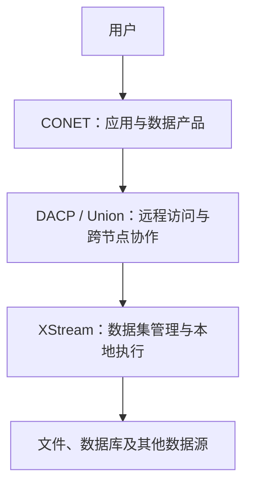
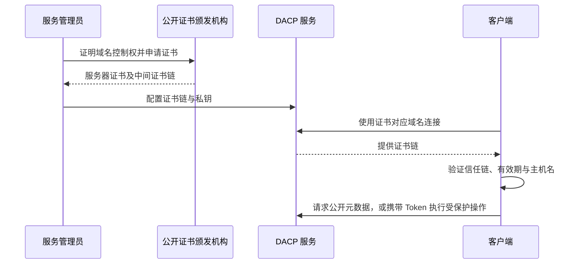

# 常见问题

[English](faq.md)

## 1. 一个节点如何加入 Union？

Union 使用节点签发的服务凭据连接配置中的节点。节点不主动注册，也不需要发送邀请。

1. 准备 Union 配置，在 Union 主机上查询稳定身份：

   ```bash
   union-admin identity /etc/dacp/union.yaml
   ```

   记录 `union_id` 和 `scheduler_identity`，保留 Union 状态目录及稳定的证书身份。

2. 在节点主机上签发绑定该 Union 身份的凭据。目录使用节点配置的 `credential_directory`：

   ```bash
   dacp-admin grant-union /protected/node-credentials \
     --subject union-service \
     --union-id UNION_ID \
     --fingerprint SCHEDULER_IDENTITY
   ```

   将大写占位符替换为第一步得到的身份值。只保存返回的 `token` 值，不要保存完整 JSON 作为 Token 文件。通过安全方式传至 Union 主机，限制文件权限，例如执行 `chmod 600`。

3. 在 Union 配置中增加节点：

   ```yaml
   members:
     - url: dacp://node.example.org:18861
       credential_file: /protected/union/node.token
   ```

   确保服务之间网络可达，TLS 配置允许建立连接。节点须启用 Union 执行服务；其 `union` 配置见部署指南。

4. 重启 Union 以应用成员列表，然后诊断连接：

   ```bash
   union-admin members /etc/dacp/union.yaml
   ```

   也可在 Union 看板查看成员健康状态。成员不可用不会阻止 Union 启动，服务会持续轮询重试。

参见 [Union 部署](../dacp-union-server/README_zh.md)和[凭据与角色](security_zh.md)。

## 2. 一个节点可以加入多个 Union 吗？

可以。为每个 Union 单独签发服务凭据，分别绑定其 Union ID 与证书身份；在各 Union 的成员配置中填写同一个节点地址及对应凭据。各 Union 独立维护公开数据集名称与 Job。撤销一个 Union 的凭据不会撤销另一个的凭据。

节点本地 Job 和所有 Union 共享节点执行容量，目前没有按 Union 单独预留资源或保证公平调度。一个节点同时加入两个 Union，不代表这两个 Union 的其他成员自动互信。接纳的 Union 服务凭据授权该 Union 的服务操作，目前没有按 Union 配置的数据集允许列表。

## 3. 目前有哪些权限和角色？

| 角色 | 权限 |
|---|---|
| `reader` | 公开内容读取及本地预签名工具权限 |
| `runner` | Reader 能力、Job 执行、推导及本人 Job 管理 |

数据集发现、Item 列表和 Item 元数据公开访问。内容遵循数据集的公开、不公开或定时公开策略；公开内容可匿名读取，普通角色不能绕过不公开或未到期的限制。执行 Job 需要 runner 权限。Union 服务凭据采用独立的证书绑定信任机制。管理员为账号分配预定义角色，不是将各日志操作名单独配置为角色权限。参见[安全与授权](security_zh.md)。

## 4. 步骤之间和跨节点 Job 有时间限制吗？

目前没有独立的步骤间空闲超时。下游可以等待上游数据，下游缓冲区满时上游也会等待；这些等待会消耗执行时间。

默认执行时限为 1,800 秒。服务通过 `execution_timeout_seconds` 配置，提交的执行策略可以用 `timeout_seconds` 缩短。Union 向子 Job 下发剩余时间，子 Job 同时受节点 Union 执行配置的时限约束。控制请求通常另有 30 秒的截止时间，数据流调用也有截止时间。持续收到数据不会延长调用截止时间。参见[执行策略](materialization_zh.md)。

## 5. 30 秒 deadline 错误表示 Job 执行太久了吗？

不一定。`CallOptions deadline exceeded after 29.99…s` 表示某次远程调用超时，不表示整个 Job 已达到执行时限。应在 Union 和节点运行日志中按业务操作名、请求 ID、Job/执行 ID 关联排查。只调大 `execution_timeout_seconds` 不会改变控制调用的截止时间。

节点接纳启动请求后先返回，再在后台解析算子、准备执行单元。接纳请求不表示初始化成功，须继续查看 Job 状态。已取消、到期或完成的子 Job 不能再次启动。“No step snapshots were recorded” 表示看板没有获取到步骤观测，并不能证明节点从未开始工作。

## 6. 请求日志和完整异常栈在哪里？

节点访问日志采用 JSON Lines，目录由 `access_log.directory` 指定；默认是进程工作目录下的 `.dacp-access/<port>/`。请求结束后异步写入，包含请求 ID、可用的 Job ID、操作名、状态和耗时。记录中的开始时间并不意味着收到请求时会单独写一条日志。

操作名采用 `catalog.list`、`item.describe`、`item.read`、`job.submit`、`job.prepare`、`job.start`、`job.status`、`job.cancel` 等业务名称，与授权权限 `data:read` 等不同。独立的传输认证审计仍记录 RPC 方法。

服务端运行日志记录完整异常栈、原因链及关联标识。Job 创建前失败时没有可用的 Job ID。客户端只收到简明错误，访问日志不包含异常栈。参见[访问日志](access-logs_zh.md)。

## 7. 看板会自动刷新吗？

节点和 Union 看板打开时加载，之后通过 **Refresh** 或 **Reload** 手动更新。切换分页、筛选或展开数据集时，可按需加载相应内容。服务后台的成员轮询不依赖浏览器刷新，仍会继续。CONET 大屏保留自动更新。参见[看板](node-web_zh.md)。

## 8. 如何关闭看板 Web 服务？

**DACP 节点：**在节点启动配置中设置以下内容，然后重启节点：

```yaml
web:
  enabled: false
```

节点看板默认开启，因此删除节点配置中的 `web` 段并不能关闭它。

**Union Server：**从启动配置中删除整个顶层 `web` 段，然后重启 Union。例如，删除以下配置：

```yaml
web:
  host: 127.0.0.1
  port: 19880
```

Union 仅在存在该配置段时启动看板。Union 配置不接受 `web.enabled: false`、`web: false` 或 `web: null`。

关闭看板会关闭对应的 HTTP 监听及只读 HTTP 接口，不会关闭 DACP 数据服务、Job 执行、Union 协调、执行历史或独立配置的 S3 服务。修改后须重启对应节点或 Union 进程才能生效。参见[看板](node-web_zh.md)和 [Union 部署](../dacp-union-server/README_zh.md)。

## 9. DACP 支持哪些常见操作，对应的英文名称和权限是什么？

| 操作 | 英文业务名称 | 访问要求 |
| --- | --- | --- |
| 查询服务能力 | `service.capabilities` | 匿名公开 |
| 列出数据集 | `catalog.list` | 匿名公开 |
| 获取目录快照 | `catalog.describe` | 匿名公开 |
| 列出 Item / 展开 Folder | `item.list` | 匿名公开 |
| 查看 Item 元数据 | `item.describe` | 匿名公开 |
| 统计记录数 | `item.count` | 数据集内容发布策略 |
| 读取 Item 视图 | `item.read` | 数据集内容发布策略 |
| 推导步骤输出 | `step.infer` | `job:execute` |
| 推导 Job 输出 | `job.infer` | `job:execute` |
| 提交 Job | `job.submit` | `job:execute` |
| 重放 Job | `job.replay` | `job:execute` |
| 查询 Job 状态 | `job.status` | `job:manage:self`，并校验归属 |
| 取消 Job | `job.cancel` | `job:manage:self`，并校验归属 |
| 读取 Job 结果 | `job.result.read` | `job:manage:self`，并校验归属 |
| 读取 Job 事件 | `job.events.read` | `job:manage:self`，并校验归属 |
| 列出可用节点 | `node.list` | `job:execute` |
| 查询节点状态 | `node.status` | 可信服务身份及执行计划授权 |
| 查询 Union 成员关系 | `union.membership.get` | 可信服务身份及执行计划授权 |
| 准备子 Job | `job.prepare` | 可信服务身份及执行计划授权 |
| 启动子 Job | `job.start` | 可信服务身份及执行计划授权 |
| 读取步骤输出 | `step.output.read` | 可信服务身份及执行计划授权 |
| 查询步骤物化状态 | `step.materialization.status` | 可信服务身份及执行计划授权 |

目录、列表和元数据始终公开；Item 内容读取及实际扫描遵循数据集发布策略。Job 提交权限不绕过数据集内容限制。S3 列表和对象元数据匿名公开，GET 内容同样遵循数据集策略；提供的签名仍须有效。

过滤、投影、限制和科学切片属于 `item.read` 参数。表中英文名是业务日志名称，不是远程方法名或权限标识。看板提供只读信息，其内网边界须通过监听和防火墙配置；管理命令通过本地 `dacp-admin`、`union-admin` 执行。参见[访问日志](access-logs_zh.md)、[认证与访问控制](security_zh.md)和[数据集发布策略](dataset-publication_zh.md)。

## 10. `/etc/dacp/ca.crt` 是什么？

这是示例中的公开 CA 证书文件路径，用于校验远程服务的 TLS 证书。部署时应替换为实际 CA 证书路径。它不是访问 Token，也不是私钥，本身不会授予数据读取或 Job 执行权限。

所有连接均验证服务器证书和主机名。仅当平台信任服务器证书时才可省略 CA 文件；私有 CA 或自签名 CA 必须配置 `ca`。Designer 连接配置中的路径位于 Designer 服务器上，不是访客电脑上的路径。账号 Token 通过独立的 `token_file` 配置。参见[认证与访问控制](security_zh.md)。

## 11. 如何限制 DACP 服务仅在内网内被访问？

分别配置 DACP、看板和 S3 的监听地址。例如，本机内网地址为 `10.0.82.103`：

```yaml
host: 10.0.82.103
port: 19860
public_host: 10.0.82.103
web:
  host: 10.0.82.103
  port: 19880
s3:
  enabled: true
  host: 10.0.82.103
  port: 21860
```

以上是 DACP Server 配置；Union 使用 `public_url: dacp://10.0.82.103:19860` 声明对外地址，而非 `public_host`。仅本机访问时，各监听地址设置为 `127.0.0.1`；此时不能通过内网 IP 访问。未使用的看板和 S3 应关闭，关闭方式见本页相关问题。

绑定内网地址限制监听网卡，但不会校验访问来源。还需在主机防火墙、云安全组和网络边界中，仅允许指定内网网段访问实际配置的 DACP、看板和 S3 端口，并禁止公网映射、转发及代理暴露；同时检查 IPv6 入站规则。修改后重启服务，分别从允许的内网和禁止的网络验证可达性。`public_host` / `public_url` 只声明地址，不是访问控制规则。网络限制不替代 TLS 服务器身份验证和业务权限校验。

## 12. 如何理解 CONET、DACP 和 XStream 三个项目之间的关系？

**XStream 提供数据管理与本地计算基础，DACP 将这些能力开放到网络，CONET 将网络能力组织成面向用户的应用。**

| 项目 | 定位 | 核心职责 |
|---|---|---|
| XStream | 数据集管理与本地数据流执行引擎 | DataCatalog—Dataset—Item、格式解析、DataView、算子、Job 本地执行和 Designer |
| DACP | 数据发布与远程计算服务 | 数据集与 Job 执行的网络访问、身份认证和读取授权；Union 提供跨节点协作 |
| CONET | 数据协作网络与应用平台 | 组织数据中心、展示联合目录、App Builder、分析历史、数据产品发布与分享，以及网络大屏 |



以一次跨中心分析为例：

1. 用户在 CONET 应用中选择区域、上传文件或填写参数。
2. CONET 将参数填入固定 Job，提交给 DACP Union。
3. Union 根据数据位置规划、拆分 Job，向各 DACP 节点下发子任务。
4. 每个节点使用内嵌的 XStream 引擎执行本地步骤。
5. CONET 展示进度和结果，并可将分析结果发布为 DACP 数据集。

XStream 在本地执行步骤：读取远程 Item 不意味着自动将后续计算下推到该服务器。DACP 提供远程调用，Union 提供跨节点规划。CONET 负责应用表单、展示、历史和产品，不重复实现格式解析、流执行或跨节点规划。CONET 的应用准入队列与执行节点的资源保护相互配合，不能替代节点自身的资源限制。

XStream 可以独立在本地运行；DACP 可以脱离 CONET，通过客户端、SDK 或 Shell 使用；CONET 为 DACP 网络提供面向应用的入口。图中表示该应用栈，不代表 XStream 的所有数据访问都必须经过 DACP。

## 13. 公网 DACP 服务如何配置证书，客户端需要怎样配置？

建议使用受公开信任的 CA 签发的服务器证书。使用 Certbot、acme.sh 等 ACME 客户端，通过 HTTP 或 DNS 验证证明对服务域名的控制权后申请证书。为 DACP TLS 监听配置服务器证书及中间证书链（通常为 `fullchain.pem`）和私钥（通常为 `privkey.pem`）。私钥仅保存在服务端；配置自动续期，并在续期后重新加载或重启服务，使新证书生效。

客户端验证证书链、有效期和主机名。当签发 CA 已被客户端运行环境的默认信任库信任时，无需显式提供 `ca` 文件。使用私有 CA 时，通过可信渠道分发根证书并配置 `ca`，或将其安装到客户端受管理的信任库。匿名浏览目录也不能关闭服务器身份校验。客户端信任库应保持更新。

证书验证确认服务器身份，访问 Token 授予业务操作权限。公开目录浏览仍验证服务器；受保护操作还需提供具有相应权限的凭据。普通客户端不需要客户端证书。参见[认证与访问控制](security_zh.md)和 [ACME 证书申请说明](https://letsencrypt.org/getting-started/)。

## 14. 支持通过域名连接时，服务器端需要配置什么？

以 `node.example.com` 为例：

1. 添加 DNS A 记录，指向服务器公网 IPv4 地址；仅在 IPv6 已配置且可访问时添加 AAAA 记录。
2. DACP 监听可访问的本机网络接口，或监听 `0.0.0.0` 以覆盖全部 IPv4 接口。监听地址仍是本机接口地址，无需填写域名；监听 `127.0.0.1` 时仅本机可访问。
3. 安装 Subject Alternative Name 包含 `node.example.com` 的 TLS 证书，并配置中间证书链和私钥。
4. 在防火墙、云安全组及必要的 NAT 映射中开放实际配置的 TCP 端口。
5. DACP Server 的 `public_host` 设置为 `node.example.com`；Union 的 `public_url` 设置为 `dacp://node.example.com:19860`，端口使用实际值。相应更新客户端、Designer 和 Union 成员的连接地址。

客户端随后可以使用 `dacp://node.example.com:19860/dataset/item` 连接。仅包含域名的证书不能用于验证直接通过 IP 建立的连接。仅修改 DNS，也不会让已有的仅含 IP 的证书自动适用于域名。

DACP 可以直接提供 TLS 服务，无需额外部署反向代理。如使用代理，须支持 Arrow Flight 的 gRPC/HTTP/2 流量，并保留所需安全边界。独立暴露的看板和 S3 端点应分别配置。

## 15. 如何让 DACP 动态发布现有 Java 业务系统中的 Dataset 和 Item？

通过 DACP 服务端安装的 XStream 数据提供器插件接入。薄适配层可以直接调用已有 Java 库，也可以通过 HTTP/RPC 接口连接独立运行的业务程序；客户端仍使用正常的 DACP 协议。

| 需求 | 扩展点 |
|---|---|
| 动态发现 Dataset 列表 | 实现 `DataCatalogProvider`，返回 `DataCatalog` |
| 列出 Item、描述元数据及读取内容 | 实现 `DatasetProvider`，返回 `PublishedDataset`，由其创建请求作用域的 `DatasetAccess` 实现数据访问契约 |
| 在自己的 JVM 应用内启动 DACP | 通过 `DacpServer.builder().catalog(...)` 注入 `DataCatalog` |

如果发现的 Dataset 对应普通文件目录，目录适配层可通过 `CatalogContext.createDataset` 复用已安装的 `directory` provider。自定义内容后端则需要实现相应的 Dataset 访问接口。仅返回元数据列表不代表 Item 可以读取；读取和 Job 执行还需要提供受支持的 `DataView` 及其流实现。

将插件 JAR 和私有依赖安装到服务端 `plugin_directory`，在 `META-INF/services/xstream.data.DataCatalogProvider` 和按需使用的 `META-INF/services/xstream.data.DatasetProvider` 中注册具有公开无参构造方法的实现类，然后重启。无需修改核心注册表或客户端。编译时以 provided 范围依赖与宿主兼容的 `xstream-data-core` API，不重复打包宿主 API。当前公共接口使用 Scala 集合和函数类型，因此通常采用少量 Scala 适配代码更方便，业务逻辑仍可保留在 Java 中。

例如，将以下片段合并到服务端配置：

```yaml
plugin_directory: /opt/dacp/plugins
data_catalog:
  provider: business-catalog
  source:
    endpoint: http://127.0.0.1:9000
```

`business-catalog` 和 `source.endpoint` 是由自定义插件解释、校验的示例设置，并非内置的 HTTP 目录连接器。`data_catalog` 不能与非空的静态 `datasets` 配置并存。适配层负责刷新与缓存策略、后端超时、取消检查、并发访问和资源清理；发现失败不能伪装为空目录。Dataset 描述必须包含公开的 `title` 和 `description` 字段，后端凭据及私有存储设置不能进入公共元数据。

参见 [DACP 插件安装](plugins_zh.md)、[动态目录](https://github.com/rdcn-link/xstream-codex/blob/main/docs/dataset-catalogs_zh.md)、[Dataset 提供器](https://github.com/rdcn-link/xstream-codex/blob/main/docs/dataset-providers_zh.md)和 [Item 与流访问](https://github.com/rdcn-link/xstream-codex/blob/main/docs/dataset-access_zh.md)。现有完整提供器示例采用 Scala，目前未提供完整的纯 Java 接入示例。

## 连接配置图解



私钥始终保留在服务端。客户端的信任来自默认信任库或明确配置的私有 CA，不能仅因服务器提供了某张证书就信任它。部署细节见第 13、14 问。

## 16. 如何调整或二次扩展物理计划优化？

部署调优可以在 Union 启动 YAML 中设置 `planning.beam_width`，以及内置 `cost` provider 的启动、计算、带宽和延迟参数。在**物理计划 → 完整计划**中比较预计传输量、关键路径与实际执行观测。更大的束宽比较更多候选，但会增加规划时间。这些参数属于 Union，不放在 Designer 或 Job 中。

需要针对领域优化时，实现 `dacp.union.PhysicalPlanOptimizer`，提供输出大小、计算和内存估算、链路模型、额外完整节点分配候选及评分。通过 `META-INF/services/dacp.union.PhysicalPlanOptimizer` 注册 JAR，安装到 `plugin_directory`，选择 `planning.provider` 后重启。安装实现无需修改核心、重新编译服务器或改变客户端。回调应确定、有界且无副作用。

所有候选仍遵守来源所有权、显式分配、容量、executor 及已知内存约束；runtime 合并由成员最终确认，发布策略和凭据不变。插件是管理员安装的可信代码，不是 Job 上传的代码。该接口不提供自动过滤／Join 重写、自动物化或运行中重规划。

参见[物理计划](physical-planning_zh.md)、[开发契约](developers/planning-optimizer_zh.md)和[可运行示例](../examples/planning-optimizer/README_zh.md)。
