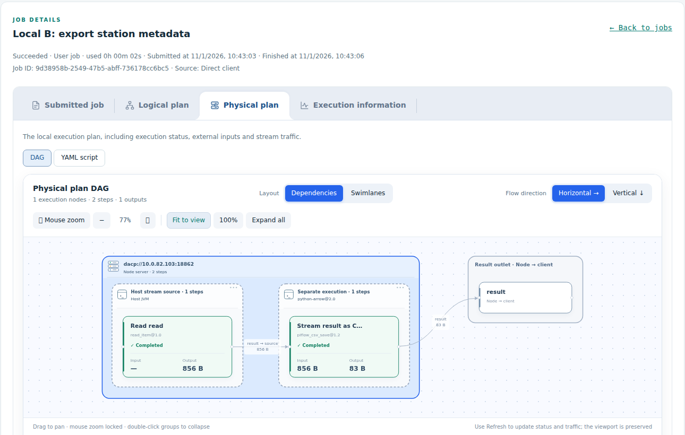

# Dashboard and execution plans

[中文](node-web_zh.md)

Use the read-only node and Union dashboards on the internal network to inspect services and Jobs. The dashboards do not require login, consume Item streams or offer data downloads.

## Find a page

| Page | What to inspect |
|---|---|
| Node overview | Service address, uptime, resources, execution capacity and Job history |
| Data catalog (`/datasets`) | Published Dataset names, descriptions and service URIs |
| S3 service (`/s3`) | Listener state, request counts and transferred bytes |
| Job details (`/job?id=...`) | Submitted script, plans, execution policy, attempts and step status |
| Union members (`/nodes`) | Member health, resources, Job participation and observed stream traffic |

Job lists show readable names and generated IDs, source, type, status, start time and duration. Select a Job to open its separate detail page. All dashboard pages load once when opened and do not refresh automatically; use **Refresh** or **Reload** when needed. This includes node and Union overviews, Job lists and details, S3 statistics, and member topology. Changing a filter or page, or expanding a dataset, may load the requested information. Node and Union use matching tabs and DAG controls. Dataset pages load asynchronously and expose incomplete/failing requests explicitly.

## Read a Job detail page

| Tab | Question it answers |
|---|---|
| Submitted job | What did the client submit? |
| Logical plan | Which steps and stream connections define the computation? |
| Physical plan | Where does it execute, and which steps share an execution unit? |
| Execution information | What happened: policy, attempts, status, timing and failure details? |

The physical plan contains the complete plan and, on Union, dispatched subjob tabs ordered from upstream to downstream. Each plan has **DAG** and **YAML script** views. Placement annotations belong to the physical plan. Server groups identify execution locations; dashed unit groups identify process boundaries and runtime models. Step cards show state and observed stream payload. Missing observations appear as `—`.

A Union-assigned subjob is the plan dispatched to that node. Its external inputs identify upstream outputs outside the local execution area. Use Union's detail page for the complete logical Job and its global plan. A node's direct client Job shows its submitted definition and local plans.

## DAG controls

Switch between dependency and swimlane layouts and choose horizontal or vertical direction. Select a step or edge to highlight it. Toolbar controls offer zoom, fit, reset and expand. Mouse-wheel zoom is locked by default; the wheel scrolls the page while locked. Unlock **Mouse zoom** to zoom with the wheel. Horizontal layouts align server and unit heights; vertical layouts align widths.

## Execution sources and internal routing

The list distinguishes `Direct client` / `Union` sources and `User job` / `Union sub-job` types. Source filtering applies before pagination. Only top-level Jobs occupy list rows; associated step records appear in details and retain attempt numbers.

For dashboard integrations, `/api/history?source=client` or `?source=union` filters source; omitted or `all` returns all top-level Jobs. `/api/executions/<record_id>` includes `step_records`. Source is derived from server execution records. Subjob YAML preserves the actual assigned definitions, remote inputs and output routes; identity digests authorize stream consumers and are not data representations.

## Data catalog

`/datasets` shows local Dataset names on a node and public Union names on Union. It offers text filtering, refresh and JSON descriptions. Loading metadata does not open Items or submit Jobs. See [directory semantics](dataset-directory.md) for incomplete catalogs and member-local names.

For operational metrics, S3 status and dashboard listeners, see [monitoring and dashboard configuration](operations/monitoring.md).
