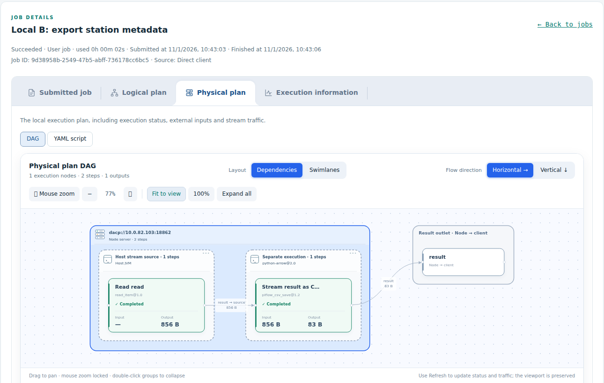

# 看板与执行计划

[English](node-web.md)

通过内网中的节点与 Union 只读看板查看服务和 Job。看板无需登录，不消费 Item 数据流，也不提供数据下载。

## 查找页面

| 页面 | 查看内容 |
|---|---|
| 节点概览 | 服务地址、运行时长、资源、执行容量和 Job 历史 |
| 数据目录（`/datasets`） | 已发布数据集名称、描述与服务 URI |
| S3 服务（`/s3`） | 监听状态、请求次数和传输字节数 |
| Job 详情（`/job?id=...`） | 提交脚本、计划、执行策略、尝试与步骤状态 |
| Union 成员（`/nodes`） | 成员健康、资源、参与 Job 次数和观测流量 |

Job 列表展示可读名称、自动生成的 ID、来源、类型、状态、开始时间和耗时。选择 Job 后打开独立详情页。所有看板页面在打开时加载一次，不会定时自动刷新；需要时点击 **Refresh** 或 **Reload**。此规则包括节点和 Union 概览、Job 列表与详情、S3 统计及成员拓扑。切换筛选或分页、展开数据集时，可以按需加载相应信息。节点与 Union 使用一致的标签页和 DAG 控件；数据目录采用异步加载，明确展示不完整或失败的请求。

## 阅读 Job 详情

| 标签页 | 回答的问题 |
|---|---|
| Submitted job | 客户端提交了什么？ |
| Logical plan | 哪些步骤与流连接构成计算？ |
| Physical plan | 在哪里执行，哪些步骤共享执行单元？ |
| Execution information | 执行发生了什么：策略、尝试、状态、计时与失败详情？ |

物理计划中包含完整计划；Union 还提供按上游至下游排序的下发子 Job 标签页。每个计划都有 **DAG** 与 **YAML script** 两种视图。步骤放置标注属于物理计划；服务器分组标识执行位置，虚线执行单元分组标识进程边界与运行环境。步骤卡片显示状态与观测到的流载荷，未观测值显示 `—`。

Union 下发的子 Job 是分配给本节点的计划，其外部输入在本地执行区域之外标明上游输出。完整逻辑 Job 和全局计划应在 Union 详情页查看；用户直接提交的节点 Job 展示提交定义和本地计划。

## DAG 操作

在依赖布局和泳道布局间切换，选择水平或竖直方向；点击步骤或连线进行高亮。工具栏提供缩放、适应视图、重置和展开功能。鼠标滚轮缩放默认锁定，此时滚轮正常滚动页面；解锁 **Mouse zoom** 后可用滚轮缩放。水平布局对齐服务器与执行单元高度，竖直布局对齐宽度。

## 执行来源与内部路由

列表区分 `Direct client` / `Union` 来源与 `User job` / `Union sub-job` 类型。来源过滤发生在分页之前。仅顶层 Job 占据列表行，关联步骤记录在详情中展示并保留尝试序号。

集成看板时，`/api/history?source=client` 或 `?source=union` 按来源过滤，省略或使用 `all` 返回全部顶层 Job。`/api/executions/<record_id>` 包含 `step_records`。来源由服务端执行记录确定。子 Job YAML 保留实际下发定义、远程输入和输出路由；身份摘要用于授权流消费者，不表示数据视图。

## 数据目录

`/datasets` 在节点端展示本地数据集名称，在 Union 端展示公开名称，提供文本过滤、刷新与 JSON 描述。加载元信息不会打开 Item 或提交 Job。不完整目录和成员本地名称的语义见[数据集目录](dataset-directory_zh.md)。

监控指标、S3 状态和看板监听配置请阅读[监控与看板配置](operations/monitoring_zh.md)。
