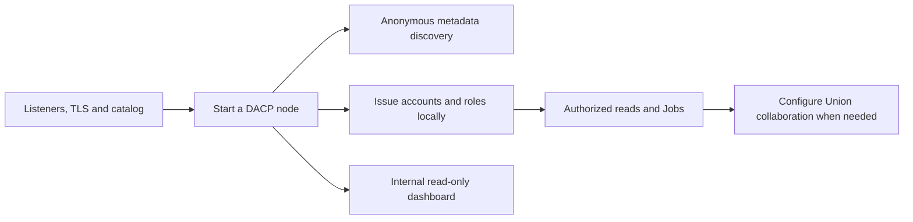

# Operations guide

[中文](README_zh.md) · [Documentation](../README.md)

Administrators deploy DACP data nodes and Union Server, configure connections to independent operator repositories, and maintain certificates, authorization, published data, and execution records. See the [DACP protocol](../protocol.md) for protocol and identity boundaries.

For Dataset identities supplied by a database or application, use a [dynamic catalog plugin](https://github.com/rdcn-link/xstream-codex/blob/main/docs/dataset-catalogs.md). Applications hosting a node directly can use the [embedding API](../embedded-server.md).



## Find an operations task

| Task | Guide and reference |
|---|---|
| Deploy nodes and publish data | Deployment below, [configuration](../reference.md), [SQL example](../../examples/sql/README.md) |
| Accounts, roles and certificates | [Authentication and local credential tools](../security.md) |
| Deploy Union or a relay | [Union deployment](../../dacp-union-server/README.md), [proxy deployment](../../dacp-proxy-server/README.md) |
| Install backend and execution plugins | [Server plugins](../plugins.md) |
| Observe health, resources, S3 and traffic | [Monitoring and dashboard configuration](monitoring.md) |
| Logs, history cleanup and maintenance | [Access logs](../access-logs.md), [execution records](../execution-history.md) |
| Back up and restart | Monitoring, records, and shutdown below |

For client connections and Job submission, use the [User guide](../usage.md); for application integration, use the [Development guide](../developers/README.md).

## Single-node deployment

Servers require JDK 17 and sbt 1.10.x. Operator execution also requires Linux and access to Docker Engine. Clients browsing data do not require Docker. Run `docker info` to check access for the service account; group membership changes require a new login.

Build from the project root:

```bash
(cd dacp-server && sbt stage)
(cd dacp-union-server && sbt stage)
```

Local demonstrations use the project's certificate script and example configuration. Production deployments need their own CA, hostnames, and certificate management. Relative configuration paths resolve against the process working directory.

```bash
bash scripts/certs.sh
cd dacp-server
sbt 'run ../examples/server.yaml'
```

## Publish data and configure execution

Declare Dataset providers and their parameters in node configuration. Built-in and external providers share the same plugin contracts. See the [technical reference](../reference.md), [Dataset providers](https://github.com/rdcn-link/xstream-codex/blob/main/docs/dataset-providers.md), and [SQL example](../../examples/sql/README.md) for directory and SQL configuration. Restrict data directories and credentials to the service account.

Nodes resolve public operators through `remote_operator_library_urls`. Repository order affects lookup order. Publish shared runtimes separately from operator code. See [packaging](https://github.com/rdcn-link/xstream-codex/blob/main/docs/operator-packaging.md) and the [executor manual](https://github.com/rdcn-link/xstream-codex/blob/main/plugins/xstream-plugin-operator-executors/README.md) for execution environments and native commands. Remote nodes accept public repository operators only; source submission belongs to the operator repository review service.

## Certificates and authorization

Ordinary DACP clients use TLS and tokens without requiring client certificates. Union uses mutual TLS and node-issued service credentials bound to its Union ID and certificate fingerprint. Peer step streams are authorized by exact execution plans. Credentials are created, rotated and revoked locally and reload automatically. See [authentication and access control](../security.md).

## Union and repository

- [Union manual](../../dacp-union-server/README.md): configuration, service credentials, polling, job submission, and management dashboard.
- [Two-node example](../../examples/union/README.md): complete certificate, node, Union, and client demonstration.
- [Repository manual](https://github.com/rdcn-link/xstream-operator-repository/blob/main/docs/browsing.md): initialization, publication, source materials, HTTP service, and downloads.

Union builds one Union from configuration, connects independent members using node-issued credentials and polls their status. Its public read-only HTTP dashboard exposes job scripts and execution metadata without login or tokens. Review step parameters for information unsuitable for public viewing. Computation remains protected by authorization on DACP interfaces.

## Monitoring, records, and shutdown

The dashboard shows node health, start time, uptime, job DAGs, status, and traffic. Unreachable node status may be unknown. Nodes and Union persist execution metadata, rather than historical result files. See [execution history](../execution-history.md) for storage, queries, and restart behavior. Back up persistent configuration, member identities and credentials, and execution records. Stop services before copying to avoid inconsistency across files.

Use Ctrl+C for foreground processes or send SIGTERM. Restarting does not resume interrupted result streams. Inspect operator images with `docker image ls`; local runtime configuration and repository artifacts are separate resources. Setting the log level to DEBUG does not change remote Job operator admission.

Nodes also start a read-only HTTP dashboard by default on the DACP service port plus 1000. Disable it with `web.enabled: false`. See the [monitoring and dashboard configuration](monitoring.md) for configuration and DAG views.

Nodes also enable the [S3-compatible read service](../s3-service.md) by default, on the DACP service port plus 2000. It provides HTTPS and SigV4-authenticated downloads of bytes Items using separate signing keys with the same DACP subjects and reader/runner roles. Disable it with `s3: {enabled: false}`.

Union provides standard DACP discovery, Items, Jobs and S3. For public short names, placement and management access, see [Union proxy service](../union-proxy.md).

For joining a Union, multi-Union membership, permissions and timeout troubleshooting, see the [FAQ](../faq.md).
