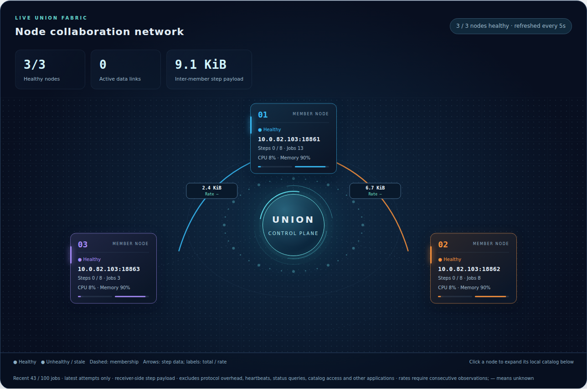

# Monitoring and dashboard configuration

[中文](monitoring_zh.md) · [Operations guide](README.md)

Monitor nodes, Union, S3 and task data transfers through the internal read-only dashboards. For logical/physical plans and attempts of a particular Job, use the [Job dashboard guide](../node-web.md).

## Node and Union monitoring

The node overview shows resources, execution capacity and Job status. Union members show health, participation and task stream traffic. Links display cumulative bytes and transfer rates. Retained observations for unavailable members describe the last observation, not current state. Viewing monitoring pages does not read Item data.



## S3 operations overview

`/s3` shows listener and aggregate counters without bucket browsing, object downloads or account controls. Counter scope and reset behavior are described in [S3 monitoring](../s3-service.md#s3-operations-overview).

## Configure the node dashboard

Each node starts HTTP on its DACP service port plus 1000 by default. Startup logs report the actual address. Set an explicit port when the default would exceed 65535:

```yaml
web:
  enabled: true
  host: 0.0.0.0
  public_host: node-a.example.org
  port: 19861
```

`enabled` is boolean; `port` is 0–65535, with 0 selecting an ephemeral port available as `server.webPort`. `public_host` is the browser-facing host and defaults to the node's `public_host`; the bind address is independent. Disable with `web: {enabled: false}`. Closing the node closes HTTP; bind failure fails startup and releases acquired resources.

Successful startup advertises `web_enabled` and `web_url` through node status so Union can link to the node dashboard. The interface is English; Dataset names, descriptions, step labels and scripts retain their original content. Static resources are available locally.

Dashboards expose execution metadata and stored parameters across submitters. Bind them to the intended internal network. Data and execution authorization remains enforced by DACP service calls. For Union dashboard configuration, see the [Union manual](../../dacp-union-server/README.md).
