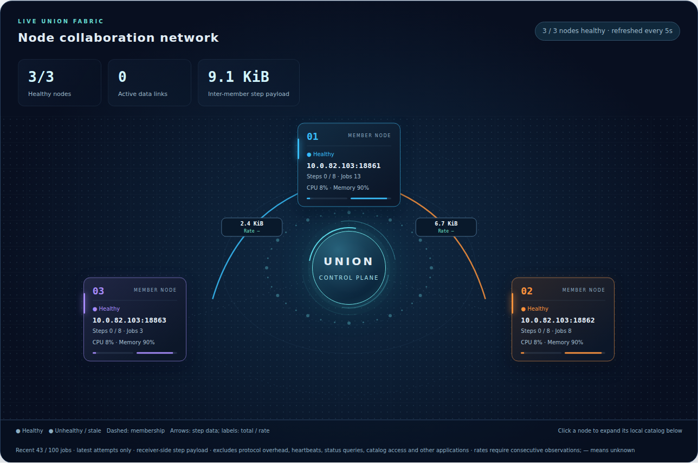

# 监控与看板配置

[English](monitoring.md) · [运维指南](README_zh.md)

通过内网只读看板监控节点、Union、S3 和任务数据传输。查看具体 Job 的逻辑计划、物理计划与执行尝试，请阅读[Job 看板指南](../node-web_zh.md)。

## 节点与 Union 监控

节点概览显示资源使用、执行容量与 Job 状态；Union 成员页显示健康状态、参与次数及任务数据流量。连线展示累计传输量与速率。不可用成员的保留指标属于最后一次观测，不代表实时状态。目录与 Item 数据不会因查看监控页面而被读取。



## S3 运行概览

`/s3` 展示监听与累计计数，不提供桶浏览、对象下载或账号管理。统计范围和重置行为见 [S3 监控](../s3-service_zh.md#s3-运行概览)。

## 配置节点看板

节点默认在 DACP 服务端口加 1000 的端口启动 HTTP，实际地址写入启动日志。默认端口会超出 65535 时需显式配置：

```yaml
web:
  enabled: true
  host: 0.0.0.0
  public_host: node-a.example.org
  port: 19861
```

`enabled` 为布尔值；`port` 为 0–65535，0 表示临时端口，可通过 `server.webPort` 获取。`public_host` 是浏览器访问地址，默认采用节点 `public_host`，与监听地址分开。使用 `web: {enabled: false}` 关闭。节点关闭时同时关闭 HTTP；绑定失败会使启动失败并释放已获取资源。

启动成功后，节点状态通过 `web_enabled` 与 `web_url` 提供看板地址，供 Union 展示链接。界面采用英文；数据集名称、描述、步骤标签和脚本保留原始内容，静态资源在本地提供。

看板跨提交者展示执行元信息与已保存参数，应绑定预期的内网。数据读取和执行权限由 DACP 服务调用检查。Union 看板配置见 [Union 手册](../../dacp-union-server/README_zh.md)。
