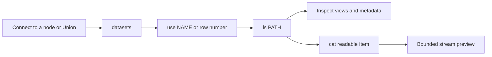
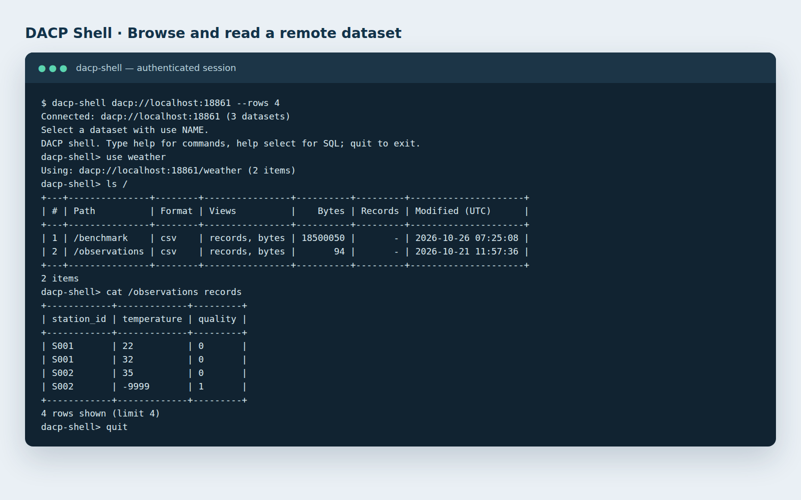

# Connect to your first DACP service

[中文](quickstart_zh.md)

Use this walkthrough when a node or Union is already running. You need its DACP address; ask its administrator for a reader or runner token and trusted CA to read data. To start your own service, use [node deployment](operations/README.md).

## 1. Install the Shell

Install the Python client from an extracted client download or this source checkout. Python 3.10+ is required. From a source checkout:

```bash
python3 -m venv .venv
.venv/bin/pip install ./dacp-client
```

Use `.venv/bin/dacp-shell` below, or `dacp-shell` after activating the environment.

## 2. Discover public metadata

Replace the example address with your service. With no token, CA or client certificate configured, anonymous metadata browsing requires only the address:

```bash
.venv/bin/dacp-shell dacp://data.example.org:18861
```

```text
datasets
use 1
ls /
help cat
```

`datasets` lists numbered Dataset names and JSON descriptions. `use 1` selects the first entry; a complete directory with one Dataset is selected automatically. `ls /` lists Items and their advertised views. Row numbers refer to the latest listing. Anonymous browsing keeps TLS encryption without certificate verification; see [connection security](security.md).

## 3. Read an Item

Reconnect with the credentials provided by the administrator:

```bash
.venv/bin/dacp-shell dacp://data.example.org:18861 \
  --ca /path/to/ca.crt --token-file /path/to/reader.token
```

```text
datasets
use 1
ls /
cat 1
```

Select a readable Item from `ls`; folders must be expanded first with `ls /folder`. `cat 1` previews the first listed Item using its default view; `cat 1 records`, `cat 1 text` and `cat 1 array` request a particular supported view. Catalog contents and paths depend on the publisher. Previews are bounded; use the [SDK examples](users/README.md#browsing-and-reading) to consume a full stream.





*An actual Shell session, presented in a terminal-style capture. Names and paths vary by deployment.*

## 4. Submit a Job

A runner account can submit an existing Job using the same node or Union connection:

```text
submit job.yaml --vars variables.yaml --policy policy.yaml
```

Omit `--vars` or `--policy` when unnecessary. Job, variable and policy file paths are local to the Shell process. Input Item references resolve on the receiving service. Consume the result as it arrives; Ctrl+C cancels the running operation. See [remote submission examples](jobs.md) and [execution policies](materialization.md).

## Next steps

| Goal | Guide |
|---|---|
| Write Python or Scala integration code | [Shell and SDK guide](users/README.md) |
| Query records or read with an S3 client | [Record queries](records-scans.md), [S3 access](s3-service.md) |
| Publish your own files or SQL tables | [Deployment](operations/README.md), [SQL example](../examples/sql/README.md) |
| Combine independent data nodes | [Union guide](union-proxy.md), [complete collaboration example](../examples/union/README.md) |
| Inspect results and execution plans | [Dashboard guide](node-web.md) |
