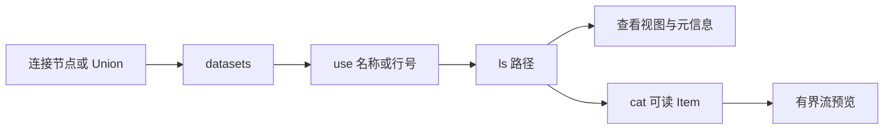
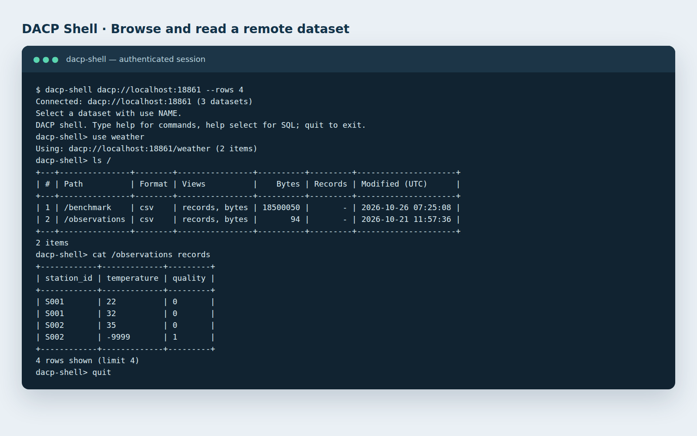

# 连接第一个 DACP 服务

[English](quickstart.md)

本教程适用于已有节点或 Union 服务的情况。首先获取 DACP 地址；读取数据时还需向管理员获取 reader 或 runner Token 以及受信任的 CA。启动自己的服务请阅读[节点部署](operations/README_zh.md)。

## 1. 安装 Shell

从解压的客户端下载包或源码目录安装 Python 客户端，需要 Python 3.10+。在源码目录中执行：

```bash
python3 -m venv .venv
.venv/bin/pip install ./dacp-client
```

下文使用 `.venv/bin/dacp-shell`；激活虚拟环境后也可以使用 `dacp-shell`。

## 2. 发现公开元信息

将示例地址替换为实际服务地址。未配置 Token、CA 或客户端证书时，匿名浏览元信息只需服务器地址：

```bash
.venv/bin/dacp-shell dacp://data.example.org:18861
```

```text
datasets
use 1
ls /
help cat
```

`datasets` 列出带行号的数据集名称与 JSON 描述；`use 1` 选择第一项，完整目录只有一个数据集时会自动选中。`ls /` 列出 Item 及其支持的视图。行号对应最近一次列表。匿名浏览保留 TLS 加密，但不验证服务器证书；详见[连接安全](security_zh.md)。

## 3. 读取 Item

使用管理员提供的凭据重新连接：

```bash
.venv/bin/dacp-shell dacp://data.example.org:18861 \
  --ca /path/to/ca.crt --token-file /path/to/reader.token
```

```text
datasets
use 1
ls /
cat 1
```

请从 `ls` 结果中选择可读 Item；目录需要先通过 `ls /folder` 展开。`cat 1` 使用默认视图预览第一项；`cat 1 records`、`cat 1 text`、`cat 1 array` 显式选择支持的视图。实际内容和路径由发布者决定。Shell 预览有大小限制，完整消费流请参考 [SDK 示例](users/README_zh.md#浏览与读取)。





*实际 Shell 会话，以终端样式呈现。数据集名称和路径随部署而变化。*

## 4. 提交 Job

runner 账号可以在同一个节点或 Union 连接上提交已有 Job：

```text
submit job.yaml --vars variables.yaml --policy policy.yaml
```

不需要变量或策略时省略对应选项。Job、变量与策略文件的路径相对于 Shell 进程；输入 Item 在接收服务的上下文中解析。结果到达时即可读取，Ctrl+C 取消当前操作。详见[远程提交示例](jobs_zh.md)与[执行策略](materialization_zh.md)。

## 下一步

| 目标 | 指南 |
|---|---|
| 编写 Python 或 Scala 集成程序 | [Shell 与 SDK 指南](users/README_zh.md) |
| 查询记录或通过 S3 客户端读取 | [记录查询](records-scans_zh.md)、[S3 访问](s3-service_zh.md) |
| 发布自己的文件或 SQL 表 | [部署指南](operations/README_zh.md)、[SQL 示例](../examples/sql/README_zh.md) |
| 连接独立数据节点 | [Union 指南](union-proxy_zh.md)、[完整协作示例](../examples/union/README_zh.md) |
| 查看执行计划和结果状态 | [看板指南](node-web_zh.md) |
