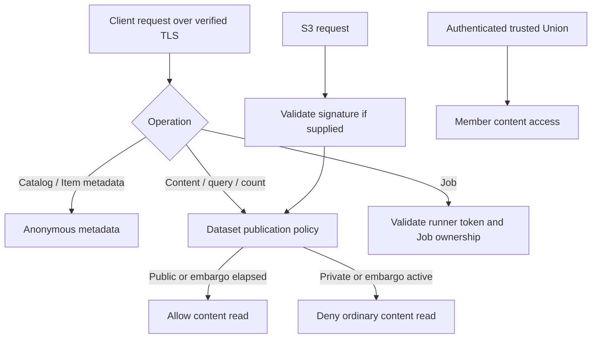

# Authentication and access control

This document describes implemented DACP authentication, authorization boundaries, credential management, revocation and audit. The following sections cover node, Union, S3 and operator repository configuration and operations.

## Service boundaries

| Service | Authentication and access scope |
| --- | --- |
| Ordinary node and Union Flight services | Public metadata over TLS; dataset publication policies for content; bearer tokens and subject roles for execution |
| Union collaboration calls to members | Mutual TLS and a node-issued Union service credential |
| Step streams between nodes | Mutual TLS and execution plans bound to steps, ports and consumers |
| S3 service | Public metadata; dataset content policies; optional HTTPS SigV4 and presigned GET using shared DACP subjects |
| Node and Union dashboards | Public read-only access inside the internal network; no login or access control |
| Operator repository | Public approved operators and runtimes; per-submitter Tokens for sources; authenticated administrator review |

Authorization takes place on the server. Ordinary and collaboration SDKs are separate products sharing Flight, certificate and stream protocol implementations. Choosing an SDK does not grant permissions.

## Ordinary clients

Catalogs, Dataset Item lists, Folder child lists and Item metadata (Views, Schema, size, creation and modification times and already available record counts) are anonymous over TLS. Metadata access never requests an explicit count scan. Data streams, queries and computed counts follow dataset publication policies; Job operations require a token. Individual client certificates are not required. All connections, including anonymous access, verify the server certificate and hostname. Without an explicit CA, platform trust roots are used; private or self-signed CAs must be provided explicitly. Anonymous connections never bypass verification. Union mutual TLS and certificate bindings remain enforced.

Tokens belong to a stable subject, which can hold multiple tokens. Jobs, status, results, cancellation and replay are authorized by job ownership. Token replacement or rotation must preserve the subject and historical job ownership.

Administrators create, list, revoke and rotate credentials using local server tooling. Tokens contain at least 256 bits of randomness, are shown only when created, and are stored as digests. Changes reload automatically. The server checks credentials in memory at the start of each RPC. Revoking or expiring an ordinary token leaves admitted RPCs and result streams running; subsequent RPCs on the same connection must pass authentication again.

## Subject roles and authorization

Roles belong to a stable subject, not to individual tokens. A subject may hold several independently revocable tokens. Assign roles locally with `set-roles`; the command replaces the complete role set. `none` removes all roles. Issuing a token does not grant any role implicitly.

| Role | Permissions |
| --- | --- |
| Anonymous | Public catalog, Item and Folder listings, Item metadata, and content of public datasets |
| `reader` | Public content access and local presigning-tool eligibility; no private dataset override |
| `runner` | Reader permissions plus execution, inference, samples and management/results of owned Jobs; source policies still apply |
| Union service | Separate certificate-bound service credential; member collaboration operations, subject to node resource limits |
| Execution consumer | Exact execution-plan authorization for the designated intermediate output; not a permanent user role |

Content access follows [dataset publication policies](dataset-publication.md): public, private or embargoed, defaulting to private. Neither reader nor runner bypasses these policies. Runner grants execution, inference and owned-Job management; reader remains relevant to local presigning-tool issuance. Catalogs and metadata are always anonymous. Supplied invalid, revoked or expired credentials are still rejected. Nodes trust explicitly authenticated Union service identities; Union enforces source dataset policies for its ordinary users.

The service reads immutable in-memory credential and subject snapshots for each new call. Local changes reload within approximately 250 ms. Already admitted ordinary calls and streams retain their permission snapshot; role changes, token revocation and expiry affect subsequent calls. Union service revocation still cancels associated active collaboration. A malformed credential file rejects its credentials. A malformed subject file clears shared user roles, denying new role-protected execution and local presigning operations while leaving public content access and Union service authentication unchanged.

Subjects are stored in `subjects.json` in the credential directory, independently of `credentials.json`:

```json
{
  "analyst": {"roles": ["runner"]},
  "data_client": {"roles": ["reader"]}
}
```

The CLI validates roles and atomically writes protected files. It provides no remote administration interface. Internal node/Union dashboards remain read-only, unfiltered by user identity and protected by deployment networking, not these roles. Their pages and HTTP APIs must remain on the internal network; do not expose them through a public proxy. S3 shares the instance’s subjects and roles, using separate signing keys. Operator-repository accounts remain independent.

## Union and member nodes

At startup, Union reads the member list for its single Union from configuration. There is no remote member management API. A node administrator issues a service credential bound to the Union identity and client certificate fingerprint. Union connects using the configured member address and credential file, without invitation, approval or additional operator allowlists.

Accepting the credential grants trust in Union collaboration operations. Nodes can independently serve other clients they permit. Union maintains a stable identity and records member identities. An unavailable member does not prevent startup; polling retries later.

Each collaboration call checks the service credential. Unlike ordinary tokens, revocation or expiration of a Union service credential must stop the associated active collaboration steps and streams.

Members of the same Union need no additional peer grants. However, certificates issued by the same CA alone do not grant arbitrary access to another member's data. Execution plans must constrain the execution instance, step, output port and consumer. Union service secrets must never be forwarded to downstream nodes.

## S3

DACP and S3 share subjects and credential management. S3 listings and object HEAD metadata are anonymous. GET content follows dataset publication policy, allowing anonymous reads of public datasets. Ordinary S3 keys, reader/runner roles and presigned links do not open private or unexpired embargoed datasets. Supplied SigV4 signatures must be valid; revoked keys, expiry and signature tampering reject subsequent requests, while admitted downloads may finish.

S3 keys cannot authenticate DACP calls or submit Jobs. Tokens and S3 keys can be revoked and rotated independently. Local presigning commands still require a current read role. A presigned URL is a temporary credential; do not log or distribute it publicly. Nodes and Union maintain independent subject directories without requiring user identity unification.

## Dashboards and operator repository

Dashboards are internal, read-only services. Deployment networking controls their exposure. This design does not provide public internet login protection.

Approved operator browsing and downloads are public. Developers submit source through per-submitter Token APIs; private source and pending artifacts are not public. Administrators sign in separately, manage Tokens and environments, inspect automatic scan/build results, assign multiple categories and a final public trust score, and approve publication. Versions cannot be overwritten. Detailed scan reports remain private; scores are review assessments, not safety guarantees. See [source submission and review](https://github.com/rdcn-link/xstream-codex/blob/main/docs/operator-submission.md).

## Audit and credential storage

Access logs should record the subject, operation, resource, outcome, duration, byte counts and associated job. Credential and member lifecycle events should also be recorded. Never log raw tokens, private keys, S3 secrets or complete signed URLs.

Credential files should be accessible only to the service account. Ordinary tokens are stored as digests. S3 signature verification requires recoverable key material, so it would be incorrect to describe all credentials as digest-only.

## Implementation and verification status

Implemented features include local credential management and hot reload, anonymous metadata, subject roles and ordinary Flight token authentication, certificate-bound Union service credentials, job ownership isolation, exact peer plan authorization, separate collaboration SDKs, S3 SigV4 and presigned GET. Automated tests cover admitted streams continuing after ordinary token revocation while subsequent calls fail, active collaboration stopping after service credential revocation, ownership surviving token rotation, and audit records for rejected requests. Live integration verifies authentication on three member nodes, Union collaboration calls, and boto3 signed listing, metadata, content, Range and presigned GET requests.

Related documentation: [access logs](access-logs.md), [data access](https://github.com/rdcn-link/xstream-codex/blob/main/docs/dataset-access.md), [operator repository](https://github.com/rdcn-link/xstream-operator-repository/blob/main/docs/browsing.md). Public data reads require no token; execution examples require a runner token file; Union member configuration requires a node-issued service credential file.

## Local credential operations

Set node `credential_directory: /protected/node-credentials` and configure a separate directory for Union. By default, a node uses `.dacp-security/PORT` under its process working directory, and Union uses `state_directory/credentials`. Directory permissions are 700 and credential files are 600.

Local tools use these subcommands. Servers themselves only start services; they do not expose administration commands:

| Tool | Subcommands |
| --- | --- |
| `dacp-admin` | Common account, credential and execution-history commands |
| `union-admin` | Identical common commands, plus `identity CONFIG` and `members CONFIG` |

Common commands share one implementation: arguments, defaults, JSON output and errors are identical. Pass the target service's credential directory. `create-account` creates an account and issues both a DACP token and S3 keys; its default role is reader. Use runner for Job execution. `create-token` issues an additional token for an existing account. `grant-union` issues a member's certificate-bound Union service credential, without an ordinary account or S3 keys.

```bash
target/universal/stage/bin/dacp-admin create-account /protected/node-credentials --subject alice --role runner --expires-in 86400
target/universal/stage/bin/dacp-admin create-account /protected/node-credentials --subject data_client
target/universal/stage/bin/dacp-admin create-token /protected/node-credentials --subject alice
target/universal/stage/bin/dacp-admin list-subjects /protected/node-credentials
target/universal/stage/bin/dacp-admin set-roles /protected/node-credentials alice reader
target/universal/stage/bin/dacp-admin list-credentials /protected/node-credentials
target/universal/stage/bin/dacp-admin rotate-credential /protected/node-credentials CREDENTIAL_ID
target/universal/stage/bin/dacp-admin revoke-credential /protected/node-credentials CREDENTIAL_ID
```

Use `set-roles DIRECTORY SUBJECT none` to remove execution and local presigning permissions; public content remains readable and admitted streams continue. Credentials can be revoked or rotated independently.

Account creation returns `subject`, `roles`, `token_id`, `token`, `access_key_id`, `secret_key` and `expires_at_ms`. Secrets are returned only on issuance; listing hides them. Protect the response and save the `token` value separately in a mode-600 text file for `--token-file`; do not use the complete JSON as a token file. Duplicate account creation fails without changing existing permissions.

First run `union-admin identity CONFIG` to obtain the stable `union_id` and `scheduler_identity`. Then issue a credential locally at each member:

```bash
target/universal/stage/bin/dacp-admin grant-union /protected/node-credentials --subject union-service --union-id UNION_ID --fingerprint SCHEDULER_IDENTITY
```

Save the returned `token` in that member's Union `credential_file`. Subsequent calls read replacement file contents. Unreachable members, invalid credentials and temporarily unreadable credential files produce unavailable status and are retried by polling without preventing Union startup.

No separate S3 issuance is required. `access_key_id` and `secret_key` sign S3 requests and cannot authenticate DACP calls. See [S3](s3-service.md) for presigning and boto3 examples.

The authentication layer also writes `authentication-audit.jsonl`, recording RPC methods, subjects, status and duration, including authentication and authorization rejections. `credential-audit.jsonl` records credential management events. Each rotates to its corresponding `.previous.jsonl` after exceeding 1 MiB. Node access logs and execution history supply business payload counts and resource details.

`list-history DIRECTORY [OFFSET LIMIT]` and `get-history DIRECTORY RECORD_ID` read local history; see [execution history](execution-history.md). `identity CONFIG` reads or initializes Union identity. `members CONFIG` diagnoses members online using configured credentials; other administration commands operate locally.

## Local source operator boundary

Standalone XStream supports `operator: {local: ./directory}` for trusted local development and later source publication. DACP and Union remote Job interfaces reject this reference, including in DEBUG mode; they do not expose host paths or build commands. Server execution continues to use repository operators and the separately configured DEBUG inline-source mechanism.

## Authorization boundaries

Public metadata does not require an account. Protected operations are checked by the receiving service against subject roles and Job ownership.


