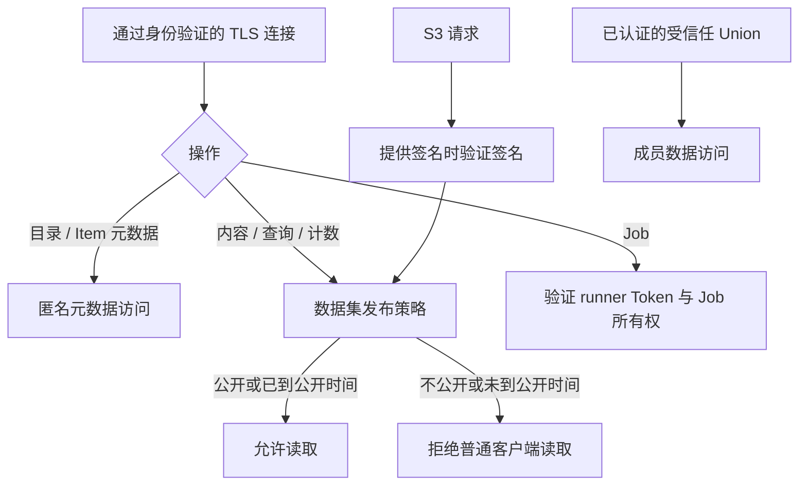

# 认证与访问控制

本文说明 DACP 已实现的认证方式、授权边界、凭据管理、撤销行为和审计。下文提供节点、Union、S3 与算子仓库的配置和操作说明。

## 服务边界

| 服务 | 认证与访问范围 |
| --- | --- |
| 节点与 Union 的普通 Flight 服务 | TLS 上匿名公开元信息；内容遵循数据集发布策略；执行采用 Token 和主体角色 |
| Union 到成员节点的协作调用 | 双向 TLS 与节点签发的 Union 服务凭据 |
| 节点间任务数据流 | 双向 TLS 与精确绑定任务、端口和接收方的执行计划 |
| S3 服务 | 元数据公开；内容遵循数据集策略；通过共享 DACP 主体提供可选的 HTTPS SigV4 和预签名 GET |
| 节点、Union 运维看板 | 内网公开只读，不提供登录或访问控制 |
| 算子仓库 | 已批准算子与环境公开；提交源码使用个人 Token，管理员登录审核 |

授权发生在服务端。普通客户端 SDK 与协作 SDK 分开提供，但共享 Flight、证书和流协议实现；选择某个 SDK 本身不会获得权限。

## 普通客户端

目录、Dataset 的 Item 列表、Folder 子项列表及 Item 元数据（Views、Schema、大小、创建时间和修改时间和已有记录数）允许通过 TLS 匿名访问，不触发显式计数扫描。数据流、查询及计算记录数遵循数据集发布策略；Job 操作需要 Token，不要求每个客户端都申请证书。所有连接（包括匿名访问）都验证服务器证书和主机名。未显式配置 CA 时使用平台信任根；私有 CA 或自签名 CA 必须显式提供。匿名连接不会跳过验证。Union 双向 TLS 与证书绑定保持不变。

Token 归属于稳定的主体，一个主体可以持有多个 Token。任务、状态、结果、取消和重放按任务所有者授权。更新或轮换 Token 不应改变主体及其历史任务归属。

管理员通过服务器本地凭据工具创建、列出、撤销和轮换凭据。Token 至少使用 256 位随机数，只在创建时输出一次，服务端保存摘要。凭据变更热加载；服务端在每次 RPC 开始时从内存检查凭据。普通 Token 到期或撤销后，已经接纳的 RPC 和结果流继续执行；同一连接上的后续 RPC 必须重新通过检查。

## 主体角色与授权

角色属于稳定的主体（subject），不属于某个 Token。同一主体可持有多个独立撤销的 Token。通过本地 `set-roles` 分配角色；该命令替换全部角色集合，`none` 清除所有角色。创建 Token 不会隐式授予角色。

| 角色 | 权限 |
| --- | --- |
| 匿名访问者 | 公开目录、Item 与 Folder 列表、Item 元数据和公开数据集内容 |
| `reader` | 公开内容读取和本地预签名工具权限；不能绕过不公开数据集策略 |
| `runner` | Reader 权限以及执行、推导、样例、自己 Job 的管理和结果接收；仍遵循源数据集策略 |
| Union 服务 | 独立的证书绑定服务凭据，允许成员协作操作，仍受节点资源上限约束 |
| 执行消费者 | 根据精确执行计划访问指定中间输出，不是永久用户角色 |

数据集内容读取由[数据集发布策略](dataset-publication_zh.md)决定：公开、不公开或定时公开，未声明时默认不公开。reader 和 runner 均不绕过该策略。runner 授予 Job 执行、推导及本人任务管理权限；reader 保留用于本地预签名工具的签发权限。目录和元数据始终匿名公开。提供的无效、撤销或过期凭据仍会被拒绝。节点信任显式认证的 Union 服务身份，由 Union 对其普通用户执行源数据集策略。

每次新调用读取内存中不可变的凭据与主体快照。本地修改约 250 毫秒内自动加载。已经接纳的普通调用和流保留其权限快照；角色变更、Token 撤销和过期作用于后续调用。Union 服务凭据撤销仍会取消关联的活动协作。凭据文件格式错误时拒绝其中的凭据；主体文件格式错误时清空共享用户角色，拒绝后续需要角色的执行和本地预签名操作，不影响公开内容读取和 Union 服务认证。

主体保存在凭据目录的 `subjects.json` 中，与 `credentials.json` 独立：

```json
{
  "analyst": {"roles": ["runner"]},
  "data_client": {"roles": ["reader"]}
}
```

CLI 校验角色并原子写入受保护文件，不提供远程管理接口。节点和 Union 看板仍是内网只读服务，不按用户身份过滤，也不受这些角色控制。其页面与 HTTP API 必须通过部署网络边界限制在内网，不应经公开代理暴露。S3 与本实例共享主体和角色，但使用独立的签名密钥；算子仓库账号仍独立。

## Union 与成员节点

Union 启动时从配置读取唯一 Union 的成员列表，不提供远程成员管理接口。节点管理员签发绑定 Union 身份与客户端证书指纹的服务凭据；Union 配置成员地址与凭据文件即可连接，不采用邀请、审批流程或额外算子白名单。

节点接受该凭据，即信任 Union 的协作操作。节点仍可独立服务其允许的其他客户端。Union 保持稳定身份，并记录成员身份；不可用成员不会阻止 Union 启动，后续通过轮询重试。

每次协作调用检查服务凭据。与普通 Token 不同，Union 服务凭据撤销或到期时，应停止相应的运行中协作任务与流。

同一 Union 的成员之间无需额外相互授权，但不能仅凭同一 CA 签发的证书任意访问对方数据。执行计划必须约束执行实例、任务、输出端口及接收方。Union 的服务秘密不得转发给下游节点。

## S3

DACP 与 S3 共享账号 subject 和凭据管理。S3 列表及对象 HEAD 元数据匿名公开；GET 内容遵循数据集发布策略，公开数据允许匿名读取。不公开和尚未到期的数据不因持有普通 S3 密钥、reader、runner 或预签名链接而开放。提供的 SigV4 签名必须有效；密钥撤销、到期和签名篡改会拒绝后续请求，已准入的下载允许完成。

S3 密钥不能用于 DACP 认证或提交 Job。Token 与 S3 密钥可分别撤销和轮换。本地预签名命令仍要求当前账号具备读取角色。预签名 URL 是临时访问凭证，不应写入日志或公开传播。节点与 Union 各自维护账号目录，无需统一用户身份。

## 看板与算子仓库

看板按内网只读服务部署，网络暴露范围由部署环境限制。此设计不提供公网登录保护。

已批准算子的浏览和下载公开。开发者使用个人提交 Token 通过接口提交源码，私有源码与待审产物不公开。管理员单独登录，管理 Token 和环境，查看扫描/构建结果，指定多个分类与公开的最终可信度，再批准发布。版本不可覆盖。详细扫描报告保持私有，分数是审核评价而非安全保证。参见[源码提交与审核](https://github.com/rdcn-link/xstream-codex/blob/main/docs/operator-submission_zh.md)。

## 审计与凭据保管

访问日志应记录主体、操作、资源、结果、耗时、字节数及关联任务；凭据和成员生命周期事件也应记录。不得记录原始 Token、私钥、S3 密钥或带签名的完整 URL。

凭据文件应限制为运行账户可读写。普通 Token 保存摘要；S3 签名验证需要可恢复的密钥材料，因此不能把所有凭据都描述为仅保存摘要。

## 实现与验证状态

已实现本地凭据管理与热加载、普通 Flight Token 认证、Union 服务凭据与证书绑定、任务所有者隔离、节点间精确计划授权、独立协作 SDK、S3 SigV4 和预签名 GET。自动化测试覆盖普通 Token 撤销后已有流继续、后续调用拒绝，服务凭据撤销后运行中任务与流终止，Token 轮换后保留任务归属，以及拒绝请求的审计。真实服务联调验证了三个成员节点的认证、Union 协作调用和 boto3 的签名列表、元数据、内容、Range 及预签名 GET。

相关说明：[访问日志](access-logs_zh.md)、[数据访问](https://github.com/rdcn-link/xstream-codex/blob/main/docs/dataset-access_zh.md)、[算子仓库](https://github.com/rdcn-link/xstream-operator-repository/blob/main/docs/browsing_zh.md)。普通客户端示例应提供 Token 文件；Union 成员配置应提供节点签发的服务凭据文件。

## 本地凭据操作

节点配置 `credential_directory: /protected/node-credentials`，Union 配置自己的 `credential_directory`。未指定时，节点使用进程工作目录下 `.dacp-security/端口`，Union 使用 `state_directory/credentials`。目录权限为 700，凭据文件为 600。

本地工具的子命令如下。服务器程序负责启动服务，管理操作使用以下工具：

| 工具 | 子命令 |
| --- | --- |
| `dacp-admin` | 公共账号、凭据和执行历史命令 |
| `union-admin` | 同一套公共命令，以及 `identity CONFIG`、`members CONFIG` |

两套工具的公共命令共享同一实现，参数、默认值、JSON 输出和错误行为一致。使用目标服务的凭据目录。`create-account` 创建账号，同时签发 DACP Token 和 S3 密钥；默认角色为 reader，需要执行 Job 时指定 runner。`create-token` 为已有账号补发 Token。`grant-union` 是成员节点授予 Union 的证书绑定服务凭据，不是普通账号，不签发 S3 密钥。

```bash
target/universal/stage/bin/dacp-admin create-account /protected/node-credentials --subject alice --role runner --expires-in 86400
target/universal/stage/bin/dacp-admin create-account /protected/node-credentials --subject data_client
target/universal/stage/bin/dacp-admin create-token /protected/node-credentials --subject alice
target/universal/stage/bin/dacp-admin list-subjects /protected/node-credentials
target/universal/stage/bin/dacp-admin set-roles /protected/node-credentials alice reader
target/universal/stage/bin/dacp-admin list-credentials /protected/node-credentials
target/universal/stage/bin/dacp-admin rotate-credential /protected/node-credentials CREDENTIAL_ID
target/universal/stage/bin/dacp-admin revoke-credential /protected/node-credentials CREDENTIAL_ID
```

创建账号返回 `subject`、`roles`、`token_id`、`token`、`access_key_id`、`secret_key`、`expires_at_ms`。秘密仅在签发时返回，列表不返回秘密。安全保存响应，并将 `token` 值单独写入权限为 600 的文本文件供 `--token-file` 使用；不要把整个 JSON 当作 Token 文件。重复账号创建会失败，不会覆盖或修改现有权限。

Union 先执行 `union-admin identity CONFIG` 获得稳定 `union_id` 和 `scheduler_identity`。然后在每个成员本地签发：

```bash
target/universal/stage/bin/dacp-admin grant-union /protected/node-credentials --subject union-service --union-id UNION_ID --fingerprint SCHEDULER_IDENTITY
```

将返回的 `token` 放入 Union 配置的该成员 `credential_file`。文件更换后，后续调用读取新值。配置中的成员如果不可达、凭据无效或凭据文件暂不可读，会显示不可用，后续轮询重试，不阻止 Union 启动。

无需单独签发 S3 密钥。`access_key_id` 和 `secret_key` 用于 S3 签名，不能作为 DACP Token。预签名及 boto3 示例见 [S3 服务](s3-service_zh.md)。

认证层另生成 `authentication-audit.jsonl`，记录 RPC 方法、主体、状态与耗时，含认证和授权拒绝；`credential-audit.jsonl` 记录凭据管理事件。两者超过 1 MiB 时轮换为各自的 `.previous.jsonl`，业务数据量与资源信息由节点访问日志和任务历史补充。

使用 `set-roles DIRECTORY SUBJECT none` 清空账号权限，同时影响 DACP 和 S3 的后续请求；已接纳的流继续。两类凭据可独立撤销或轮换。

S3 对每个内容请求检查数据集策略；提供的签名还必须有效。清空主体角色会移除执行和本地预签名权限，不会阻止公开内容读取；已接纳的下载继续。Token 与 S3 密钥可独立撤销或轮换，轮换后保留主体角色。本地生成预签名 URL 同样要求当前具有读取角色。为同一账号签发两类凭据时，使用相同的 `--subject`。

`list-history DIRECTORY [OFFSET LIMIT]` 和 `get-history DIRECTORY RECORD_ID` 读取本地历史，详见[执行历史](execution-history_zh.md)。`identity CONFIG` 查询或初始化 Union 身份；`members CONFIG` 使用配置中的凭据在线诊断成员，其他管理命令在本地操作。

## 本地源码算子边界

独立 XStream 支持 `operator: {local: ./directory}`，用于可信本地开发并可提交源码到仓库。DACP 和 Union 的远程 Job 接口不接受此引用，DEBUG 模式也不会开放本机路径或构建命令。服务端继续使用仓库算子及已配置的 DEBUG 内联源码机制。

## 授权边界

公开元数据不需要账号，受保护操作由接收服务检查主体角色及 Job 所有权。


