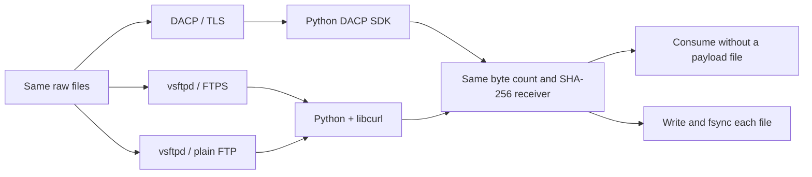
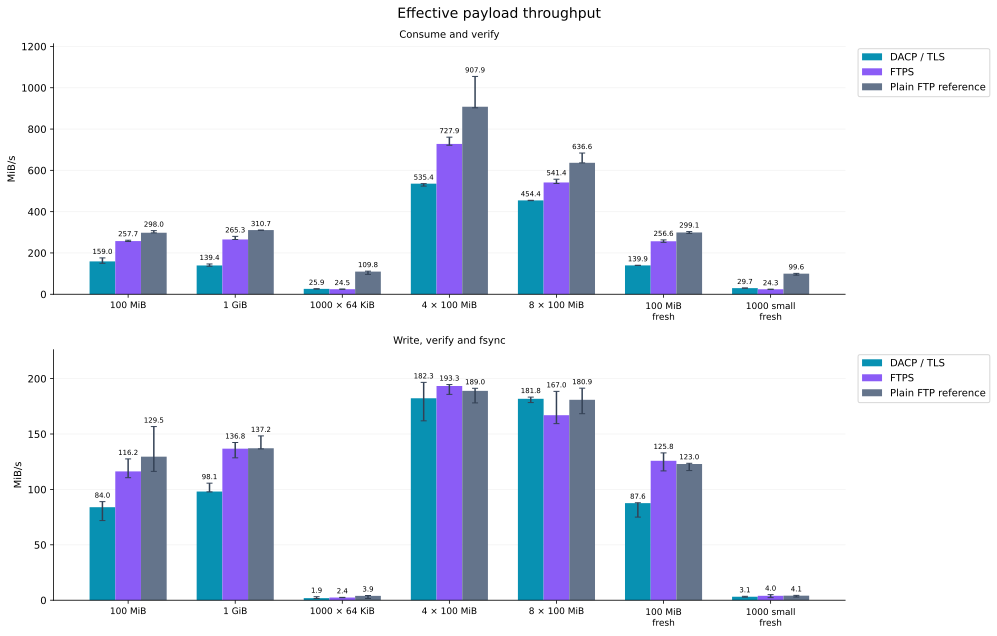
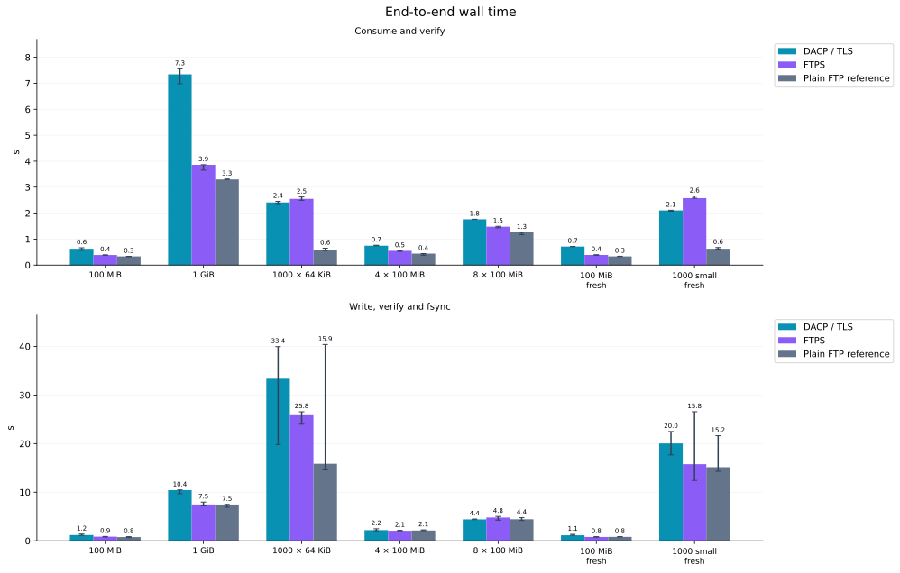
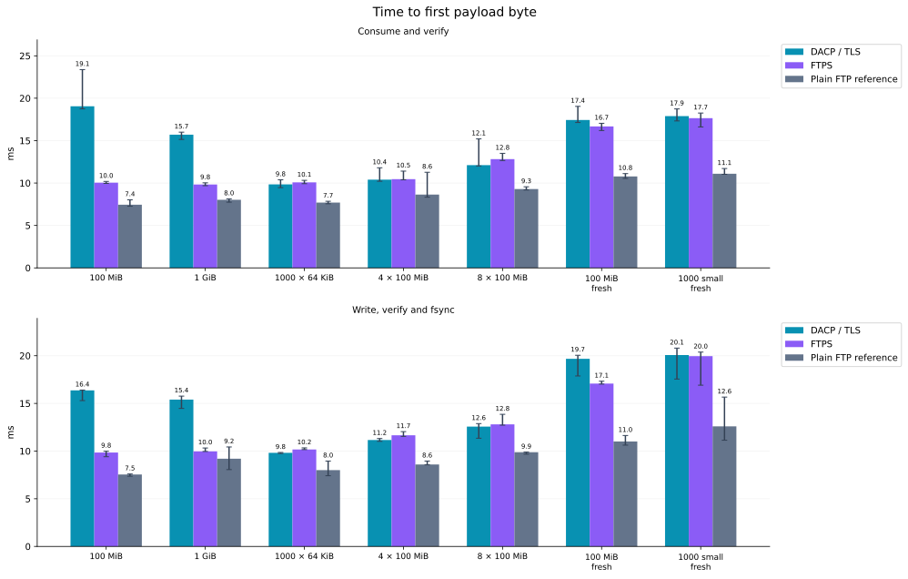
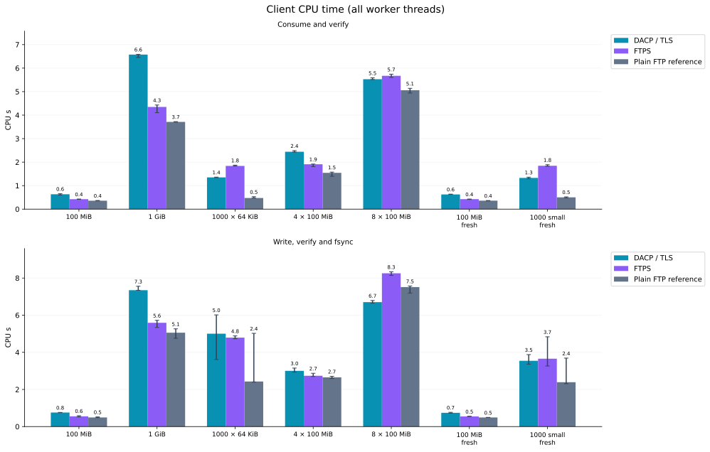
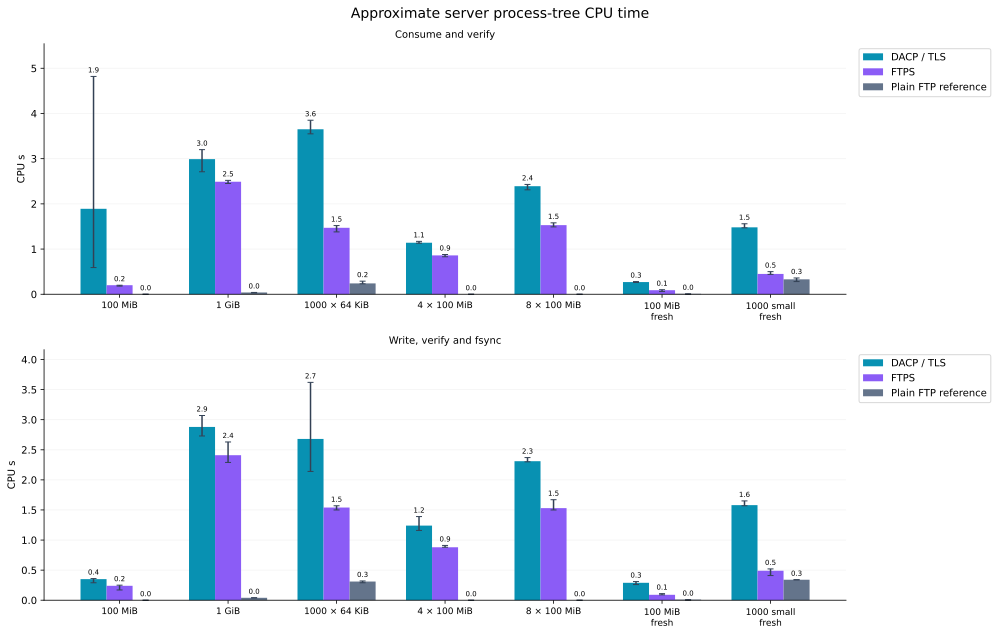
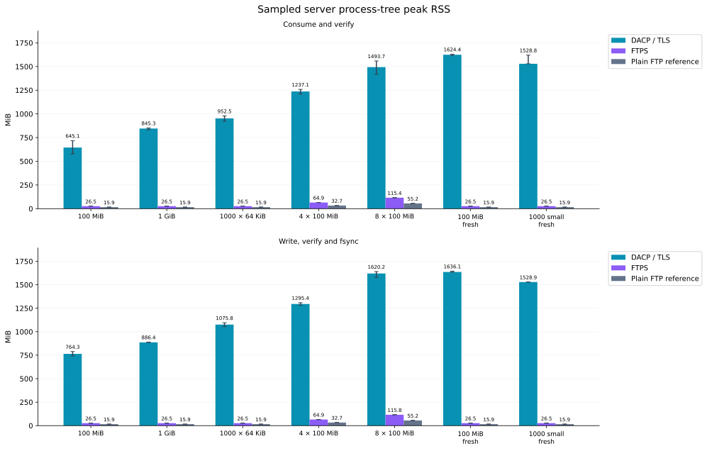
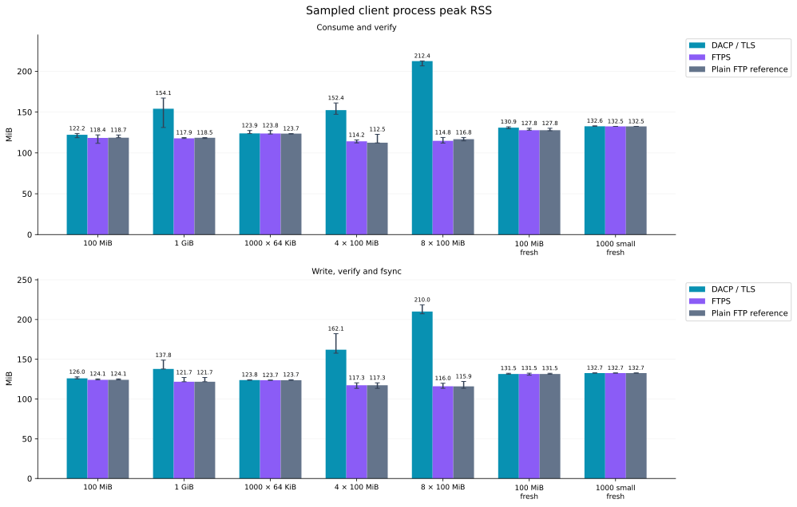

# Measured DACP and FTP file transfers

2026-11-05T14:06:10Z

An IPv4-loopback benchmark uses three isolated server processes serving identical raw files: DACP/TLS, vsftpd FTPS and plain FTP as a reference. There are 168 runs including warmups, with 0 failures. Each combination has 1 warmups and 3 measured repeats. Every successful file passes byte-count and SHA-256 validation.

**This measures protocol and implementation overhead on one host, not physical-network throughput or WAN performance. The primary comparison is DACP/TLS versus FTPS; unencrypted FTP has different security and is only a reference.**

## Test topology

## Workloads and timing

- Large files: 100 MiB and 1 GiB. Small files: 1,000 × 64 KiB. Four/eight concurrent downloads read the same 100 MiB source, for 400/800 MiB aggregate payloads.
- Reused connections: one independent client per worker, prepared with connection and first Item/file metadata outside timing; normal per-file metadata requests remain timed. Fresh cases create clients per trial, not per small file.
- Identical generated contents, 64 KiB receive targets and SHA-256 checks are used. Actual libcurl callback blocks may be smaller. DACP includes SDK and Arrow decoding overhead. Files contain physically written deterministic pseudorandom data, not sparse holes.
- Consume mode saves no received payload. Disk mode times writing, flush, fsync and close for every file. Directories are not fsynced and power-loss recovery is not evaluated. Received files are removed after timing.
- Startup, certificate/account creation, input generation and reused-connection preparation are excluded. JVM/OS caches remain warm; methods are randomly interleaved using a fixed seed. Worker-pool startup, metadata requests, transfers, decoding, validation and resource sampling are timed.
- TLS methods validate the same temporary self-signed certificate and hostname. DACP uses a reader Token; FTP/FTPS use read-only anonymous identities, so this is not a transport-only ablation. FTPS requires TLS on control and data channels. libcurl TLS session caching is enabled; vsftpd does not require session reuse. No explicit compression is enabled.

## Environment

- Linux-6.8.0-85-generic-x86_64-with-glibc2.39; 16 logical CPUs; 31.3 GiB RAM.
- Python 3.12.3; PyArrow 26.0.1; vsftpd 3.0.5.
- PycURL/7.49.0 libcurl/8.23.0 OpenSSL/3.6.5 zlib/1.3 brotli/1.2.1 libpsl/0.21.5 libssh2/1.11.1_DEV nghttp2/1.70.0 ngtcp2/1.25.0 nghttp3/1.18.0 mit-krb5/1.22.2.
- DACP byte_chunk: 65,536; seed: 20261105.

## Measured wall time

### consume

| Case | DACP/TLS s | FTPS s | Plain FTP s | DACP/FTPS time ratio |
|---|---:|---:|---:|---:|
| large-100MiB | 0.629 | 0.388 | 0.336 | 1.62× |
| large-1GiB | 7.344 | 3.860 | 3.296 | 1.90× |
| small-batch | 2.410 | 2.549 | 0.569 | 0.95× |
| parallel-4 | 0.747 | 0.550 | 0.441 | 1.36× |
| parallel-8 | 1.761 | 1.478 | 1.257 | 1.19× |
| large-100MiB-fresh | 0.715 | 0.390 | 0.334 | 1.83× |
| small-batch-fresh | 2.105 | 2.577 | 0.627 | 0.82× |

### disk-fsync

| Case | DACP/TLS s | FTPS s | Plain FTP s | DACP/FTPS time ratio |
|---|---:|---:|---:|---:|
| large-100MiB | 1.191 | 0.860 | 0.772 | 1.38× |
| large-1GiB | 10.436 | 7.485 | 7.466 | 1.39× |
| small-batch | 33.351 | 25.847 | 15.855 | 1.29× |
| parallel-4 | 2.195 | 2.069 | 2.117 | 1.06× |
| parallel-8 | 4.401 | 4.790 | 4.423 | 0.92× |
| large-100MiB-fresh | 1.141 | 0.795 | 0.813 | 1.44× |
| small-batch-fresh | 20.036 | 15.767 | 15.159 | 1.27× |

## Main observations

- `large-1GiB`, consume: DACP/TLS 139.4 MiB/s, FTPS 265.3 MiB/s; throughput ratio 0.53×.
- `small-batch`, consume: DACP/TLS 25.9 MiB/s, FTPS 24.5 MiB/s; throughput ratio 1.06×.
- `parallel-4`, consume: DACP/TLS 535.4 MiB/s, FTPS 727.9 MiB/s; throughput ratio 0.74×.
- `parallel-8`, consume: DACP/TLS 454.4 MiB/s, FTPS 541.4 MiB/s; throughput ratio 0.84×.
- Per-file fsync introduces storage latency and variability; disk-mode differences cannot be assigned entirely to transport protocols.

A time ratio above 1 means DACP is slower; below 1 means faster. Values are medians of successful measured trials.

## Measured figures

Bars show medians; whiskers span minimum to maximum, not confidence intervals. Throughput counts useful payload bytes, excluding TLS/TCP/FTP/Arrow framing. Each figure separates consume and disk cases.

## Completion counts

| Method | Succeeded / all (including warmups) |
|---|---:|
| dacp-tls | 56/56 |
| ftps | 56/56 |
| ftp-plain | 56/56 |

## Interpretation and limits

- Results compare concrete server/client implementations, not a universal protocol ranking. All methods read the same files on one shared host, competing for CPU, memory and storage.
- SHA-256 and receive loops may limit loopback throughput. These rates are not link capacity; differences cannot be attributed entirely to Arrow, TLS or any single layer.
- Server CPU is an approximate process-tree counter delta including reaped children; short-lived processes and reaping timing affect precision. Client CPU covers the entire benchmark process, workers and resource sampler.
- RSS is sampled every 50 ms. Server values sum process RSS without deduplicating shared pages: they are not PSS or per-request incremental memory. Client RSS includes loaded SDK/libcurl libraries and allocator caches and depends on trial order. Short peaks may be missed.
- Three measured repeats do not establish production capacity or tail latency. Failed trials remain in raw data and are excluded from successful medians.
- Cross-host/WAN transport, uploads, query pushdown, structured views, Jobs, recovery and compression are not tested. Production services do not participate.

## Reproduction and raw records

- [Programs and commands](../benchmarks/transfer/README.md)
- [All raw records](benchmarks/transfer/transfer-20261105.json)
- Raw records include SHA-256 identities for the server artifact, vsftpd binary and DACP SDK; benchmark_source_sha256 identifies benchmark sources at report generation.

- [libcurl TLS control/data protection](https://curl.se/libcurl/c/CURLOPT_USE_SSL.html)
- [vsftpd configuration](https://security.appspot.com/vsftpd/vsftpd_conf.html)
