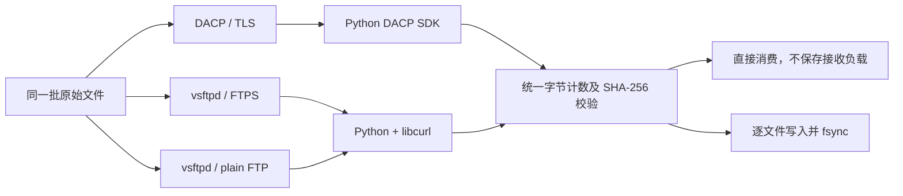
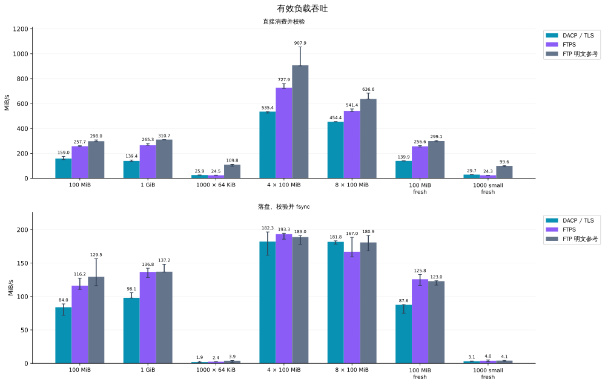
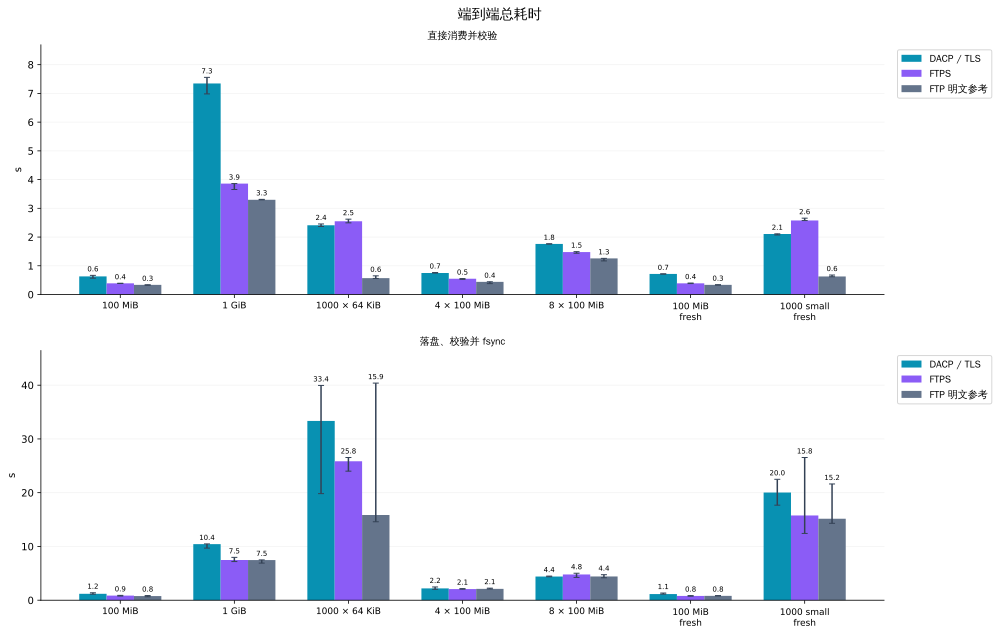
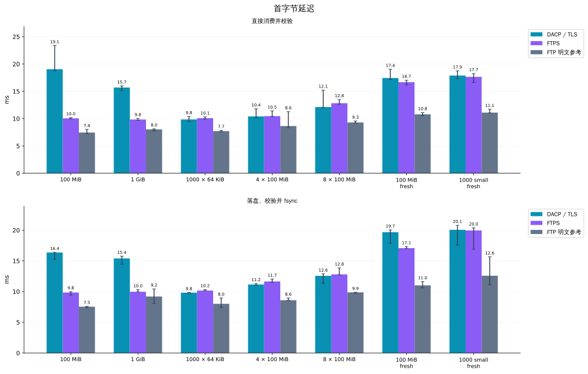
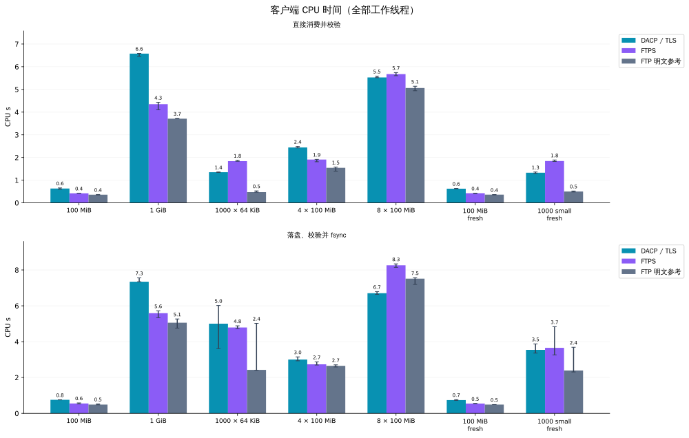
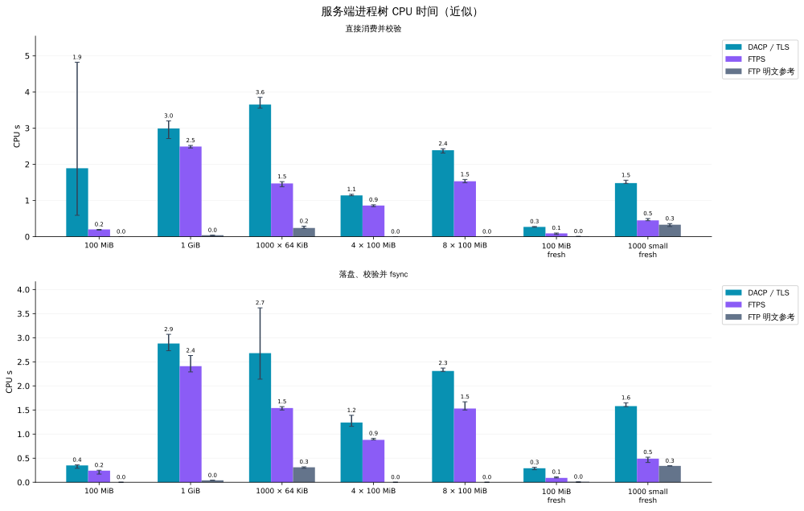
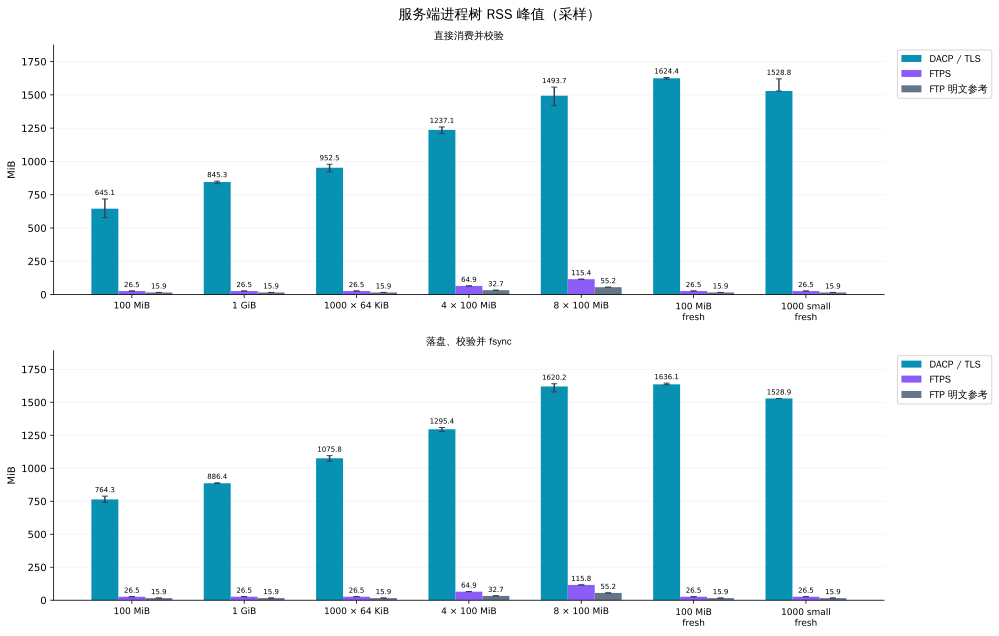
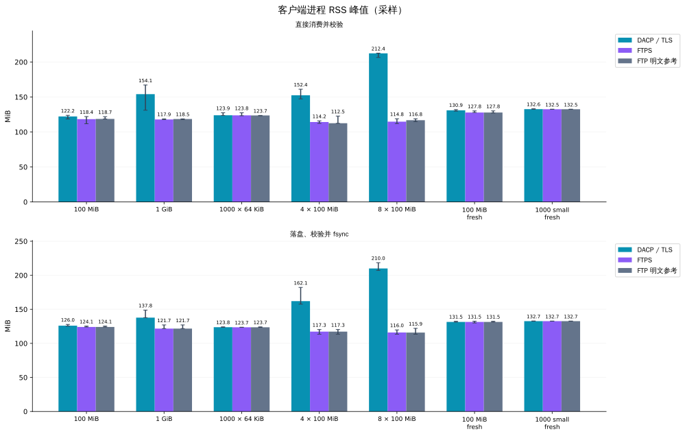

# DACP 与 FTP 文件传输实测

2026-11-05T14:06:10Z

本机 IPv4 回环测试，三个独立服务进程读取同一批原始文件：DACP/TLS、vsftpd FTPS 和未加密 FTP 参考。共 168 次运行（含预热），失败 0 次。每个组合预热 1 次、正式重复 3 次。所有成功传输逐文件校验字节数及 SHA-256。

**这些结果衡量同一主机上的协议及实现开销，不代表物理网络吞吐或广域网表现。主对比是 DACP/TLS 与 FTPS，明文 FTP 的安全条件不同，仅供参考。**

## 测试拓扑

## 工作负载与计时

- 大文件：100 MiB 和 1 GiB；小文件：1,000 个 64 KiB 文件。4/8 路并发各自下载同一个 100 MiB 源文件，总负载为 400/800 MiB。
- 连接复用：每个工作线程持有一个独立客户端，会先完成连接及首个 Item/文件的元信息请求，准备不计时；随后保留正常逐文件元信息请求。新连接组为每次试验新建客户端，不是每个小文件重新连接。
- 所有方法使用相同生成内容、相同 64 KiB 接收目标分块、相同 SHA-256 校验。libcurl 回调实际分块可能更小；DACP 包含 SDK 和 Arrow 解码开销。文件为实际写入的确定性伪随机数据，不是稀疏文件。
- 直接消费组不保存接收负载；落盘组逐文件写入、flush、fsync 和 close 均计时。未对目录 fsync，不评价断电恢复。临时接收文件在计时后删除。
- 服务启动、证书及账号生成、源文件生成、连接复用准备不计时。JVM/系统文件缓存保留，方法按固定种子随机交错；不强制清空缓存。线程池启动、元信息请求、传输、解码、校验及资源采样均计时。
- 两种 TLS 方法校验同一临时自签名证书及主机名。DACP 使用 reader Token，FTP/FTPS 使用只读匿名身份；因此不是只替换传输介质的消融实验。FTPS 控制和数据通道都强制 TLS，libcurl 开启 TLS 会话缓存；vsftpd 不强制会话复用。无显式压缩。

## 环境

- Linux-6.8.0-85-generic-x86_64-with-glibc2.39; 16 logical CPUs; 31.3 GiB RAM.
- Python 3.12.3; PyArrow 26.0.1; vsftpd 3.0.5.
- PycURL/7.49.0 libcurl/8.23.0 OpenSSL/3.6.5 zlib/1.3 brotli/1.2.1 libpsl/0.21.5 libssh2/1.11.1_DEV nghttp2/1.70.0 ngtcp2/1.25.0 nghttp3/1.18.0 mit-krb5/1.22.2.
- DACP byte_chunk: 65,536; seed: 20261105.

## 正式运行耗时

### 直接消费

| 场景 | DACP/TLS 秒 | FTPS 秒 | 明文 FTP 秒 | DACP/FTPS 耗时比 |
|---|---:|---:|---:|---:|
| large-100MiB | 0.629 | 0.388 | 0.336 | 1.62× |
| large-1GiB | 7.344 | 3.860 | 3.296 | 1.90× |
| small-batch | 2.410 | 2.549 | 0.569 | 0.95× |
| parallel-4 | 0.747 | 0.550 | 0.441 | 1.36× |
| parallel-8 | 1.761 | 1.478 | 1.257 | 1.19× |
| large-100MiB-fresh | 0.715 | 0.390 | 0.334 | 1.83× |
| small-batch-fresh | 2.105 | 2.577 | 0.627 | 0.82× |

### 落盘并 fsync

| 场景 | DACP/TLS 秒 | FTPS 秒 | 明文 FTP 秒 | DACP/FTPS 耗时比 |
|---|---:|---:|---:|---:|
| large-100MiB | 1.191 | 0.860 | 0.772 | 1.38× |
| large-1GiB | 10.436 | 7.485 | 7.466 | 1.39× |
| small-batch | 33.351 | 25.847 | 15.855 | 1.29× |
| parallel-4 | 2.195 | 2.069 | 2.117 | 1.06× |
| parallel-8 | 4.401 | 4.790 | 4.423 | 0.92× |
| large-100MiB-fresh | 1.141 | 0.795 | 0.813 | 1.44× |
| small-batch-fresh | 20.036 | 15.767 | 15.159 | 1.27× |

## 主要观察

- `large-1GiB` 直接消费：DACP/TLS 139.4 MiB/s，FTPS 265.3 MiB/s，吞吐比 0.53×。
- `small-batch` 直接消费：DACP/TLS 25.9 MiB/s，FTPS 24.5 MiB/s，吞吐比 1.06×。
- `parallel-4` 直接消费：DACP/TLS 535.4 MiB/s，FTPS 727.9 MiB/s，吞吐比 0.74×。
- `parallel-8` 直接消费：DACP/TLS 454.4 MiB/s，FTPS 541.4 MiB/s，吞吐比 0.84×。
- 逐文件 fsync 会引入存储延迟与波动，不能据此把落盘差异全部解释为传输协议差异。

耗时比大于 1 表示 DACP 较慢，小于 1 表示 DACP 较快。数值为成功正式样本的中位数。

## 实测图表

柱为中位数，误差线为最小到最大值，不是置信区间。吞吐只按有效负载计算，不含 TLS、TCP、FTP 或 Arrow 封装字节。每张图分别展示直接消费及落盘组。

## 成功次数

| 方法 | 成功 / 全部（含预热） |
|---|---:|
| dacp-tls | 56/56 |
| ftps | 56/56 |
| ftp-plain | 56/56 |

## 解释与限制

- 这些结果比较当前服务端和客户端实现，不能证明某协议在所有实现或网络上始终更快。所有协议均在同机读取同一文件，并共享 CPU、内存和存储。
- SHA-256 与接收循环可能限制回环吞吐。不能把这里的速度当作链路带宽，亦不能把差异全部归因于 Arrow、TLS 或某一层。
- 服务端 CPU 为进程树计数的近似差值，包含已回收子进程；短命进程和回收时序可能影响精度。客户端 CPU 为整个测试进程累计时间，包含工作线程和资源采样。
- RSS 每 50 ms 采样：服务端值为进程树 RSS 之和，不去除共享页，不是 PSS，也不是每次请求新增内存。客户端含 SDK/libcurl 已加载库及分配器缓存，受试验顺序影响。短暂峰值可能漏采。
- 只有三个正式重复，不能据此给出稳定的生产容量或尾延迟结论。失败样本保留在原始记录中，不计入成功中位数。
- 不测试跨机器、广域网、上传、查询下推、结构化视图、Job 执行、故障恢复或压缩。现有生产服务没有参与测试。

## 复现与原始记录

- [测试程序与运行说明](../benchmarks/transfer/README_zh.md)
- [全部原始记录](benchmarks/transfer/transfer-20261105.json)
- 原始记录包含服务产物、vsftpd 二进制和 DACP SDK 的 SHA-256；benchmark_source_sha256 为生成报告时的测试源码快照。

- [libcurl TLS control/data protection](https://curl.se/libcurl/c/CURLOPT_USE_SSL.html)
- [vsftpd configuration](https://security.appspot.com/vsftpd/vsftpd_conf.html)
