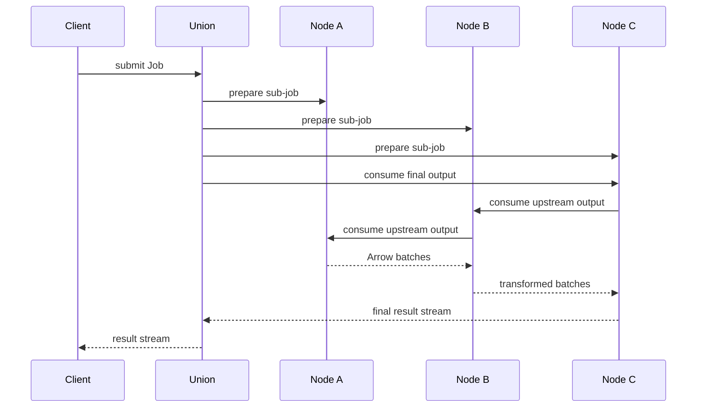

# Single-Union collaboration protocol

Each Union maintains one persistent identity and reads its independent members from startup configuration. It polls member health and schedules jobs; nodes do not register or send heartbeats.

## Identity and authorization

Ordinary clients use TLS and bearer tokens. Union-to-member calls use mutual TLS plus node-issued service credentials bound to the Union ID and certificate fingerprint. Trusting a CA alone grants no collaboration permissions. Members trust all operations authorized through their Union service credential. Peer data streams are limited to exact execution plans. Local credential revocation or expiry stops active collaborative work. See [authentication and access control](security.md) for credential administration and different ordinary-token revocation semantics.

Membership comes only from configuration, without remote invitation or administration APIs. Union identity, member pins, public namespace routes and execution history persist. Unavailable members do not prevent startup and are retried by polling. Restart does not recover running executions; committed materializations support explicit replay.

## Execution and streams

Clients submit standard Jobs with public Union input URIs, optional logical step.node and explicit outputs. Asynchronous submission uses the same public namespace. See [Union proxy service](union-proxy.md). X reuses DAG validation and groups steps into node subjobs. Union accepts versioned operators only, without inline source. Inputs use upstream `step[:port]` references; external Items enter through `read_item@1.0` with `params.uri/view`. Foreign member streams use Flight. Nodes read local Items through DatasetAccess, without downloading through X or Flight. Each output connection has one consumer.

X prepares every subjob before starting any. Nodes check capacity and authorization and reject plans they cannot execute. A's output binds the execution/step/port to B's certificate identity; B pulls it over mTLS. Local connections use bounded queues; cross-node streams use Flight `DoGet` with backpressure. OperatorFrames are reused: start/data/end is followed by complete only after successful execution; failures terminate with a Flight error. After complete, consumers must still verify successful Flight end-of-stream. Outputs create no Dataset and stream directly by default; explicit policy can materialize selected outputs on the producing node for replay.

Final results travel from a node through X's bounded queue to the client. Status is independent and does not wait for a slow result reader. Connections, execution, and waiting for results have timeouts. Explicit cancellation, execution failure, or interruption of final result consumption cancels the entire Job. Clients can connect to results after submission but before timeout; disconnecting a status subscription alone does not cancel execution.

### Dispatched subjob routing contract

Global jobs, node subjobs, execution policies and variable files use YAML. U retains the received workflow text as `submitted_job_yaml` and persists the planned execution definition as YAML. Subjobs travel in the `job_yaml` text field of Flight control messages; policies use `execution_policy_yaml`. Clients resolve variables before submitting YAML. Status and traffic metadata remain structured messages.

User Job inputs accept only `step[:port]`; top-level `outputs` selects returned streams. An internal step dispatched by U to C looks like the following. Replace identity placeholders with actual 64-character hexadecimal certificate digests:

```yaml
name: Weather screening
union_id: union-U
execution_id: job-001
steps:
  - id: export
    operator: piflow_csv_save@1.0
    params: {header: true}
    inputs:
      source:
        origin: dacp://node-b:18862
        producer_identity: <B identity digest>
        task: filter
        port: result
    output_routes:
      result:
        consumer_identity: <U identity digest>
```

Local inputs use `source: read:result`; `inputs` alone establishes the connection without a local identity digest. Cross-node inputs use location objects containing `origin`, `producer_identity`, `task` and `port`. Object-form local inputs are rejected.

`output_routes` declares only outputs read remotely over Flight, including final outputs returned to U. Omit it when there are no remote outputs. Each value must contain exactly `consumer_identity`. One output port cannot have both local and remote consumers. Nodes derive connected ports from the union of local `inputs` and remote `output_routes` for execution, materialization and replay. Local streams connect only within the node and cannot be read through Flight. Actual representations come from operator stream headers, not routing declarations.

For example, A’s read step has no `output_routes`. Its parse step consumes the reader through `inputs: {source: read:result}` and declares B’s identity for its remote `result` output.

U prepares and starts A, B and C. Read requests connect U→C→B→A, while data flows A→B→C→U with concurrent steps and backpressure. Intermediate streams bypass U. Recipient identities authorize reads without changing DAG binding syntax. Node dashboards show connections in the topology and preserve internal routes within the complete Sub-job definition.

## Observability

X periodically polls member capacity and health. During execution it queries subjob status and produces Flight events. Events have monotonically increasing sequence numbers and a bounded in-memory window. A stale cursor receives an explicit gap plus current snapshot; snapshots are also available from the status endpoint. Events include Step states and per-port cumulative payload_bytes, records where applicable, remote_payload_bytes, and last_activity_ms. Byte counters measure data frame payloads, excluding TLS/gRPC overhead. Sending and receiving are counted separately and must not be summed as unique traffic. Unknown totals do not produce percentages; rates can be calculated from successive counters.

The implementation does not promise automatic running-job recovery, internal checkpoints, fan-out, arbitrary scheduling optimization, scientific array representations, or cross-node snapshot consistency.

## Execution policy, output materialization, and replay

Union accepts a separate `execution_policy` JSON alongside `job_yaml`. Streaming remains the default. Selected connected outputs are saved on their producing node through `MaterializationStoreProvider`; all selected ports commit together after the step succeeds and inputs are verified. `materialization.allowed: false` prohibits engine output materialization and rejects conflicting defaults or step overrides.

The owner can explicitly request `replay_job` after the source execution terminates. This creates a new execution, reuses complete, unexpired selected outputs, prunes unnecessary upstream work, and reruns downstream steps. Final outputs can also be replayed. Original and effective policies, source links, and replay state are retained in history. Nodes must enable a storage plugin and revalidate authorization. Read [execution policy, storage configuration, client examples, and plugin contracts](materialization.md).

This is step-boundary replay, not internal operator checkpoints, byte-offset resume, or restoration of running processes. Expired, incomplete, or corrupt artifacts cannot successfully replay. Standard `Job.run` is also supported at Union, sharing its scheduling and execution policy engine.

Top-level `max_retries` (0–10, default 0) bounds execution retries. Results remain incremental; consumers must provide a retry callback to discard prior partial output. Materialization is optional. `timeout_seconds` covers resource waits and all attempts and cannot exceed the server limit. See [execution policy](materialization.md).

## Administration website

U can expose a read-only operations dashboard on a separate HTTP listener without changing the Flight collaboration protocol above. The operations page uses U's cached state without triggering node RPCs or claiming results. The nodes page reads a member's live catalog when its card is expanded. The public read-only dashboard exposes execution metadata across submitters without login or tokens. See the [Union server](../dacp-union-server/README.md#execution-and-interfaces) for configuration and read-only HTTP interfaces.

A step `id` is its unique dependency identifier within the Job, used by input `step[:port]` references, final outputs, scheduling, status, and traffic correlation; it is required. Optional `title` describes its purpose, supports Unicode, and must contain 1–256 characters without control characters. Titles need not be unique and do not resolve dependencies. Dashboard cards and DAGs show the title with the ID; execution history retains titles.

```yaml
name: daily-temperature
steps:
  - id: read_observations
    operator: read_item@1.0
    inputs: {}
    params:
      uri: dacp://localhost:18861/climate/observations
      view: records
  - id: daily_temperature
    title: Aggregate product quantities
    node: dacp://localhost:18861
    operator: daily_temperature_stats@1.0
    inputs:
      source: read_observations
outputs:
  result: daily_temperature
```

The DAG uses locally bundled AntV G6 5.1.1 without an external CDN. Step cards show `title`, falling back to the ID, together with operator, state and input/output payload. Edges show ports and payload. Click a card or edge to inspect the full title, step ID, server address, cross-node payload, rate between observations and record counts where applicable below the graph. Sending and receiving count separately; missing observations and terminal rates display `—`. Final-output edges use source output-port counters, not confirmed client-received bytes.

Color, symbols and borders distinguish steps: solid green ✓ for completed, thick blue ▶ for running, dashed gray ○ for not yet executed, and red ! for failed, cancelled, interrupted or expired. Unknown execution state uses an amber border and `?` label rather than implying the step has not executed. A legend and explicit state text remain visible.

G6 supports dependency and swimlane layouts, each with horizontal (left to right) or vertical (top to bottom) flow. Swimlanes align dependency stages in server rows or columns. Layout controls are independent; refresh preserves both choices. The default combined layout is: both server groups and their internal steps are automatically arranged left to right by dependency. Each server region has a contrasting background color and border and a heading with its address and step count. Local inputs and steps stay within the server region, cross-region edges represent data flow, and final outputs occupy a separate Union → client region. Double-click group backgrounds to collapse or expand them; “Expand all” restores the complete view.

The toolbar offers zoom in/out, fit canvas and 100% display, with 15%–250% zoom. Drag to pan and scroll to zoom around the pointer. State refreshes update content while preserving layout, zoom, pan and collapsed groups. Switching jobs lays out and fits the new graph. Canvas information is also available in the step and port tables below for reading and assistive technology access.

The website separates the operations dashboard `/`, graphical member nodes `/nodes`, and data catalog `/datasets`. Node cards load local dataset names inline; the catalog first loads the member list, then reads each member directory independently in parallel. Each response immediately displays Union-assigned public names and Union URIs without waiting for other members. Failures or timeouts affect only that member; successful results remain visible with progress and incomplete-directory warnings, and Refresh retries the reads. Remote catalog reads use a separate bounded thread pool so they cannot occupy the request threads serving pages and job status. Only name mappings are persisted, not catalog lists. Policies and attempts are separate; expandable attempt timelines label missing historical information explicitly.

The nodes page uses a dark topology view with health, capacity and directed data flows. Traffic counts receiver-side `remote_payload_bytes` once, never adding send and receive totals. Its scope is inter-member step edges from the latest attempt of each of the most recent 100 jobs, including persisted history. It excludes protocol overhead, other applications and final output returned to clients. Rates require successive fresh observations for the same attempt and input port; retry resets, stale samples or missing observations show unknown. Transfer animation appears only for observed positive rates. Clicking a topology node expands its local datasets below without consuming result streams.

Node cards show environment CPU, DACP process CPU, environment memory, JVM heap, available processors and thread count. Readings come from JVM management APIs and may reflect container limits. Environment memory is not DACP-exclusive; heap is not total process memory. Unsupported metrics show unknown. Participation counts deduplicate jobs with observed member execution states in this Union’s retained history; steps and retries do not add counts. The topology counts step data payload only, excluding heartbeats, status queries, catalog access and Flight message envelopes. Dashed Union membership links indicate membership rather than data transfer and display no message byte counts.

Node topology edge labels display cumulative traffic and observed rates directly; unknown rates show `—`. Hover over an edge or label for endpoints and step payload statistics. Traffic is not duplicated in a separate list below the topology.

The topology uses an orbital background, distinct member card colors, resource utilization bars and directed links. Only links with a positive observed rate animate; the system reduced-motion preference disables animation.

Web interfaces use English throughout the Union job, node and data catalog pages and the DACP node dashboard. User-provided step titles, scripts, dataset names and descriptions are displayed in their original language.

Click a step, input/output node, edge or server group in the job DAG to highlight the selection and show its details. Click empty canvas space to clear it. Automatic updates and layout changes preserve selections that still exist; changing jobs clears the selection. Node dashboards share this interaction.

### Shared execution

Nodes plan shared execution from runtime compatibility and connected ports, without invoking structure inference or reading input contents. Actual stream headers supply metadata during execution.

Topology traffic labels use a separate top layer above the Union hub, nodes and wires without intercepting mouse input. Smaller labels are centered directly on their edges, moving only along the original curves with no detached leader lines; resizing recalculates placement. Job scripts retain saved YAML indentation and blank lines. JSON is displayed with multiline indentation while preserving original numeric and string tokens. Upstream inputs in local step definitions display as `task:port`, rather than presenting internal binding objects as submission syntax.

DAGs in the node and Union dashboards lock mouse-wheel zoom by default. Click 🔒 Mouse zoom to unlock it and 🔓 Mouse zoom to lock it again. Toolbar zoom controls remain available.

Input locations, including `read_source`, use `producer_identity` to verify the data provider, paired with output `consumer_identity`. Member metadata retains its distinct `identity` field.

Job names in both the Union and node dashboards open a dedicated `/job?id=...` page. This page can be bookmarked and loads current or historical execution details directly by ID. It keeps the DAG, script, policy, attempts and traffic together and loads on opening or clicking Refresh. Use **Back to jobs** to return to the list.

The logical plan shows only the submitted steps and stream dependencies. The physical plan groups steps in server panels with rack icons and, within each server, in dashed execution-unit windows with dedicated title bars. These groups come from execution records reported by the engine. Swimlane spacing includes nested unit frames and header areas in both flow directions. Shared-process groups, separate executions and host stream sources remain distinct. Click a step to inspect placement reasons and source mappings; click an execution unit to inspect its runtime, state and fusion reason. Missing execution records are shown as pending or not recorded, never inferred from matching runtimes. Sub-job tabs retain DAG and YAML script views.

Dedicated Union and node Job detail pages do not poll automatically. Use the header **Refresh** button for current status; job list pages retain automatic refresh.

Union and node job details have four top-level tabs: **Submitted job**, **Logical plan**, **Physical plan**, and **Execution information**. Submitted job shows the immutable YAML received by the service, receipt time and submitted execution policy. Variables are resolved by the client before submission, so the original variable file cannot be reconstructed from server history. Logical plan shows resolved steps and stream dependencies with DAG/YAML views. Physical plan contains the complete execution DAG/YAML and nested member sub-job views ordered upstream to downstream. Execution information groups step status, execution units, runtimes and payload totals by member, followed by the effective policy and attempt timeline. Union links to node details when a node web address and history record are available. Failed observations preserve the last successful snapshot and its timestamp, with an explicit warning. Node records originating from Union show the received executable sub-job under Submitted job and its local execution under Physical plan; they explicitly report that the global logical plan is on Union.

Execution-unit labels include the runtime model and version (for example `python-arrow@1.0`). Unit details also show the pinned image digest and catalog dependency versions when available. Built-in item readers use the host JVM. Runtime metadata comes from the repository catalog for the exact execution image; missing catalog metadata is reported explicitly.

## Collaboration data path

Union coordinates execution. Intermediate step data flows directly between members; the final stream is relayed to the client through Union.



In dependency layouts, execution servers align along the top edge for horizontal flow and the left edge for vertical flow. Sibling execution units use the same alignment, with spacing to keep frames separate. Server and execution-unit dimensions are normalized separately. Collapsed frames are excluded; expanding groups reapplies alignment.
