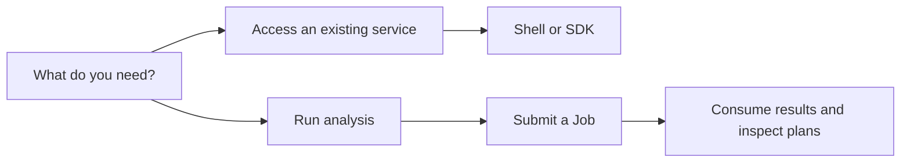
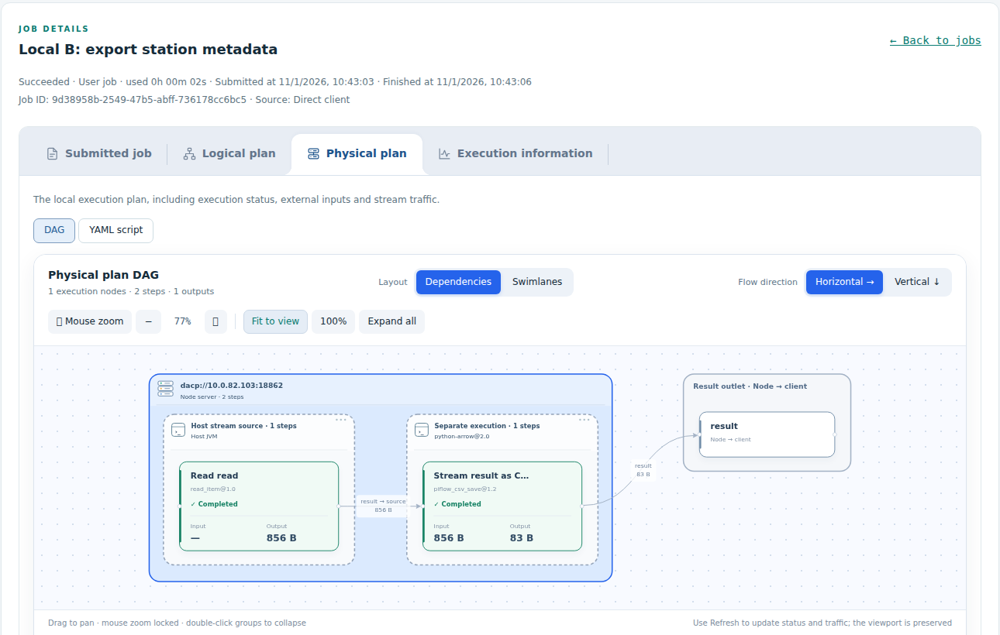

# User guide

[中文](usage_zh.md)

Access published data remotely and run Jobs on a node or through Union. Start with the path matching your immediate task.

## 1. Connect and read

| Task | Tutorial and reference |
|---|---|
| First connection and first Item preview | [Quick start](quickstart.md) |
| Shell commands and Python/Scala examples | [Shell and SDK guide](users/README.md), [Scala SDK](../dacp-client-scala/README.md) |
| Discover published Datasets and interpret partial catalogs | [Dataset directories](dataset-directory.md) |
| Filter, project and limit remote records | [Record queries](records-scans.md) |
| Use S3 clients or share a temporary download | [S3 access and presigned GET](s3-service.md) |
| Resolve access-denied errors or configure credentials | [Roles and connection security](security.md) |

## 2. Submit and inspect Jobs

| Task | Tutorial and reference |
|---|---|
| Submit with variables and receive live results | [Remote Job submission](jobs.md) |
| Set retries, timeout, materialization and replay | [Execution policies](materialization.md) |
| Inspect submitted Job, logical and physical plans, and execution details | [Dashboard guide](node-web.md) |
| Inspect execution records | [Execution history](execution-history.md) |
| Run through a Union public namespace | [Union data and Jobs](union-proxy.md), [weather collaboration example](../examples/union/README.md) |
| Compare local, distributed and materialized execution | [Local versus Union](local-vs-union-benchmark.md), [streaming versus materialization](materialization-benchmark.md) |

*The same Job-detail tabs are used by node and Union dashboards. The physical plan identifies execution servers, units and their runtime environments.*

For deployment, publication, security, monitoring and maintenance, use the [Operations guide](operations/README.md). For application integration, use the [Development guide](developers/README.md). Job authoring and operator development are covered by the [XStream guides](http://xstream.conoai.cn/docs.html).
