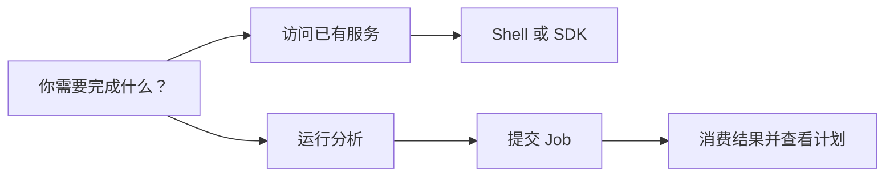
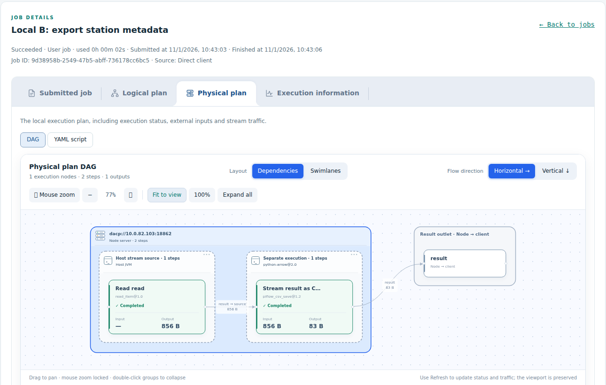

# 使用指南

[English](usage.md)

远程访问已发布的数据，在单节点或 Union 上提交和运行 Job。请按当前目标选择入口。

## 1. 连接与读取

| 任务 | 教程与参考 |
|---|---|
| 第一次连接和 Item 预览 | [快速上手](quickstart_zh.md) |
| Shell 命令和 Python/Scala 示例 | [Shell 与 SDK 指南](users/README_zh.md)、[Scala SDK](../dacp-client-scala/README_zh.md) |
| 发现公开数据集，理解不完整目录 | [数据集目录](dataset-directory_zh.md) |
| 对远程记录进行过滤、投影和限行 | [记录查询](records-scans_zh.md) |
| 使用 S3 客户端或分享临时下载链接 | [S3 访问与预签名 GET](s3-service_zh.md) |
| 排查访问被拒绝或配置凭据 | [角色与连接安全](security_zh.md) |

## 2. 提交与查看 Job

| 任务 | 教程与参考 |
|---|---|
| 携带变量提交并接收实时结果 | [远程 Job 提交](jobs_zh.md) |
| 配置重试、超时、物化与重放 | [执行策略](materialization_zh.md) |
| 查看提交任务、逻辑计划、物理计划和执行信息 | [看板指南](node-web_zh.md) |
| 查看执行记录 | [执行历史](execution-history_zh.md) |
| 使用 Union 公开命名空间执行 | [Union 数据与 Job](union-proxy_zh.md)、[气象协作示例](../examples/union/README_zh.md) |
| 比较单机、协作和物化执行 | [单机与 Union 对比](local-vs-union-benchmark_zh.md)、[流与物化对比](materialization-benchmark_zh.md) |

*节点与 Union 看板使用相同的 Job 详情标签页；物理计划标明执行服务器、执行单元与运行环境。*

部署、发布、安全、监控和维护见[运维指南](operations/README_zh.md)，应用集成见[开发指南](developers/README_zh.md)。Job 编写和算子开发见 [XStream 指南](http://xstream.conoai.cn/docs.html)。
