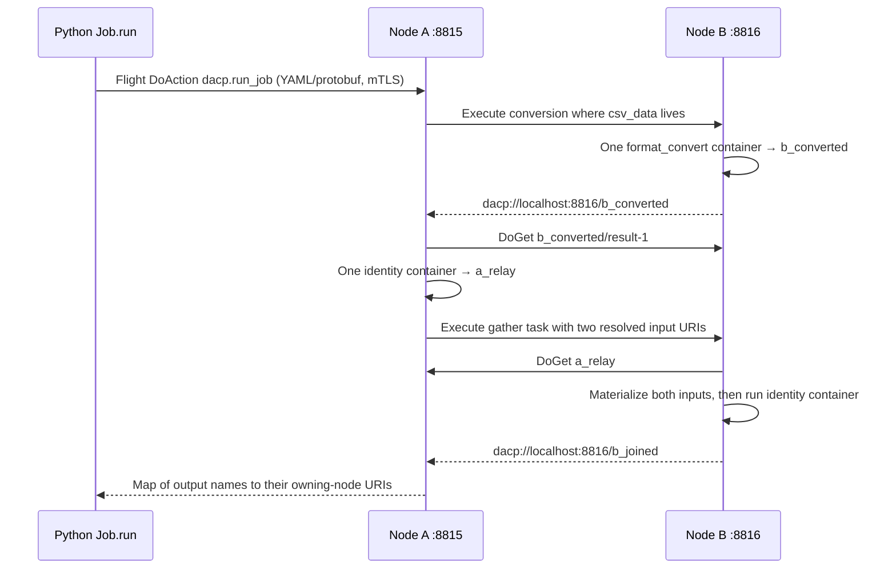

# Collaborative dacp servers

This example runs two autonomous servers. Only **B** owns the CSV source. A accepts a YAML DAG and coordinates three container tasks:



All data transfers use pull-based Flight `DoGet`. The coordinator only exchanges task descriptions and output URIs. There is no central node registry, shared filesystem, cluster, or login/token protocol.

From the project root, prepare the image and SDK (Docker access is required):

```bash
python3 -m venv .venv
.venv/bin/pip install -e './dacp-client[test]'
bash scripts/certs.sh
docker build -f operators/format_convert/1.0/Dockerfile -t dacp/format-convert:1.0 .
bash scripts/test-collaboration.sh
```

The script stages the server, starts A and B, waits for readiness, submits the DAG, verifies each output's owning node, Arrow schema, row counts, and exact Parquet bytes, then stops both servers. It also checks remote failure propagation, skipped downstream work, and mTLS rejection of clients without certificates. Logs are retained in a printed temporary directory. Ports 8815/8816 must be free. The script uses `.venv/bin/python`; override with `DACP_PYTHON` if needed.

To run the nodes manually, use separate terminals from `dacp-server`:

```bash
sbt 'run ../examples/multi-node/node-a.yaml'
sbt 'run ../examples/multi-node/node-b.yaml'
```

From the project root, submit without restarting either server:

```python
import os
from pathlib import Path
from dacp import Job, Source

os.environ['DACP_CA'] = 'examples/certs/ca.crt'
os.environ['DACP_CERT'] = 'examples/certs/client.crt'
os.environ['DACP_KEY'] = 'examples/certs/client.key'
outputs = Job.run('dacp://localhost:8815',
                  Path('examples/multi-node/job.yaml').read_text(), timeout=180)
with Source.open(outputs['b_joined']) as ds:
    for item in ds.list():
        for batch in ds.open(item.path).as_records():
            print(batch.to_pydict())
```

The manual YAML uses fixed output names; use new names for each run until the owning server restarts. `check.py` generates unique names automatically. Namespace collision rejection is not task deduplication or a retry mechanism.

## Placement and policies

- A task defaults to the server in its **first resolved input URI**. For multiple inputs, this first input is the data anchor.
- Optional `node: dacp://host:port` chooses an execution server explicitly. Use the server's advertised `public_host` and port consistently.
- `input: upstream/logical/item` and `inputs: [upstream_a, upstream_b]` resolve to absolute URIs before dispatch. The worker never resolves DAG references or forwards tasks.
- The full DAG, dependencies, URI syntax, and all target nodes are checked before dispatch. Tasks run in topological order; independent tasks are currently serialized.
- `task_peers` lists origins the coordinator may dispatch to; its own advertised origin is always allowed. This list grants permission, rather than providing discovery or dataset lookup.
- `task_input_prefixes` lists dataset URI prefixes a worker may pull. If omitted/empty, it defaults to `allowed_uri_prefixes`, allowing existing local-only configurations to work.
- `allowed_uri_prefixes` controls reads **and permission to publish task outputs** on the worker. The worker checks every input and its output before starting a container.
- `max_concurrent_tasks` bounds running local tasks and control requests. Excess requests fail immediately with `UNAVAILABLE`; there is no automatic queue or retry.

The demo uses whole-node prefixes to accommodate random output names. On separate machines, replace `localhost`, set certificates with the advertised DNS names in their SANs, narrow dataset prefixes, configure each node's permitted peers/inputs, and install the referenced operator versions/images on every execution node. A and B have distinct certificates signed by the demo CA. Each server uses its own configured certificate for outbound mTLS.

`identity@1.0` preserves binary payloads and writes internal `part-N.<format>` files, published as `/result-N` data Items. It accepts CSV, NDJSON, binary files, and Parquet. It enables downstream consumers to retain upstream Parquet schema footers without reparsing or recompressing the file. It shares the built-in operator image with `format_convert@1.0`; `DACP_OPERATOR` selects the installed implementation inside each isolated container.

## Failure and lifetime semantics

`Job.run` is synchronous and returns `{output_name: dacp_uri}` only after every task succeeds. A failed worker, input stream, or container terminates that job and prevents downstream dispatch. Errors include the failed task and execution node. Other jobs and the servers remain available.

Flight actions are `dacp.run_job` (`RunJobRequest`/`RunJobResult`) and `dacp.execute_task` (`ExecuteTaskRequest`/`ExecuteTaskResult`), defined in `proto/dacp.proto`. Control bodies are limited to 1 MiB. Jobs use the existing connection-level mTLS; there are no authentication fields in task messages.

There are no task retries, checkpoints, rollback, deduplication, or failover. Outputs already produced stay on their owning node until its configured TTL or shutdown. If a control response is lost or a client times out, remote execution may continue; inspect outputs/use fresh names and rerun from sources as appropriate. TTL must cover downstream task startup and consumption. Per-task container execution is limited to 30 minutes; remote dispatch waits up to 35 minutes. Set the Python job timeout for the entire DAG, not just one task.
